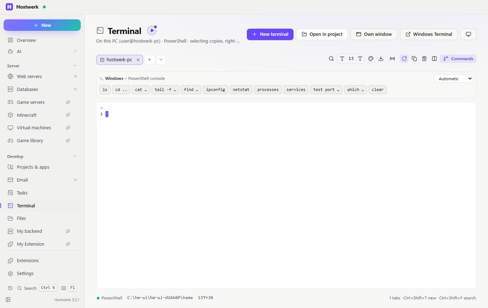

# Terminal

[← Back to the overview](README.md)

On this PC (user@hostwerk-pc) · PowerShell · selecting copies, right-click pastes

### What you can do here

- Video
- New terminal
- Open in project
- Own window
- Windows Terminal
- Terminal on another machine
- hostwerk-pc
- Close terminal “hostwerk-pc”
- New terminal (PowerShell) · Ctrl+Shift+T
- Choose another shell
- Search (Ctrl+Shift+F)
- Smaller font
- Larger font
- Color scheme: Hostwerk – click to switch
- Save recording as a text file
- Send input to several tabs (e.g. for several servers at once)
- The session is restored next time – click to turn off
- Copy selection
- Clear display
- Split (second terminal beside it)
- Commands
- ls
- cd ..
- cat …
- tail -f …
- find …
- ipconfig
- netstat
- processes
- services
- test port …
- which …
- clear

Generated on 2026-11-20 · Hostwerk 3.2.2
