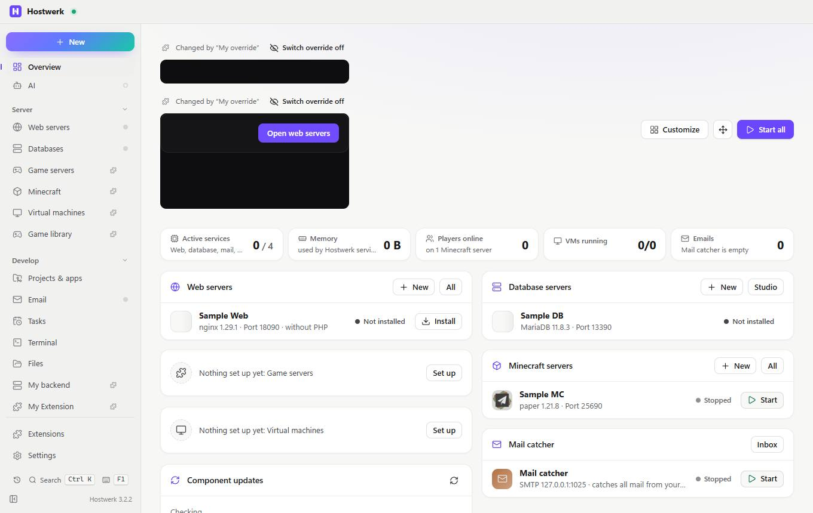

# Overview

[← Back to the overview](README.md)

### Areas on this page

- Web servers
- Database servers
- Minecraft servers
- Mail catcher
- Component updates

### What you can do here

- From the extension “My override” – info
- Switch override off
- Customize
- Arrange tiles
- Start all
- New
- All
- Change image
- Install
- Studio
- Set up
- Start
- Inbox
- Check again

Generated on 2026-11-20 · Hostwerk 3.2.2
