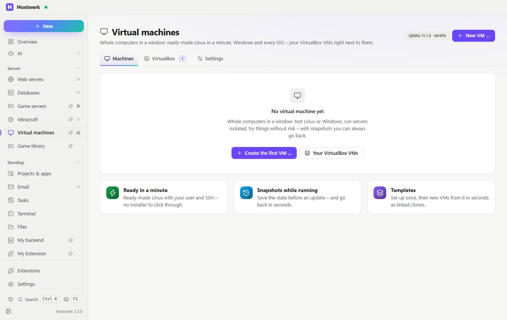
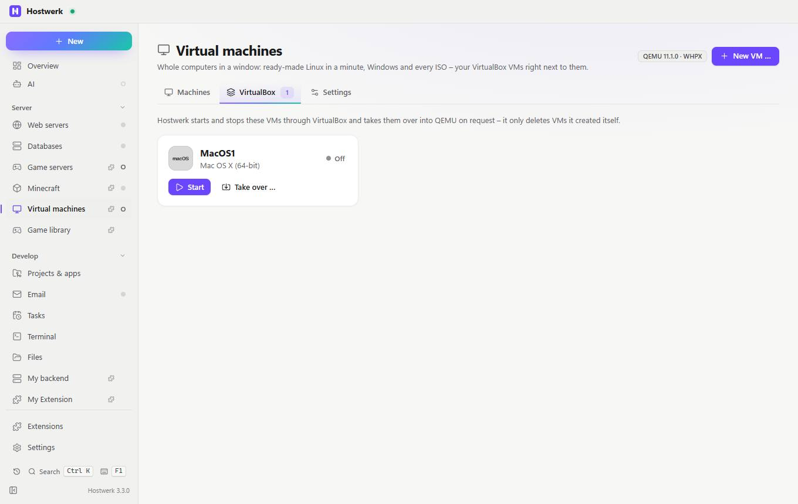
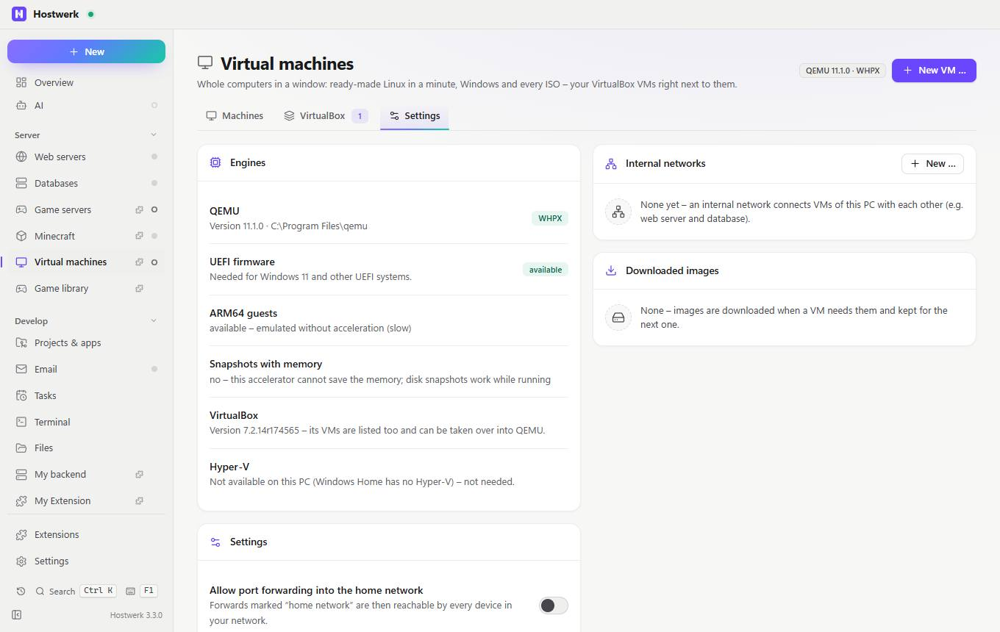

# Virtual machines

[← Back to the overview](README.md)

Whole computers in a window: ready-made Linux in a minute, Windows and every ISO – your VirtualBox VMs right next to them.

### What you can do here

- New VM …
- Create the first VM …
- Your VirtualBox VMs

## Tabs

### VirtualBox

**What you can do here:** New VM … · Change image · Start · Take over …

### Settings

**Areas on this page:** Engines · Settings · Internal networks · Downloaded images

**What you can do here:** New VM … · New …

Generated on 2026-11-20 · Hostwerk 3.3.0
