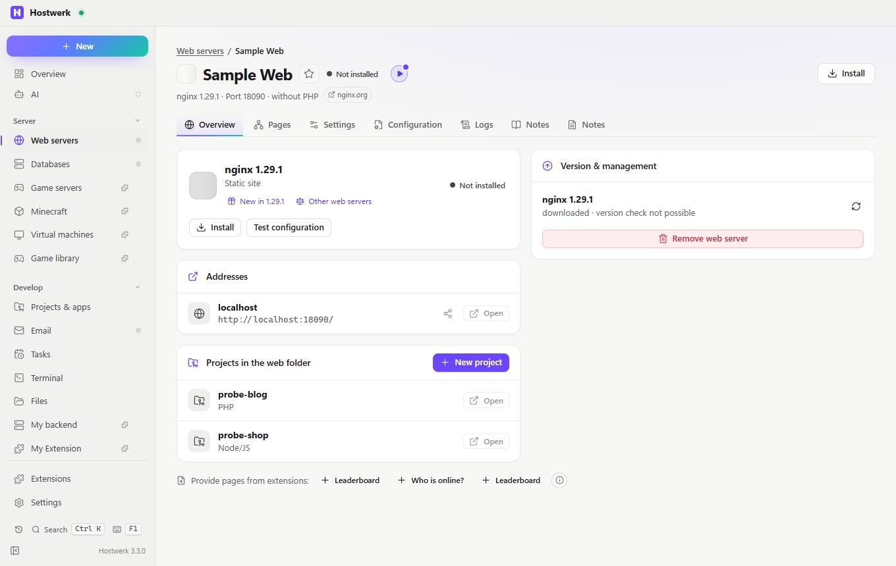
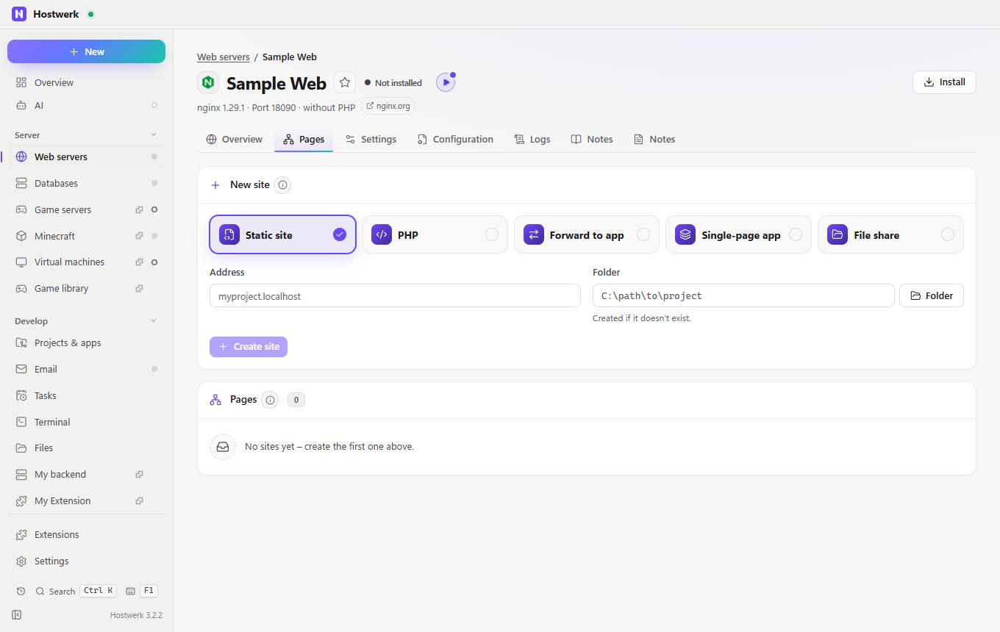
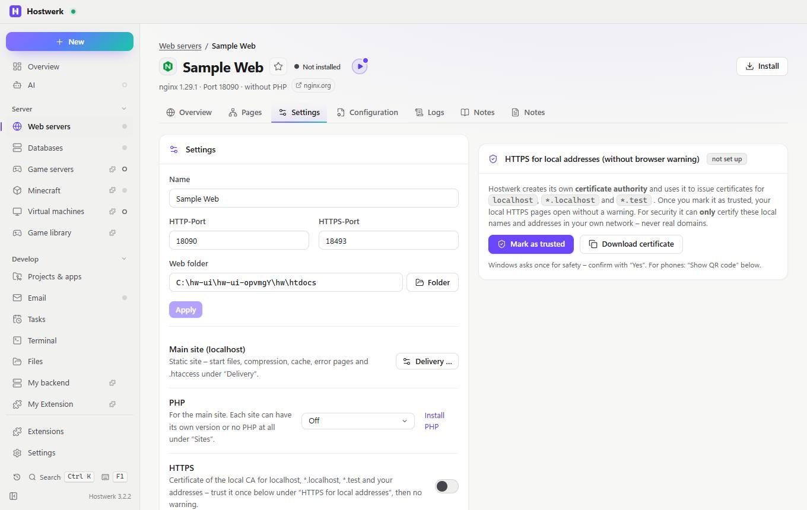
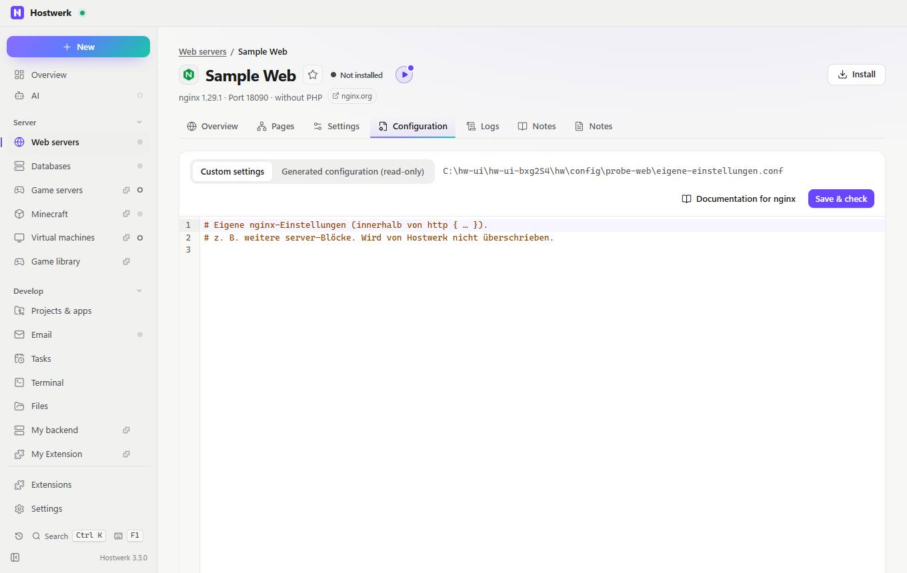
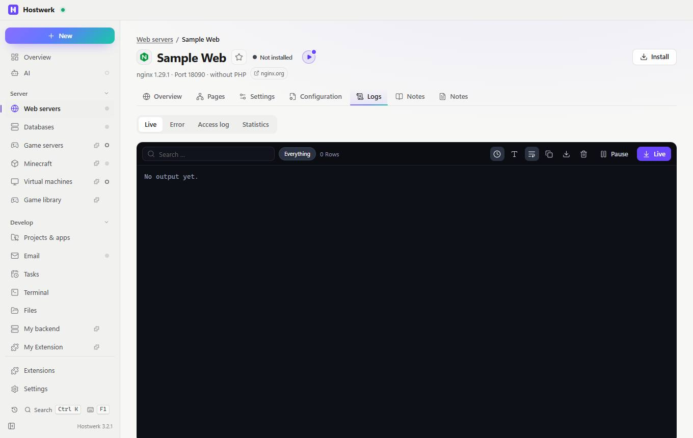
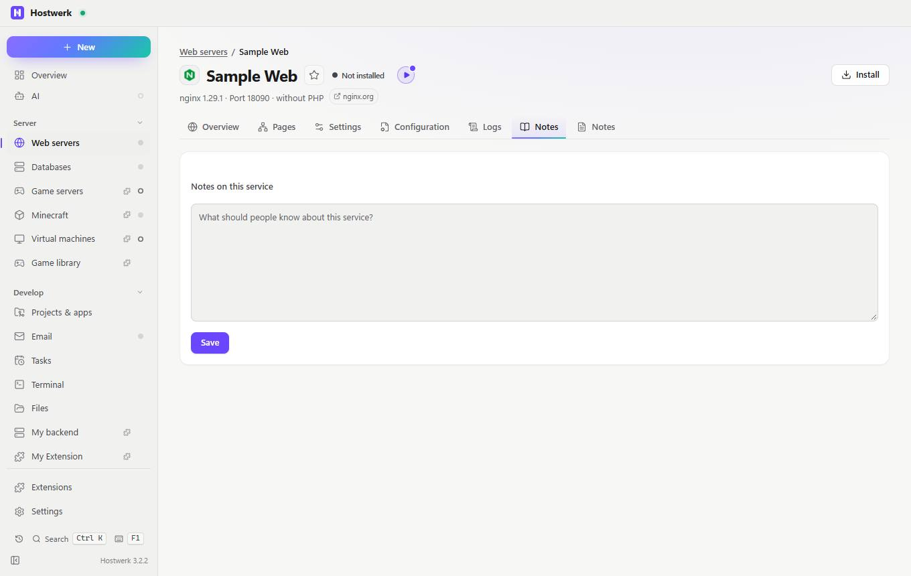

# Sample Web → Overview

[← Back to the overview](README.md)

nginx 1.29.1 · Port 18090 · without PHP nginx.org

### Good to know

- What is this? Extensions like the leaderboard can put their own page into this web server – Hostwerk writes it into a subfolder and keeps it up to date at the chosen interval.

### Areas on this page

- Addresses
- Projects in the web folder
- Version & management

### What you can do here

- Change image
- Mark as favorite (then listed at the top)
- 3 videos
- nginx.org
- Install
- New in 1.29.1
- Other web servers
- Test configuration
- Share publicly (link for the internet)
- Open
- New project
- Check again
- Remove web server
- Leaderboard
- Who is online?

## Tabs

### Pages

> Tip: addresses ending in .localhost Addresses like myproject.localhost work in Chrome, Edge and Firefox without an entry in the hosts file. With *.project.localhost all subaddresses end up at the same site.
> Each site has its own address on this server. You set up the main site (localhost) under “Overview”.

**Areas on this page:** New site · Pages

**What you can do here:** Change image · Mark as favorite (then listed at the top) · 3 videos · nginx.org · Install · Static site · PHP · Forward to app · Single-page app · File share · Folder · Create site

### Settings

**Areas on this page:** Settings · HTTPS for local addresses (without browser warning)

**What you can do here:** Change image · Mark as favorite (then listed at the top) · 3 videos · nginx.org · Install · Folder · Apply · Delivery … · Mark as trusted · Download certificate

### Configuration

**What you can do here:** Change image · Mark as favorite (then listed at the top) · 3 videos · nginx.org · Install · Documentation for nginx · Save & check

### Logs

**What you can do here:** Change image · Mark as favorite (then listed at the top) · 3 videos · nginx.org · Install · Everything · Show time · Larger font · Wrap long lines · Copy · Save as text file · Empty · Pause · Live

### Notes

**What you can do here:** Change image · Mark as favorite (then listed at the top) · 3 videos · nginx.org · Install

Generated on 2026-11-18 · Hostwerk 3.2.1
