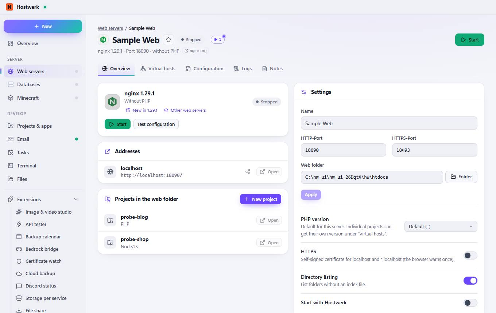
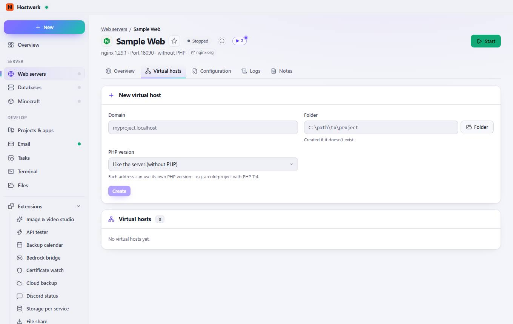
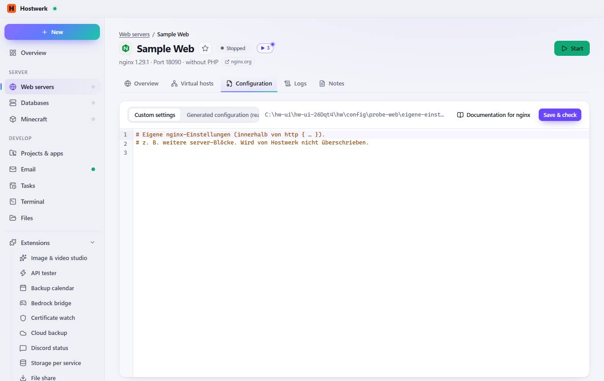
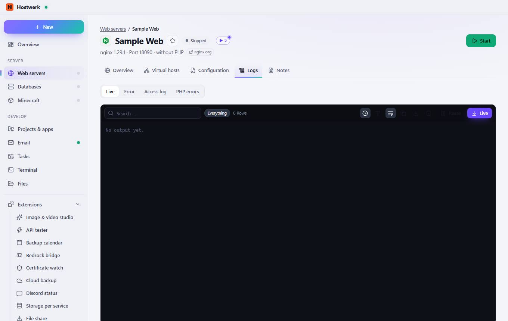
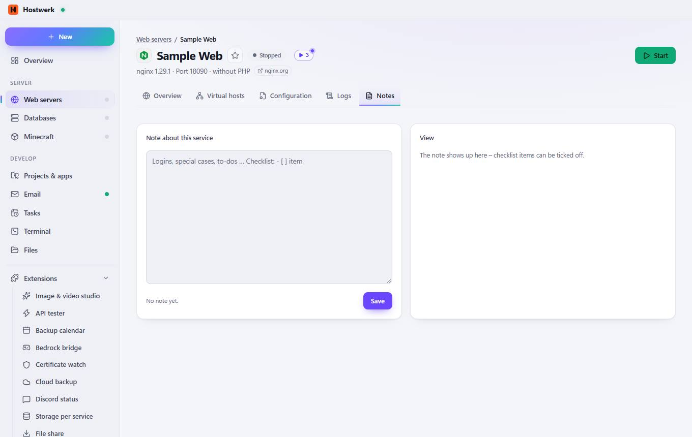

# Sample Web → Overview

[← Back to the overview](README.md)

nginx 1.29.1 · Port 18090 · without PHP nginx.org

### Areas on this page

- Addresses
- Projects in the web folder
- Settings
- Version & management

### What you can do here

- Change image
- Mark as favorite (then listed at the top)
- nginx.org
- Start
- New in 1.29.1
- Other web servers
- Test configuration
- Share publicly (link for the internet)
- Open
- New project
- Folder
- Apply
- Check again
- Remove web server

### Inputs

- Name
- HTTP-Port
- HTTPS-Port
- Web folder
- PHP version
- HTTPS
- Directory listing
- Start with Hostwerk

## Tabs

### Virtual hosts

> Tip: domains ending in .localhost Addresses like myproject.localhost work in Chrome, Edge and Firefox without an entry in the hosts file.

**Areas on this page:** New virtual host · Virtual hosts

**What you can do here:** Change image · Mark as favorite (then listed at the top) · nginx.org · Start · Folder · Create

### Configuration

**What you can do here:** Change image · Mark as favorite (then listed at the top) · nginx.org · Start · Documentation for nginx · Save & check

### Logs

**What you can do here:** Change image · Mark as favorite (then listed at the top) · nginx.org · Start · Everything · Show time · Larger font · Wrap long lines · Copy · Save as text file · Empty · Pause · Live

### Notes

**What you can do here:** Change image · Mark as favorite (then listed at the top) · nginx.org · Start

Generated on 2026-10-20 · Hostwerk 2.10.0
