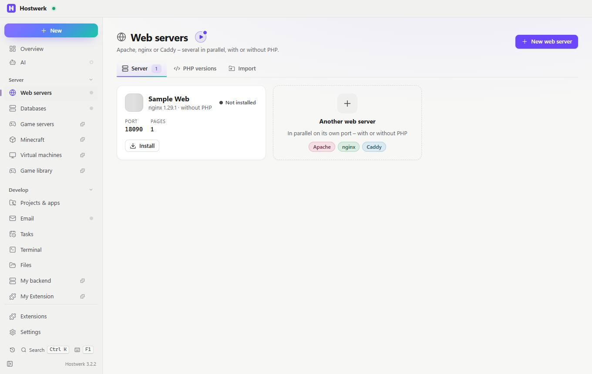

# Web servers

[← Back to the overview](README.md)

Apache, nginx or Caddy – several in parallel, with or without PHP.

### What you can do here

- 3 videos
- New web server
- Change image
- Install

## Tabs

### PHP versions

**Areas on this page:** Installed · Available (windows.php.net)

**What you can do here:** 3 videos · New web server · What's new? · Install

### Import

**What you can do here:** 3 videos · New web server · Change image · Install

Generated on 2026-11-20 · Hostwerk 3.3.0
