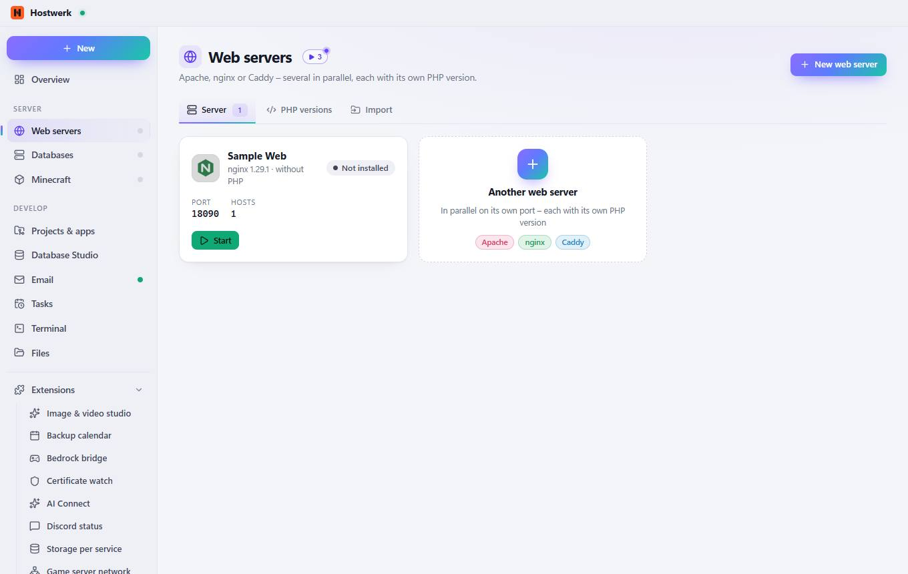
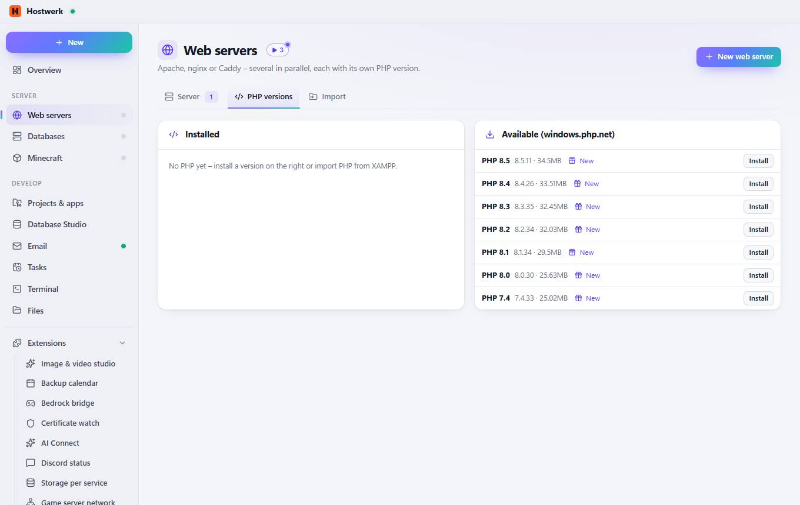
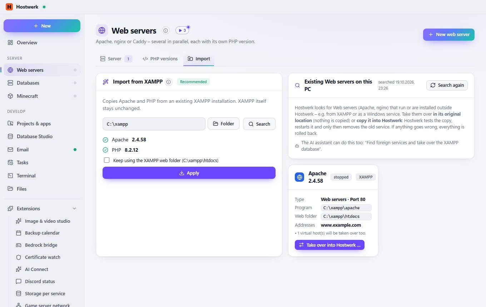

# Web servers

[← Back to the overview](README.md)

Apache, nginx or Caddy – several in parallel, each with its own PHP version.

### What you can do here

- New web server
- Change image
- Start

## Tabs

### PHP versions

**Areas on this page:** Installed · Available (windows.php.net)

**What you can do here:** New web server · New · Install

### Import

> Import – take over existing services Is a web server already running on this PC – e.g. from XAMPP or as a Windows service? Hostwerk takes it over: where it is (nothing is moved) or copied 1:1, tested and with a way back. The same search for all kinds is under System → Foreign services.
> Smart App Control is active Windows only runs programs with a known “reputation”. Brand-new Apache and PHP builds are therefore sometimes blocked – the versions from XAMPP are known and run reliably. Hostwerk checks every new version and otherwise keeps the old one; nginx, Caddy and the databases haven't been affected so far.

**Areas on this page:** Import from XAMPP · Existing Web servers on this PC · Apache 2.4.58

**What you can do here:** New web server · Folder · Search · Apply · Search again · Take over into Hostwerk …

Generated on 2026-10-19 · Hostwerk 2.9.0
