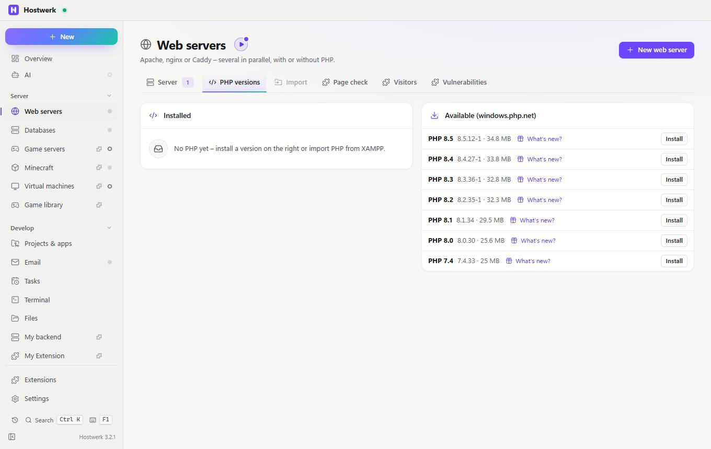
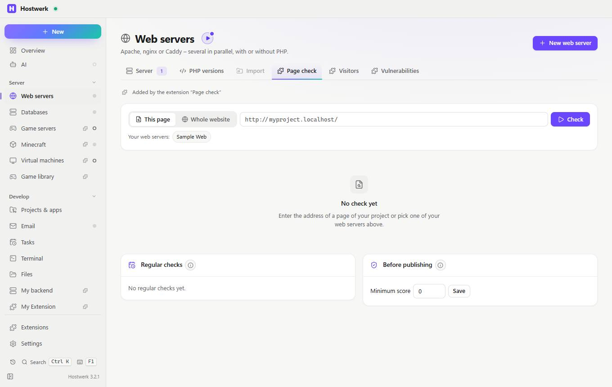

# Web servers

[← Back to the overview](README.md)

Apache, nginx or Caddy – several in parallel, with or without PHP.

### What you can do here

- 3 videos
- New web server
- Change image
- Install

## Tabs

### PHP versions

**Areas on this page:** Installed · Available (windows.php.net)

**What you can do here:** 3 videos · New web server · What's new? · Install

### Import

**What you can do here:** 3 videos · New web server · Change image · Install

### Page check

> Regular checks Hostwerk checks these addresses on its own and tells you when the score drops by 5 points or more.
> Minimum score Publishing extensions (e.g. “Publish pages”) check the page first and stop below this score. 0 = off.

**Areas on this page:** Regular checks · Before publishing

**What you can do here:** 3 videos · New web server · From the extension “Page check” – info · Check · Sample Web · Save

Generated on 2026-11-18 · Hostwerk 3.2.1
