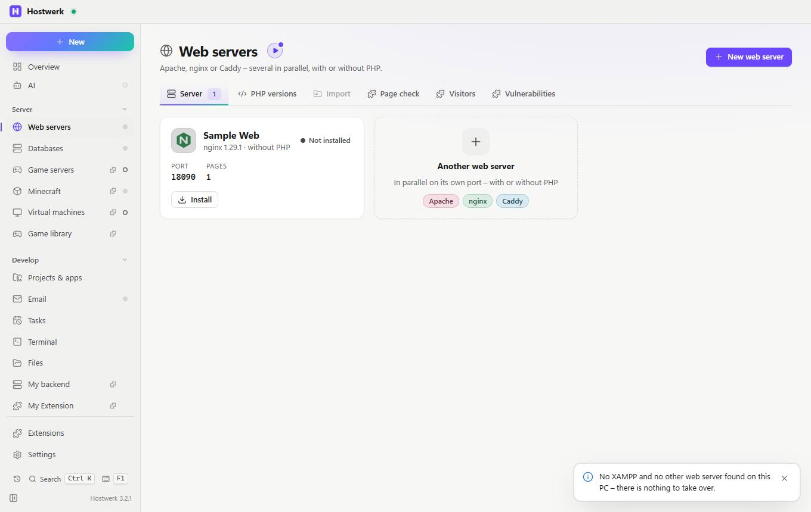

# Web servers

[← Back to the overview](README.md)

Apache, nginx or Caddy – several in parallel, with or without PHP.

### What you can do here

- 3 videos
- New web server
- Change image
- Install

## Tabs

### PHP versions

**Areas on this page:** Installed · Available (windows.php.net)

**What you can do here:** 3 videos · New web server · What's new? · Install

### Import

> Import – take over existing services Is a web server already running on this PC – e.g. from XAMPP or as a Windows service? Hostwerk takes it over: where it is (nothing is moved) or copied 1:1, tested and with a way back. The same search for all kinds is under System → Foreign services.

**Areas on this page:** Import from XAMPP · Existing Web servers on this PC

**What you can do here:** 3 videos · New web server · Folder · Search · Apply · Search again

Generated on 2026-11-20 · Hostwerk 3.2.2
