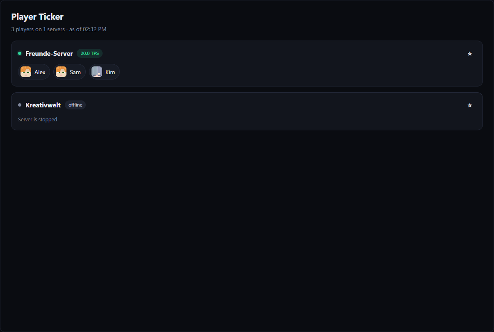
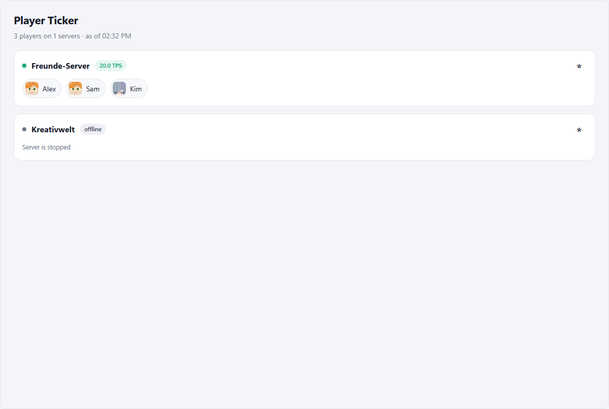
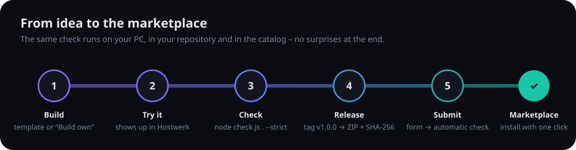
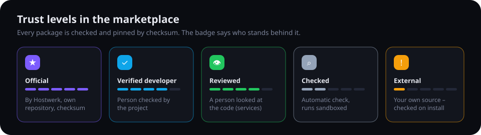
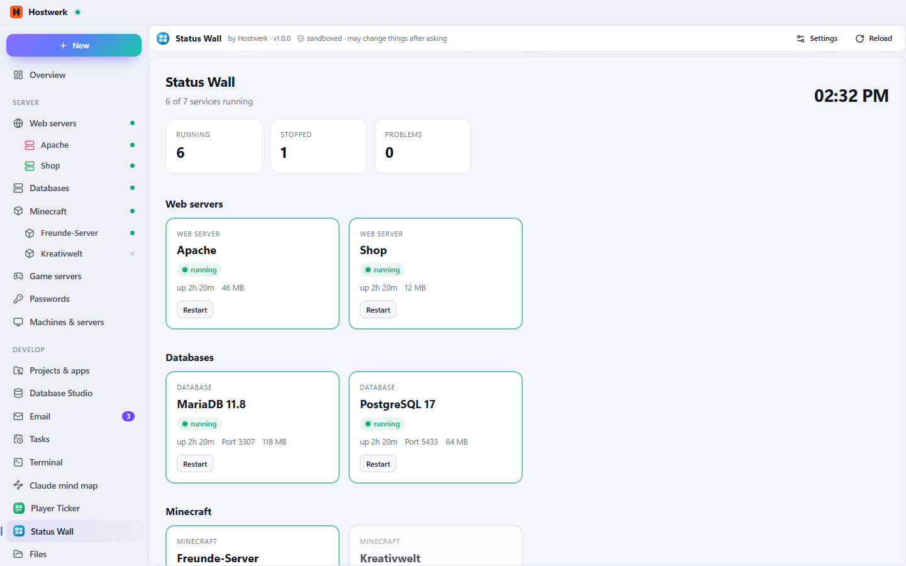

# Hostwerk-Erweiterungen bauen

[English](README.md) · **Deutsch**

Eine Erweiterung bringt eine **Seite** (in der Seitenleiste), eine **Kachel** (in der Übersicht) und/oder einen
**Dienst** (ein Programm, das Hostwerk startet) nach [Hostwerk](https://github.com/Passimoritz/hostwerk-public). Sie ist
ein Ordner mit `manifest.json`, normalem HTML/JavaScript und zwei Textdateien – ohne Build-Schritt, ohne Framework.

| Spieler-Ticker (dunkel) | Spieler-Ticker (hell) |
|---|---|
|  |  |

Erweiterungen **können Hostwerks Design nicht brechen**: Das SDK bringt den Design-Baukasten mit und gibt Farben,
Hell/Dunkel, Schrift und Sprache zur Laufzeit an die Seite weiter. Nutze die `hw-*`-Klassen und `var(--hw-…)`-Farben –
die Prüfung warnt bei festen Farben und eigenen Schriften. **Auch Hostwerks Animationen stehen dir zur Verfügung** (seit
SDK 3.6): Lade-Linie, Kreisel, Einblenden, Puls, gezeichneter Haken und hochzählende Zahlen – als Klassen,
`Hostwerk.ui.*`-Helfer und `@hostwerk/ui`-Bausteine ([Abschnitt 28](#28-sdk-36-animationen-wie-hostwerk)).



---

## Inhalt

### Wegweiser – ich will …

| Ich will … | Hier steht es |
|---|---|
| in 5 Minuten eine erste Erweiterung sehen | [1. Schnellstart](#1-schnellstart-5-minuten) |
| wissen, welche Dateien ins Paket gehören und was ins Manifest kommt | [2. Das Paket](#2-das-paket) · [3. manifest.json](#3-manifestjson) |
| eine Seite bauen, die aussieht wie Hostwerk | [5. Design-Baukasten](#5-design-baukasten--hostwerks-eigene-klassen) · [23. Laden](#23-sdk-32-laden-wie-eine-eingebaute-seite) · [28. Animationen](#28-sdk-36-animationen-wie-hostwerk) |
| eine Kachel für die Übersicht bauen – mit Laden, Leer und Fehler | [9. Kacheln](#9-kacheln-für-die-übersicht) · [31. Leere Kacheln](#31-sdk-39-leere-kacheln-wie-hostwerk) |
| Einstellungen anbieten, Daten speichern, auf Ereignisse hören | [8. Einstellungen, Speicher, Ereignisse](#8-einstellungen-speicher-ereignisse) · [18. Ereignisse und Dienste](#18-sdk-210-ereignisse-benachrichtigungen-dienste-steuern-und-öffentliche-ansichten) |
| Hostwerks Daten lesen oder Dienste steuern | [4. Das SDK](#4-das-sdk--hostwerk) · [7. Rechte](#7-rechte) · [25. Stabile Dienste](#25-sdk-33-stabile-dienste-statt-kern-interna-spuren-und-entfernen-haken) |
| ein eigenes Programm im Hintergrund (Server-Teil) | [15. Native Erweiterungen](#15-sdk-27-aussehen-abhängigkeiten-und-native-erweiterungen) · [16. Abgeschottet](#16-sdk-28-eingebaut-wie-hostwerk-selbst--und-abgeschottet) |
| Hostwerks Bereiche ergänzen (Reiter, Abschnitte, Farbschemata, Dienst-Arten) | [17. Farbschemata und Anpassungen](#17-sdk-29-farbschemata-anpassungen-und-andere-erweiterungen-erweitern) · [21. Abschnitte](#21-sdk-32-abschnitte-statt-reiter-datei-browser-und-seiten-im-webserver) · [27. Dienst-Arten](#27-sdk-35-dienst-arten-beiträge-und-ein-kern-ohne-sonderfälle) |
| den „KI fragen“-Knopf einbauen | [29. KI fragen](#29-sdk-37-ki-fragen--der-erklären-knopf-wie-in-hostwerk) |
| mich in den Bereich KI einhängen (Strg+J, Medien, Einstellungen, Gedächtnis, @-Quellen) | [32. KI überall](#32-sdk-310-ki-überall--seitenfenster-ki-plätze-und-eigene--quellen) |
| mich in den Livebetrieb einhängen (Online, Zugriff, Schutz, Überwachung, Sicherung; Lage-Punkte, eigene Adressen) | [33. Livebetrieb in fünf Bereichen](#33-sdk-311-livebetrieb-in-fünf-bereichen--abschnitte-lage-punkte-und-eigene-adressen) |
| mich in Sicherungen oder System einhängen (Lage-Punkte, Zeitplan, Abschnitte in den Bereichen) | [34. Sicherungen und System neu](#34-sdk-312-sicherungen-und-system-neu--abschnitte-lage-punkte-und-zeitplan) |
| eine Webseite oder Anmeldung in Hostwerk statt im Browser öffnen | [26. Webseiten in Hostwerk](#webseiten-in-hostwerk-sdk-314) |
| in „Dateien“ leben (Dateien öffnen, Menü „Neu“, eigener Bereich) und unter „Öffnen mit“ erscheinen | [21. Dateien öffnen und „Öffnen mit“](#dateien-öffnen-menü-neu-eigene-bereiche-und-öffnen-mit-sdk-315) |
| eigene Dateisymbole und Vorschaubilder in „Dateien“ zeigen | [21. Dateisymbole und Vorschaubilder](#dateisymbole-und-vorschaubilder-in-dateien-sdk-316) |
| prüfen und veröffentlichen | [10. Prüfen](#10-erweiterung-prüfen) · [11. Veröffentlichen](#11-veröffentlichen-repository-release-einreichen) · [35. Checkliste](#35-checkliste-vor-dem-veröffentlichen) |
| wissen, warum etwas nicht geht | [36. Häufige Fragen und Fehler](#36-häufige-fragen-und-fehler) |

### Alle Abschnitte nach Thema

**Grundlagen**
- [Worauf Erweiterungen zugreifen dürfen – und worauf nicht](#worauf-erweiterungen-zugreifen-dürfen--und-worauf-nicht) (je Recht: darf, darf nicht, fragt nach · „Darf keine Erweiterung“ · abgeschottet oder Teil von Hostwerk)
- [1. Schnellstart (5 Minuten)](#1-schnellstart-5-minuten) · [2. Das Paket](#2-das-paket) · [3. manifest.json](#3-manifestjson) · [4. Das SDK – `Hostwerk.*`](#4-das-sdk--hostwerk) · [14. Beispiele](#14-beispiele)

**Oberfläche und Design**
- [5. Design-Baukasten](#5-design-baukasten--hostwerks-eigene-klassen) · [6. Übersetzungen (Deutsch + Englisch)](#6-übersetzungen-deutsch--englisch) · [9. Kacheln für die Übersicht](#9-kacheln-für-die-übersicht)
- [23. Laden wie eine eingebaute Seite](#23-sdk-32-laden-wie-eine-eingebaute-seite) · [24. Ohne eigenen Eintrag in der Seitenleiste](#24-sdk-32-ohne-eigenen-eintrag-in-der-seitenleiste)
- [28. Animationen wie Hostwerk](#28-sdk-36-animationen-wie-hostwerk) · [29. „KI fragen“ – der Erklären-Knopf](#29-sdk-37-ki-fragen--der-erklären-knopf-wie-in-hostwerk) · [31. Leere Kacheln wie Hostwerk](#31-sdk-39-leere-kacheln-wie-hostwerk) · [32. KI überall – Seitenfenster, KI-Plätze und eigene @-Quellen](#32-sdk-310-ki-überall--seitenfenster-ki-plätze-und-eigene--quellen) · [33. Livebetrieb in fünf Bereichen – Abschnitte, Lage-Punkte und eigene Adressen](#33-sdk-311-livebetrieb-in-fünf-bereichen--abschnitte-lage-punkte-und-eigene-adressen) · [34. Sicherungen und System neu – Abschnitte, Lage-Punkte und Zeitplan](#34-sdk-312-sicherungen-und-system-neu--abschnitte-lage-punkte-und-zeitplan)

**Daten, Rechte und Sicherheit**
- [7. Rechte](#7-rechte) · [8. Einstellungen, Speicher, Ereignisse](#8-einstellungen-speicher-ereignisse) · [13. Sicherheit](#13-sicherheit)
- [18. Ereignisse, Benachrichtigungen, Dienste steuern und öffentliche Ansichten](#18-sdk-210-ereignisse-benachrichtigungen-dienste-steuern-und-öffentliche-ansichten)
- [25. Stabile Dienste statt Kern-Interna, Spuren und Entfernen-Haken](#25-sdk-33-stabile-dienste-statt-kern-interna-spuren-und-entfernen-haken)

**Hostwerk erweitern (nativ, Beiträge, eigene Arten)**
- [15. Aussehen, Abhängigkeiten und native Erweiterungen](#15-sdk-27-aussehen-abhängigkeiten-und-native-erweiterungen) · [16. Eingebaut wie Hostwerk selbst – und abgeschottet](#16-sdk-28-eingebaut-wie-hostwerk-selbst--und-abgeschottet)
- [17. Farbschemata, Anpassungen und andere Erweiterungen erweitern](#17-sdk-29-farbschemata-anpassungen-und-andere-erweiterungen-erweitern) · [20. Geteilter Seiten-Check und Notizen im Wissensgraph](#20-sdk-31-geteilter-seiten-check-und-notizen-im-wissensgraph)
- [21. Abschnitte statt Reiter, Datei-Browser und Seiten im Webserver](#21-sdk-32-abschnitte-statt-reiter-datei-browser-und-seiten-im-webserver) · [22. Minecraft-Servertypen und Netzwerke](#22-sdk-32-minecraft-servertypen-und-netzwerke)
- [26. Eigene Vollbild-Ansichten und Geräte-Anmeldung](#26-sdk-34-eigene-vollbild-ansichten-und-geräte-anmeldung) · [27. Dienst-Arten, Beiträge und ein Kern ohne Sonderfälle](#27-sdk-35-dienst-arten-beiträge-und-ein-kern-ohne-sonderfälle)

**Prüfen und veröffentlichen**
- [10. Erweiterung prüfen](#10-erweiterung-prüfen) · [11. Veröffentlichen: Repository, Release, Einreichen](#11-veröffentlichen-repository-release-einreichen) · [12. Vertrauensstufen und Verifizierung](#12-vertrauensstufen-und-verifizierung)
- [35. Checkliste vor dem Veröffentlichen](#35-checkliste-vor-dem-veröffentlichen) · [36. Häufige Fragen und Fehler](#36-häufige-fragen-und-fehler)

**Versionen**
- [19. Stabilität und Abkündigungen](#19-sdk-30-stabilität-und-abkündigungen) · [30. Erweiterungen zusammenlegen (`replaces`)](#30-sdk-38-erweiterungen-zusammenlegen-replaces) · [SDK-Changelog](SDK-CHANGELOG.md)

> Die Abschnitte 15–32 tragen die SDK-Version im Titel, mit der sie dazukamen. Sie gelten alle weiter – setze
> `"sdkVersion"` im Manifest auf die kleinste Version, deren Funktionen du nutzt ([Abschnitt 19](#19-sdk-30-stabilität-und-abkündigungen)).



---

## Worauf Erweiterungen zugreifen dürfen – und worauf nicht

<!-- perms:start -->
Diese Liste erzeugt `scripts/ext-perm-docs.js` aus `server/extensions/sdk/check.js` – derselben Quelle, aus der Hostwerk den Installations-Dialog und die Erweiterungs-Details füllt. „Wege“ sind die API-Pfade, die das Recht freischaltet (GET = lesen, alles andere = ändern); alles andere ist mit diesem Recht gesperrt. Antworten kommen immer ohne Felder an, die nach Geheimnis aussehen.

### Je Recht

| Recht | Darf | Darf nicht | Fragt nach | Wege |
|---|---|---|---|---|
| `read:services` | Übersicht: welche Dienste es gibt und ob sie laufen | Dienste starten oder stoppen<br>Protokolle und Konfiguration der Dienste<br>Felder, die nach Geheimnis aussehen (Passwort, Token, Schlüssel …) – kommen geschwärzt an | – (nur lesen) | `GET /overview` |
| `read:web` | Liste der Webserver und Angaben zu einem Webserver (Typ, Version, Ports, Zustand) | Konfigurationsdateien, Zugriffs- und Fehlerprotokolle<br>Virtuelle Hosts oder Einstellungen ändern<br>Webserver starten oder stoppen<br>Felder, die nach Geheimnis aussehen (Passwort, Token, Schlüssel …) – kommen geschwärzt an | – (nur lesen) | `GET /web[/<id>]` |
| `read:databases` | Namen, Typ, Version, Port und Zustand der Datenbankserver<br>Ob ein Passwort gesetzt ist (ja/nein) | Inhalte der Datenbanken (Tabellen, Zeilen)<br>Das Passwort selbst<br>Sicherungen auflisten, herunterladen oder wiederherstellen<br>Datenbanken starten, stoppen oder ändern | – (nur lesen) | `GET /dbs[/<id>]` |
| `read:minecraft` | Minecraft-Server, Spieler, Statistiken und Welten-Liste | Konsole, Protokolle und Absturzberichte<br>server.properties, Plugins und Sicherungen<br>Befehle senden oder etwas ändern | – (nur lesen) | `GET /mc/servers(/<id>(/(players\|stats\|worlds))?)?` |
| `read:apps` | Liste der Apps mit Zustand | Apps starten, stoppen oder ändern<br>Abhängigkeiten installieren<br>Felder, die nach Geheimnis aussehen (Passwort, Token, Schlüssel …) – kommen geschwärzt an | – (nur lesen) | `GET /apps` |
| `read:tasks` | Liste der Aufgaben mit Zeitplan und Erfolgsquote | Verlauf und Ausgaben der Läufe<br>Aufgaben ausführen, ändern oder pausieren<br>Felder, die nach Geheimnis aussehen (Passwort, Token, Schlüssel …) – kommen geschwärzt an | – (nur lesen) | `GET /tasks` |
| `read:mail` | Zustand des Mail-Fängers<br>Liste der abgefangenen Mails (Absender, Empfänger, Betreff, Vorschau) | Eine Mail vollständig öffnen oder Anhänge laden<br>Mails weiterleiten, löschen oder die Weiterleitung einrichten | – (nur lesen) | `GET /mail[/messages]` |
| `read:system` | Systemzustand, Auslastung, belegte und freie Ports, Speicher je Dienst<br>Steckbrief des Rechners: Betriebssystem, Hardware, Laufwerke, Laufzeiten, installierte Erweiterungen | Prozesse beenden<br>Ports umstellen (eigenes Recht „change:ports“)<br>Verlaufswerte (Messreihen) exportieren | – (nur lesen) | `GET /system/(health\|info\|resources\|ports\|disk-usage\|ports/free)` |
| `read:games` | Spiele-Server, ihr Zustand und ihre Spieler | Konsole und Dateien der Server<br>Server starten oder stoppen<br>Felder, die nach Geheimnis aussehen (Passwort, Token, Schlüssel …) – kommen geschwärzt an | – (nur lesen) | `GET /games`<br>`GET /games/<id>[/players]`<br>`GET /games-players` |
| `change:ports` | Einen Dienst auf einen freien Port umstellen – nach deiner Rückfrage | Ohne deine Rückfrage<br>Andere Einstellungen der Dienste ändern<br>Dienste starten oder stoppen | ja, jede Änderung | `ändern /system/ports/fix` |
| `read:live` | Zertifikate mit Restlaufzeit<br>Erreichbarkeits-Prüfungen und ihr Verlauf | Private Schlüssel der Zertifikate<br>Alarm-Ziele, Firewall, Fernzugriff, Domains<br>Etwas anlegen, ändern oder löschen | – (nur lesen) | `GET /live/(certs\|uptime)` |
| `read:network` | Router, Rechner im Verbund und Sicherheitslage | Router-Anmeldung<br>Rechner koppeln oder ihre Schlüssel<br>Firewall oder Fernzugriff ändern<br>Felder, die nach Geheimnis aussehen (Passwort, Token, Schlüssel …) – kommen geschwärzt an | – (nur lesen) | `GET /(router\|machines\|live/security)` |
| `control:services` | Webserver, Datenbanken, Apps, Mail, Minecraft- und Spiele-Server starten, stoppen, neu starten – jedes Mal nach deiner Rückfrage | Ohne deine Rückfrage<br>Dienste anlegen, löschen oder umkonfigurieren<br>Prozesse hart beenden | ja, jede Änderung | `ändern /(web\|dbs\|apps\|mail\|mc/servers\|games)/<id>/(start\|stop\|restart)`<br>`ändern /mail/(start\|stop)` |
| `command:minecraft` | Einen Befehl an einen Minecraft-Server senden – nach deiner Rückfrage | Ohne deine Rückfrage<br>Konsole oder Protokolle lesen<br>Dateien des Servers ändern | ja, jede Änderung | `ändern /mc/servers/<id>/command` |
| `run:tasks` | Eine vorhandene Aufgabe sofort ausführen – nach deiner Rückfrage | Ohne deine Rückfrage<br>Aufgaben anlegen, ändern, löschen oder abbrechen | ja, jede Änderung | `ändern /tasks/<id>/run` |
| `change:minecraft` | server.properties, Spielregeln und Server-Symbol ändern, Plugins an- und ausschalten, Sicherung anlegen – jedes Mal nach deiner Rückfrage | Ohne deine Rückfrage<br>Plugins installieren oder löschen<br>Sicherungen herunterladen, wiederherstellen oder löschen<br>Server löschen | ja, jede Änderung | `ändern /mc/servers/<id>/(properties\|gamerules\|icon\|backups\|plugins/toggle)` |
| `change:databases` | Eine Datenbank-Sicherung anlegen – nach deiner Rückfrage | Ohne deine Rückfrage<br>Sicherungen herunterladen, wiederherstellen oder löschen<br>Inhalte der Datenbanken lesen<br>Passwort ändern | ja, jede Änderung | `ändern /dbs/<id>/backups` |
| `change:mail` | Test-Mails in den Mail-Fänger schicken, alle als gelesen markieren – nach deiner Rückfrage | Ohne deine Rückfrage<br>Mails nach draußen weiterleiten oder löschen | ja, jede Änderung | `ändern /mail/(compose\|read-all)` |
| `read:knowledge` | Wissensgraph lesen: Projekte, Graph, Bericht, Fragenverlauf, Gedächtnis, Claude-Status | Etwas ändern<br>Schlüssel und Konten der KI-Anbieter | – (nur lesen) | `GET /knowledge`<br>`GET /knowledge/notes`<br>`GET /knowledge/<id>/(graph\|report\|questions\|memory\|claude)`<br>`GET /claude/(status\|connect/code)` |
| `change:knowledge` | Wissensgraph bauen und abfragen, Ordner aufnehmen, Gedächtnis pflegen, eigene Notizen eintragen, Obsidian-Export – ohne Rückfrage je Aufruf | Claude in Projekten einbinden (eigenes Recht „connect:claude“)<br>Andere Bereiche von Hostwerk ändern | nein – ausdrücklich ohne Rückfrage | `ändern /knowledge`<br>`ändern /knowledge/notes`<br>`ändern /knowledge/folders[/<id>]`<br>`ändern /knowledge/<id>/(build\|options\|query\|explain\|path\|memory[/<id>]\|obsidian/(export\|sync\|notes\|import))` |
| `connect:claude` | Claude in Projekten einbinden, reparieren und wieder vergessen – nach deiner Rückfrage | Ohne deine Rückfrage<br>Schlüssel der KI-Anbieter lesen | ja, jede Änderung | `ändern /knowledge/<id>/claude/(connect\|repair\|forget)`<br>`ändern /knowledge/forget-all`<br>`ändern /claude/connect/desktop` |
| `read:claude` | Claude-Status, Projekte, Gedächtnis-Kontext, Spar-Werkzeuge und Verbrauch | Schlüssel und Konten der KI-Anbieter<br>Tresor, Umgebungsdateien (.env) und Git der Projekte<br>Etwas ändern | – (nur lesen) | `GET /claude/(status\|connect/code\|tools\|tools/discover\|tools/usage\|targets/<id>)`<br>`GET /mind[/activity\|/context]`<br>`GET /projects[/<id>]`<br>`GET /ai/memory-share` |
| `change:claude` | Kontext in Projekt-Dateien schreiben, Spar-Werkzeuge installieren oder entfernen, Claude Desktop anbinden – jedes Mal nach deiner Rückfrage | Ohne deine Rückfrage<br>Schlüssel und Konten der KI-Anbieter | ja, jede Änderung | `ändern /claude/write/<id>`<br>`ändern /claude/tools`<br>`ändern /claude/tools/<id>/(install\|update\|remove)`<br>`ändern /claude/connect/desktop`<br>`ändern /ai/memory-share[/preview]` |
| `share:status` | Öffentliche Statusseite lesen und einrichten – Änderungen nach deiner Rückfrage | Änderungen ohne deine Rückfrage<br>Überwachung, Alarm-Ziele oder Domains ändern | ja, jede Änderung | `GET /live/statuspage`<br>`ändern /live/statuspage(/(rotate\|publish))?` |
| `share:view` | Eine Seite ohne Anmeldung anbieten (z. B. Overlay für OBS) – nur Dateien aus ihrem eigenen Ordner | Von dort Hostwerks API abfragen (nur der eigene öffentliche Server-Teil)<br>Deine Anmeldung oder Cookies nutzen | – (nur lesen) | kein API-Weg |
| `read:profile` | Deinen Namen aus Einstellungen → Allgemein – nur, wenn du ihn dort für Erweiterungen freigegeben hast (sonst kommt nichts an) | Deinen Namen ohne deine Freigabe<br>Andere Einstellungen, Konten oder Anmeldedaten | – (nur lesen) | `GET /you` |
| `run:terminal` | Einen Befehl ins Hostwerk-Terminal tippen – du drückst Enter oder bestätigst vorher im Dialog | Einen Befehl ohne dich abschicken<br>Die Ausgabe des Terminals lesen | ja, du bestätigst selbst | kein API-Weg |
| `use:ai` | Kurze Texte übersetzen, erklären, zusammenfassen oder beschreiben lassen – mit der KI, die du in Hostwerk eingerichtet hast (nur wenn sie an ist) | Schlüssel und Konten der KI-Anbieter<br>KI-Chat, Gedächtnis oder Einstellungen der KI<br>Längere Texte als 6000 Zeichen | – (nur lesen) | kein API-Weg |
| `read:updates` | Welche Sicherheits-Updates anstehen: Dienst, Version jetzt und neu | Updates einspielen (eigenes Recht „change:updates“)<br>Automatische Updates ein- oder ausschalten | – (nur lesen) | kein API-Weg |
| `change:updates` | Ein anstehendes Sicherheits-Update einspielen – mit Probelauf und Rückfall wie unter Einstellungen → Updates, im Aktivitätsprotokoll vermerkt | Abgeschottet: gar nicht – nur offizielle Pakete aus dem Hostwerk-Katalog<br>Andere Versionen einspielen oder den Probelauf überspringen<br>Automatische Updates ein- oder ausschalten | – (nur lesen) | kein API-Weg |
| `fetch:icons` | Das Symbol einer öffentlichen Webseite laden – Hostwerk holt es selbst und hebt es 30 Tage auf | Adressen im Heimnetz oder auf diesem Rechner – auch nicht über Weiterleitungen<br>Andere Inhalte als Bilder, mehr als 512 KB<br>Abgeschottet: gar nicht | – (nur lesen) | kein API-Weg |
| `write:ssh-keys` | Einen SSH-Schlüssel (privat und öffentlich) unter neuem Namen in ~/.ssh ablegen | Vorhandene Schlüssel überschreiben oder lesen<br>authorized_keys, known_hosts oder config ändern<br>Abgeschottet: gar nicht | – (nur lesen) | kein API-Weg |
| `connect:mail` | Mit den Mail-Servern sprechen, die du beim Einrichten eines Kontos angibst (IMAP, SMTP, POP3 – Ports 25, 110, 143, 465, 587, 993, 995, 2525)<br>Die Einstellungen zu deiner Mail-Adresse suchen (Autoconfig und Autodiscover deiner Domain, Mozillas Anbieter-Verzeichnis, DNS) – abgeschottet nur über die unter „network“ genannten Adressen | Andere Ports oder Webseiten (dafür gibt es „network“)<br>Abgeschottet: Mail-Server im Heimnetz oder auf diesem Rechner<br>Deine Hostwerk-Anmeldung, Einstellungen oder Geheimnisse anderer Bereiche | – (nur lesen) | kein API-Weg |
| `storage` | Eigene Daten speichern, höchstens 256 KB | Daten anderer Erweiterungen lesen – außer deren Autor gibt sie frei<br>Mehr als 256 KB | – (nur lesen) | kein API-Weg |
| `network` | Abfragen an die im Paket genannten https-Adressen | Abfragen an andere Adressen<br>Server-Code: ins eigene Netz, Heimnetz oder 127.0.0.1 – auch wenn genannt | – (nur lesen) | kein API-Weg |
| `override:ui` | Benannte Teile von Hostwerks Oberfläche ersetzen oder ergänzen – erst nach deiner Zustimmung mit Vorschau (offizielle Pakete sofort), jederzeit abschaltbar | Teile ersetzen, die nicht als Anpassungs-Stelle benannt sind<br>Sich gegen das Abschalten wehren | – (nur lesen) | kein API-Weg |
| `extend:extensions` | Andere Erweiterungen ergänzen (Reiter, Seiten, Texte) – nur so weit, wie deren Autor es erlaubt | Andere Erweiterungen installieren, ändern oder abschalten<br>Mehr als deren Autor freigibt | – (nur lesen) | kein API-Weg |
| `native` | Eigenen Server-Code ausführen: eigene Routen, Hintergrund-Arbeit, Dienste für andere Erweiterungen | Abgeschottet: Dateien außerhalb des eigenen Ordners, Programme starten, eigenes Netz, eigene Ports, Hostwerks Umgebung<br>Offizielle Pakete aus dem Hostwerk-Katalog laufen als Teil von Hostwerk – geprüft und signiert, aber nicht abgeschottet | – (nur lesen) | kein API-Weg |

### Darf keine Erweiterung

Diese Grenzen erzwingt Hostwerk technisch für jede abgeschottete Erweiterung – also alle aus anderen Quellen, jede Seite im Rahmen und eigenen Server-Code im eigenen Prozess. `scripts/ext-security-test.js` prüft jede einzelne mit einem absichtlich neugierigen Test-Paket.

- **Passwörter, Tresore und Geheimnisse lesen** – Passwort-Manager, Tresore und Schlüssel sind gesperrt; Felder, die nach Geheimnis aussehen, kommen in jeder erlaubten Antwort geschwärzt an. <sub>(Fundstelle: server/services/extpolicy.js: DENY_FIRST (pw, passwords, vault, secrets), DENY_RE, redact())</sub>
- **Hostwerks Einstellungen, Schlüssel und Anmelde-Token lesen** – Die Einstellungen sind gesperrt, Hostwerks Umgebungsvariablen erbt der Prozess nicht, Cookies und Token gehen nie an die Erweiterung. <sub>(Fundstelle: extpolicy.js DENY_FIRST (settings, auth, tokens, keys); extsandbox.js start() env + STRIP_HEADERS)</sub>
- **Sich selbst mehr Rechte geben** – Rechte stehen im Paket und gelten erst nach deiner Zustimmung. Die eigene manifest.json ist schreibgeschützt, Hostwerks Erweiterungs-Verwaltung gesperrt, „_“-Felder setzt nur Hostwerk. <sub>(Fundstelle: extpolicy.js DENY_FIRST (extmarket, extstudio, ext); extsandbox.js --allow-fs-write nur Datenordner; extmarket.js installFromDir (ohne „_“-Felder))</sub>
- **Andere Erweiterungen installieren, ändern, abschalten oder ansprechen** – Ausnahmen nur, wenn der andere Autor es erlaubt: Ergänzungen („extend:extensions“), angebotene Dienste und freigegebener Speicher. <sub>(Fundstelle: extpolicy.js DENY_FIRST (extmarket, x); extmarket.js /call (nur eigenes /x/&lt;id&gt;); extmarket.js sharedStorage)</sub>
- **Wartung, abgesicherten Start oder Updates von Hostwerk beeinflussen** – Wartung, Selbstwartung und Updates sind gesperrt; Pakete, die Wartungsdateien oder -schalter erwähnen, lassen sich gar nicht installieren. <sub>(Fundstelle: extpolicy.js DENY_FIRST (maintenance, keeper, update, app); check.js TAMPER_RE)</sub>
- **Sich verstecken oder unentfernbar machen** – Jede Erweiterung steht in der Liste und in der Wartung und lässt sich dort abschalten und entfernen. Ihr Zugriffsprotokoll kann sie nicht löschen, Meldungen tragen immer ihren Namen. <sub>(Fundstelle: check.js HIDING_KEYS (Installation abgelehnt); extpolicy.js DENY_FIRST (extmarket); extsandbox.js op toast (Name davor))</sub>
- **Dateien außerhalb des eigenen Ordners lesen oder schreiben** – Der Server-Code liest nur sein Paket und schreibt nur in seinen Datenordner; Hostwerks Datei-Bereich ist gesperrt. <sub>(Fundstelle: extsandbox.js start(): node --permission --allow-fs-read/--allow-fs-write; extpolicy.js DENY_FIRST (files, fs))</sub>
- **Abfragen an Adressen schicken, die nicht im Paket stehen** – Ohne das Recht „network“ gar keine. Server-Code kommt nie ins eigene Netz, ins Heimnetz oder an 127.0.0.1. Seiten dürfen Bilder und Medien von https-Adressen anzeigen. <sub>(Fundstelle: extensions/sandbox/runner.js (net.Socket.connect, dgram); extmarket.js mountPages (CSP connect-src))</sub>
- **Programme oder Befehle ohne deine Zustimmung starten** – Server-Code kann keine Programme, Worker oder fremden Code starten. Pakete mit eigenem Programm installiert Hostwerk nur nach deiner ausdrücklichen Zustimmung; Terminal-Befehle bestätigst du selbst. <sub>(Fundstelle: extsandbox.js (--permission, --disallow-code-generation-from-strings); extpolicy.js DENY_FIRST (terminal, pty, shell, exec); extmarket.js installFromDir PROGRAM_CONSENT; ui/src/extBridge.js TERMINAL)</sub>
- **Etwas ohne deine Rückfrage ändern** – Jede Änderung über Hostwerk fragt dich vorher. Einzige Ausnahme: Rechte, die ausdrücklich ohne Rückfrage sind (Wissensgraph bauen). <sub>(Fundstelle: extpolicy.js decide() confirm; extmarket.js /call (428 EXT_CONFIRM); extsandbox.js op api)</sub>
- **Mit deiner Anmeldung handeln oder Cookies setzen** – Seiten laufen in einem eigenen, leeren Ursprung; Antworten des Server-Codes verlieren Set-Cookie und laufen nie als Hostwerk-Seite. <sub>(Fundstelle: extmarket.js mountPages (CSP sandbox); extsandbox.js proxy (set-cookie entfernt, CSP sandbox))</sub>
- **Hostwerks eigene Bereiche oder Dienste ersetzen** – Eigene Routen gibt es nur unter /api/x/&lt;id&gt;/, Dienstnamen von Hostwerk sind vergeben. Oberflächen-Anpassungen nur mit „override:ui“ und deiner Zustimmung. <sub>(Fundstelle: extsandbox.js proxy (nur /x/&lt;id&gt;), op provide)</sub>
- **Eigene Ports öffnen** – Erreichbar ist eine Erweiterung nur über Hostwerk (/api/x/&lt;id&gt;/), nie direkt. <sub>(Fundstelle: extensions/sandbox/runner.js (net.Server.listen, dgram))</sub>

### Abgeschottet oder Teil von Hostwerk

| | Abgeschottet | Offizielles Paket mit eigenem Code |
|---|---|---|
| Wer | Alle Erweiterungen aus anderen Quellen, jede Seite im Rahmen, eigener Code im Entwickler-Modus | Pakete aus dem Hostwerk-Katalog (Prüfsumme, signierter Katalog) mit `backend`/`ui` |
| Wo läuft der Code | Seite: eigener, leerer Ursprung · Server-Code: eigener Prozess mit Nodes Rechte-Modus | Im Hostwerk-Prozess bzw. Hostwerk-Fenster |
| Rechte | Technisch erzwungen (Sperrliste, Rechte, Rückfrage, Schwärzen, Datei-/Netz-Sperre) | Geprüft und signiert, aber nicht abgeschottet – die Grenzen gelten als Regel, nicht als Sperre |

> **Offen gesagt:** Offizielle Pakete mit eigenem Code laufen als Teil von Hostwerk. Für sie gelten die Grenzen oben als Regel, nicht als Sperre. Dasselbe gilt für eigenen Code, dessen Abschottung du im Entwickler-Modus abschaltest.
<!-- perms:end -->

---

## 1. Schnellstart (5 Minuten)

**Am einfachsten – das Erweiterungs-Studio:** *Erweiterungen → Für Entwickler → Neue Erweiterung*. Ein grafischer Editor
führt durch Grunddaten, Platz in Hostwerk, Rechte, Inhalt (Bausteine wie Kennzahlen, Listen, Knöpfe, Formulare – oder
eigener Code), Texte, Live-Vorschau, Prüfung und Veröffentlichung (GitHub-Repository mit Release, Einreichen im Katalog).

**Weg A – in Hostwerk:** *Apps → Erweiterungen → Eigene bauen*. Hostwerk legt `<Hostwerk>/extensions/<id>/` an – mit
lauffähiger Seite, Texten auf Deutsch und Englisch und einem Symbol. Die Seite erscheint sofort in der Seitenleiste;
Dateien bearbeiten und oben auf **Neu laden** tippen.

**Weg B – auf GitHub:** [hostwerk-ext-template](https://github.com/Passimoritz/hostwerk-ext-template) öffnen →
**Use this template**. Das Repository bringt die Prüfung (GitHub-Action) und automatische Releases schon mit.

Ausprobieren in Hostwerk: *Apps → Erweiterungen → Datei* (ZIP des Ordners) oder *Von Link* (Link zu einem Release-ZIP).

## 2. Das Paket

```
meine-erweiterung/
├─ manifest.json        Name, Version, Rechte, Seite/Kachel/Einstellungen
├─ icon.svg             quadratisch, farbig – im Marktplatz und im Kopf der Seite
├─ page/
│  ├─ index.html        die Seite (lädt zuerst /ext-sdk.js)
│  └─ app.js            dein Code (keine Skripte aus dem Internet – alles ins Paket)
├─ widget/
│  └─ index.html        optionale Kachel für die Übersicht
└─ locales/
   ├─ de.json           alle sichtbaren Texte auf Deutsch
   └─ en.json           … und auf Englisch
```

Höchstens 10 MB. Keine Programme (`.exe`, `.sh` …) in Paketen, die nur Seiten haben.

## 3. manifest.json

```json
{
  "$schema": "https://raw.githubusercontent.com/Passimoritz/hostwerk-public/main/sdk/manifest.schema.json",
  "id": "player-ticker",
  "name": { "de": "Spieler-Ticker", "en": "Player Ticker" },
  "description": { "de": "Wer ist gerade online?", "en": "Who is online right now?" },
  "version": "1.0.0",
  "author": "Dein Name",
  "homepage": "https://github.com/du/hostwerk-ext-player-ticker",
  "icon": "icon.svg",
  "hostwerk": ">=3.0.0",
  "sdkVersion": "3.0",
  "permissions": ["read:services", "read:minecraft", "storage"],
  "page":   { "title": { "de": "Spieler-Ticker", "en": "Player Ticker" }, "icon": "users", "file": "page/index.html" },
  "widget": { "title": { "de": "Spieler online", "en": "Players online" }, "file": "widget/index.html", "size": "third" },
  "settings": [
    { "key": "refresh", "type": "number", "label": { "de": "Aktualisieren (Sekunden)", "en": "Refresh (seconds)" }, "default": 10, "min": 3, "max": 120 }
  ]
}
```

| Feld | Bedeutung |
|---|---|
| `id` | a–z, 0–9 und `-`, 2–40 Zeichen. Bleibt für immer gleich. |
| `name`, `description`, `title`, `label` | Text oder `{ "de": …, "en": … }` – im Katalog sind beide Sprachen Pflicht. |
| `version` | `1.2.3`. Eine höhere Version erscheint in Hostwerk als Update. |
| `supportedFrom` | Freiwillig (SDK 3.12): älteste noch unterstützte Version, z. B. `"2.0.0"` – höchstens `version`. Ältere Installationen werden auch bei ausgeschalteten automatischen Updates aktualisiert oder bis zum Update pausiert – siehe [Abschnitt 34](#alte-fassungen-auslaufen-lassen-supportedfrom). |
| `icon` | Quadratisches SVG/PNG im Paket – Marktplatz-Karte und Kopf der Seite. |
| `page.icon` | **Symbol in der Seitenleiste** – ein schlichtes Linien-Symbol wie bei Hostwerks eigenen Bereichen. Einer von: `puzzle users monitor gauge activity chart bell book bot box calendar camera clock cloud code coffee cpu database download file flag gamepad gift globe heart home image inbox key dashboard grid leaf line-chart list lock mail map message music network news package pie-chart radio rocket server settings shield cart sparkles star sun swords table tag terminal timer trophy tv wand wifi wrench zap`. |
| `sdkVersion` | Das SDK, für das die Erweiterung geschrieben ist, z. B. `"3.0"` – siehe [Abschnitt 19](#19-sdk-30-stabilität-und-abkündigungen). |
| `hostwerk` | Mindestversion, z. B. `>=3.0.0` – ältere Hostwerk-Versionen installieren nicht. Oder `{ "min": "3.0.0", "max": "3.x" }` mit Höchstversion. |
| `permissions` | Was die Erweiterung sehen und tun darf – siehe [Rechte](#7-rechte). |
| `network` | Webadressen, die die Seite per `fetch` erreichen darf (braucht das Recht `network`), z. B. `["https://api.example.com"]`. |
| `settings` | Formular, das Hostwerk zeichnet: `text`, `number` (`min`/`max`), `switch`, `select` (`options`). |

Mit der `$schema`-Zeile gibt es in VS Code Vorschläge beim Tippen.

## 4. Das SDK – `Hostwerk.*`

Zuerst laden: `<script src="/ext-sdk.js"></script>`. Das lädt auch den Design-Baukasten (siehe 5).

```js
const info = await Hostwerk.ready();           // Farben, Sprache, Einstellungen, Reiter, Kontext, Aktion sind da
const list = await Hostwerk.services();       // [{ id, kind, name, state, port, cpu, memory, startedAt, extra }]
const mc = await Hostwerk.minecraft.servers(); // nur Minecraft; extra.players, extra.tps
const stats = await Hostwerk.minecraft.stats(id);

Hostwerk.render('#list', Hostwerk.html`<b>${name}</b>`);   // jeder ${wert} wird maskiert – sicher für Spielernamen
Hostwerk.t('summary', { n: 3 });                            // Text aus locales/<sprache>.json, {n} eingesetzt
Hostwerk.fmt.bytes(123456); Hostwerk.fmt.duration(ms); Hostwerk.fmt.time(Date.now());

await Hostwerk.service('web', 'apache').restart();  // fragt vorher (braucht control:services)
await Hostwerk.minecraft.command(id, 'say Hi');     // fragt vorher (braucht command:minecraft)
await Hostwerk.put('/mc/servers/' + id + '/properties', { motd: '§aHi' }); // Einstellung ändern (change:minecraft, fragt vorher) – SDK 2.2
await Hostwerk.del('/knowledge/' + id + '/memory/' + eintrag);             // löschen (SDK 2.3)
const ordner = await Hostwerk.pickFolder('Tresor wählen');                 // Ordner-Dialog, Pfad oder null (SDK 2.3)
await Hostwerk.terminal('claude', { cwd: ordner, title: 'Claude' });       // tippt ins Hostwerk-Terminal, der Nutzer drückt Enter (SDK 2.5, run:terminal)

await Hostwerk.storage.set('pinned', 'srv1');       // von Hostwerk gespeichert (braucht storage)
const s = await Hostwerk.settings.get();            // Werte aus manifest.settings
Hostwerk.settings.open();                           // öffnet den Einstellungsdialog

Hostwerk.tab;                         // aktueller Reiter aus page.tabs (SDK 2.2); Hostwerk.setTab('codes') wechselt
Hostwerk.context;                     // { kind, id }, wenn als Reiter auf einer Dienstseite gezeigt (contributes.tabs)
Hostwerk.on('tab', (id) => …);        // anderer Reiter gewählt
Hostwerk.on('action', (a) => …);      // { id, target } – deine contributes.action wurde gewählt
Hostwerk.on('service', (s) => …);     // ein Dienst hat seinen Zustand geändert
Hostwerk.on('minecraft', (s) => …);   // Spieler kamen/gingen
Hostwerk.on('settings' | 'lang' | 'theme', …);

Hostwerk.toast('Fertig', { kind: 'success' });
Hostwerk.navigate('/mc/mein-server'); // einen Hostwerk-Bereich öffnen
Hostwerk.openUrl('https://…');        // öffnet nach Rückfrage im Browser (seit SDK 2.3 auch obsidian://)
Hostwerk.copy(text);                  // in die Zwischenablage (SDK 2.1)
Hostwerk.ai.explain(text);            // Hostwerks Fenster „KI fragen“ – Recht use:ai, nur bei bereiter KI (SDK 3.7, Abschnitt 29)
Hostwerk.get('/system/health');       // direkter Lesezugriff (gegen die Rechte geprüft)
```

`Hostwerk.lang` (`de`/`en`), `Hostwerk.theme` (`dark`/`light`) und `Hostwerk.embed` (`page`/`widget`) sagen dir, wo du
gerade bist.

## 5. Design-Baukasten – Hostwerks eigene Klassen

**Grundanforderung:** Eine Erweiterung sieht genauso aus wie Hostwerks eingebaute Bereiche. Deshalb liefert
`/ext-sdk.css` Hostwerks **eigene** Klassen, erzeugt aus dem aktuellen Stylesheet der App. Künftige Design-Änderungen
kommen von selbst in deiner Erweiterung an. Seitentitel, Beschreibung und Reiter (`page.tabs`) zeichnet Hostwerk selbst.
Deine Seite beginnt direkt mit dem Inhalt.

| Klassen | |
|---|---|
| Aufbau | `row`, `row-tight`, `stack`, `grid grid-2` / `grid-3` / `grid-4`, `grow`, `right`, `muted`, `small`, `tiny`, `ellipsis`, `mono` |
| Karten | `card`, `card-pad`, `card-head` (mit `h3`), `card-body`, `stat` mit `k` / `v` / `s` |
| Bedienung | `btn` (+ `primary`, `ghost`, `danger`, `sm`, `xs`), `input`, `select`, `label`, `seg` (Segment-Knöpfe), `switch` (`<label class="switch"><input type="checkbox"><span class="track"></span><span class="thumb"></span></label>`) |
| Zustand | `badge` (+ `ok`, `warn`, `err`, `accent`), `callout` (+ `ok`/`warn`/`err`) mit `callout-body`, `callout-title`, `progress` |
| Listen | `table`, `list-item`, `setting-row` (mit `txt`) |
| Leer / Laden | `empty` (+ `h3`, `p`, `empty-action`), `hw-skeleton`, `spinner`, `hw-spinner`, `hw-dots`, `hw-loading` (über `Hostwerk.ui.loader()`) |
| Bewegung (SDK 3.6) | `hw-fade`, `hw-rise`, `hw-pop`, `hw-slide`, `hw-stagger`, `hw-pulse`, `hw-breathe`, `hw-float`, `hw-spin`, `hw-shake`, `hw-glow`, `hw-flash`, `hw-check` – ruhen von selbst bei „Animationen reduzieren“, siehe [Abschnitt 28](#28-sdk-36-animationen-wie-hostwerk) |

Farben: `--bg`, `--surface`, `--surface-2`, `--line`, `--line-2`, `--text`, `--text-2`, `--muted`, `--accent`,
`--accent-soft`, `--accent-text`, `--ok`, `--warn`, `--err`, `--mono`. Die älteren `hw-…`-Klassen und `--hw-…`-Variablen
funktionieren weiter – bestehende Erweiterungen gehen nicht kaputt.

**Design-Skala (ab Hostwerk 2.11):** Schriftgrößen, Rundungen, Abstände und Höhen gibt es nur als Stufen – genau wie in
Hostwerk selbst. Nimm immer eine Stufe statt einer eigenen Zahl, dann passt deine Erweiterung auch nach künftigen
Design-Änderungen:

| Was | Variablen |
|---|---|
| Schrift | `--fs-2xs` 11 · `--fs-xs` 12 · `--fs-sm` 13 · `--fs-md` 14 · `--fs-lg` 16 · `--fs-xl` 20 · `--fs-2xl` 24 · `--fs-3xl` 28 px |
| Rundung | `--r-xs` 4 · `--r-sm` 6 · `--r-md` 8 · `--r-lg` 10 · `--r-xl` 14 · `--r-2xl` 20 · `--r-pill` |
| Abstand | `--sp-1` 4 · `--sp-2` 8 · `--sp-3` 12 · `--sp-4` 16 · `--sp-5` 20 · `--sp-6` 24 · `--sp-8` 32 px |
| Höhe von Knöpfen/Feldern | `--control-h` 34 · `--control-h-sm` 28 · `--control-h-xs` 24 px |
| Lesbare Statusfarben für Text | `--ok-text`, `--warn-text`, `--err-text` (die Grundfarben `--ok` usw. sind für Flächen und Punkte) |
| Hauptknopf, Felder | `--accent-btn`, `--input-bg` |

Alle gibt es auch mit `--hw-`-Vorsatz (z. B. `--hw-fs-sm`). Die wichtigste Aktion einer Seite ist ein `btn primary`;
den Farbverlauf trägt nur Hostwerks eigener „+ Neu“-Knopf.

**Akzentfarbe (Hostwerk 2.12 und neuer):** Der Nutzer wählt EINE Akzentfarbe (Einstellungen → Allgemein) – oder ein
Profil bringt seine eigene mit. Hostwerk leitet daraus eine vollständige, gut lesbare Palette ab, getrennt für Hell und
Dunkel (OKLCH, Kontraste nach der WCAG-Formel geprüft), und schickt sie live an deine Erweiterung – auch schon, während
der Nutzer noch wählt:

| Variable | Wofür | Zusage |
|---|---|---|
| `--accent` | die gewählte Farbe selbst: Rahmen, Schalter, Markierungspunkte | genau die Wahl des Nutzers |
| `--accent-btn` | Hintergrund von `btn primary` | weiße Schrift darauf ≥ 4,5:1 |
| `--accent-text` | Links, Symbole und Text in Akzentfarbe | ≥ 4,5:1 auf jeder Fläche, auch auf `--accent-soft` |
| `--accent-soft` | zarter Hintergrund (gewählte Zeile, Chip) | durchscheinende Tönung |
| `--accent-contrast` | Schrift direkt auf `--accent` | Weiß oder fast Schwarz, ≥ 4,5:1 |
| `--accent-ring` | Fokusrahmen | ≥ 3:1 auf jeder Fläche |
| `--accent-2` | harmonische Zweitfarbe (Diagramme, Eingabezeichen) | ≥ 3:1 auf jeder Fläche |
| `--grad` | Verlauf für Hervorhebungen | folgt dem Akzent |

**Deine Markenfarbe nie fest für Bedienelemente einsetzen** (Knöpfe, Links, Fokus, Auswahl, Reiter) – nimm `--accent*`.
Dann folgt deine Erweiterung der Farbe des Nutzers und bleibt in beiden Themes lesbar, auch bei Gelb, Cyan oder Grau.
Deine Markenfarbe gehört nur ins Logo oder Symbol.

Regeln der Prüfung (Hinweise – im Katalog Fehler): keine festen Farben, keine eigenen Schriften (`var(--mono)` ist in
Ordnung), nichts über Hostwerk legen (`position: fixed`, riesiger `z-index`). Eine bewusste Ausnahme je Datei, mit
Begründung: `/* hostwerk-allow: colors, fonts – Vorschau wie im Spiel */`.

### Gestaltung: so sieht eine Hostwerk-Seite aus

Verbindlich für Erweiterungen wie für Hostwerk selbst ist das Regelwerk
**[„So sieht eine Hostwerk-Seite aus“](ui-guidelines.md)**. Kurz:

- **Kern-Bausteine statt Eigenbau**: Karten `card`/`card-head`/`card-body`, Kennzahlen `card stat` (`v text` für Text,
  `of` für „/ gesamt“), Zustand `<StatusPill>`/`badge ok|warn|err`, leer `<Empty>`/`<TileEmpty>`, laden
  `<Loading>`/`hw-skeleton`, Bestätigen `confirmDialog` – nie `window.confirm`, keine eigenen Kreisel.
- **Hostwerks Bewegung statt eigener Keyframes** (SDK 3.6): Kreisel, Punkte, Einblenden, Puls, Haken und hochzählende
  Zahlen kommen von Hostwerk – `hw-*`-Klassen, `Hostwerk.ui.loader/animate/countUp …`, `<Dots>`, `<Reveal>`, `<CountUp>`
  ([Abschnitt 28](#28-sdk-36-animationen-wie-hostwerk)). Sie sehen aus wie Hostwerk und achten auf „Animationen reduzieren“. Einmal bewegen
  (erstes Zeichnen, eine Änderung), nie bei jedem Nachladen.
- **Seitenkopf** (nur native Seiten – Seiten im Rahmen bekommen ihn von Hostwerk): Symbol + Titel, **ein** Satz als
  `<p>`, Aktionen rechts; mehr Erklärung als ⓘ.
- **Knöpfe**: eine `primary`-Aktion je Bereich, ganz rechts; „Abbrechen“ links davon. Öffnet ein Knopf erst einen
  Dialog, endet er auf „ …“. Keine Ausrufezeichen, kein „erfolgreich“ in Meldungen (`toast.success('Gespeichert')`).
- **Wörter** (auch in `locales/de.json`): Sicherung statt Backup, Dienst statt Service, Passwort statt Kennwort, Ordner
  statt Verzeichnis, Anmeldung statt Login, neu starten statt neustarten, „Lädt …“ für Fortschritt, „…“ statt „...“.

Der Prüfer meldet Abweichungen als Hinweise mit dem Kürzel `ui-…` (kein Punktabzug), z. B.
`· [ui-text-empty] empty card as a grey sentence – use <TileEmpty …>`.

**Platz – ohne Scrollen (ab Hostwerk 3.1):** Eine Seite passt bei 1366×768 auf einen Bildschirm, lange Listen scrollen in
ihrer eigenen Fläche. Dafür gibt es Bausteine – native Erweiterungen nehmen die Komponenten aus `@hostwerk/ui`, Seiten im
Rahmen dieselben Klassen aus `/ext-sdk.css`:

| Muster | `@hostwerk/ui` | Klassen |
|---|---|---|
| Raster, das mit der Breite wächst (1366 → 2, 1920 → 3 Spalten) | `<Cols size>` | `cols` (+ `cols-sm`, `cols-lg`) |
| Einstellungen mit Gruppen links | `<SettingsLayout groups value onChange>` | `settings-layout` › `settings-nav-wrap` › `settings-nav` (`role="tablist"`, `aria-orientation="vertical"`) › `settings-nav-item`; daneben `settings-pane` |
| Ein Speichern für alles, erscheint bei Änderungen | `<SaveBar dirty onSave onReset>` | `save-bar`, `save-bar-text` |
| Seitenblatt für Seltenes („Mehr …“, Einrichten) | `<SideSheet title onClose>` | `side-sheet-back` › `side-sheet` (`role="dialog"`) › `side-sheet-head` / `-body` / `-foot` |
| Liste links, Einzelheiten rechts | `<MasterDetail list detail>` | `master-detail` › `md-list` (`md-item`, `md-group`) + `md-detail` |
| Tabelle/Liste scrollt innen, Kopf klebt | `useFillHeight({ max: true })` | `fill-scroll` (im Rahmen: Höhe selbst setzen, z. B. `max-height: calc(100vh - 160px)`) |
| Kennzahlen als schmale Leiste | `<StatBar items>` | `stat-bar` › `stat-bar-item` › `stat-bar-k` + `stat-bar-v` |
| Akkordeon, merkt sich offen/zu | `<Accordion id title>` | `<details class="accordion"><summary class="accordion-head">…</summary><div class="accordion-body">` |
| Mehrere Hinweise → einer + „weitere“ | `<HintBar id>` | `hint-bar`, `hint-bar-more` |
| Erledigter Schritt als eine Zeile | – | `summary-row` |
| Kompakte Liste statt hoher Karten | – | `list-rows` › `list-row-item` (`list-row-title`, `list-row-sub`) |
| Suche/Filter bleiben oben | – | `toolbar-sticky` |
| Zustand je Ort merken | `useRemembered(key, start)` | – |

Ziel-Budgets und Beispiele: [Regelwerk, Abschnitt 10](ui-guidelines.md#10-platz--seiten-ohne-scrollen). Auf älteren
Hostwerk-Versionen fehlen die Klassen – die Seite fällt dann auf normale Blöcke untereinander zurück, bleibt also bedienbar.

## 6. Übersetzungen (Deutsch + Englisch)

Jeder sichtbare Text steht in `locales/de.json` und `locales/en.json` mit **denselben Schlüsseln**:

```html
<h1 data-i18n="title"></h1>                <!-- füllt das SDK, wechselt mit der Sprache -->
<input data-i18n-placeholder="search">
```
```js
Hostwerk.t('playersOnline', { n: 5 })      // "{n} online"
Hostwerk.on('lang', render);               // eigene Texte neu zeichnen
```

Die Prüfung meldet fehlende Schlüssel und englische Texte, die noch deutsch aussehen. Texte im Manifest (`name`,
`description`, `title`, Bezeichnungen der Einstellungen) brauchen ebenfalls `{ "de": …, "en": … }`.

## 7. Rechte

| Recht | Erlaubt |
|---|---|
| `read:services` | Dienste und ihren Zustand sehen (`Hostwerk.services()`) |
| `read:web`, `read:databases`, `read:apps`, `read:tasks`, `read:mail` | Diese Bereiche lesen |
| `read:minecraft` | Minecraft-Server, Spieler, Statistiken, Welten |
| `read:system` | Gesundheit, Auslastung, Ports, Speicher je Dienst |
| `read:network` | Router, Rechner, Sicherheitslage |
| `read:live` | Zertifikate mit Restlaufzeit, Erreichbarkeit mit Verlauf (SDK 2.4) |
| `share:status` | Öffentliche Statusseite (`/live/statuspage`): an/aus, Titel, welche Prüfungen, geheimen Link erneuern, in einen Website-Ordner legen – fragt jedes Mal. Besucher sehen nur Namen, Zustand, Verfügbarkeit und Verlauf (SDK 2.6) |
| `control:services` | Starten, stoppen, neu starten – **Hostwerk fragt jedes Mal** |
| `command:minecraft` | Konsolenbefehle senden – fragt jedes Mal |
| `run:tasks` | Aufgaben ausführen – fragt jedes Mal |
| `change:minecraft` | server.properties, Spielregeln, Symbol, Plugins an/aus, Sicherungen – fragt jedes Mal (SDK 2.2) |
| `change:databases` | Datenbank-Sicherungen anlegen – fragt jedes Mal (SDK 2.2) |
| `change:mail` | Test-Mails in den Mail-Fänger, Mails als gelesen markieren – fragt jedes Mal (SDK 2.2) |
| `read:knowledge` | Wissensgraph: Projekte, Graph, Bericht, Fragen, Gedächtnis, Claude-Status (SDK 2.3) |
| `change:knowledge` | Wissensgraph bauen und abfragen, Ordner, Gedächtnis, Obsidian-Export, eigene Notizen als Knoten (`PUT /knowledge/notes`, SDK 3.1) – **ohne Rückfrage je Aufruf**, weil nur die eigenen Daten des Graphen betroffen sind (SDK 2.3) |
| `connect:claude` | Markierten Claude-Abschnitt und Skill in Projekte schreiben/entfernen – fragt jedes Mal (SDK 2.3) |
| `read:claude` | Claude-Status, Projekte, Gedächtnis-Kontext, Spar-Werkzeuge und Verbrauch (SDK 2.5) |
| `change:claude` | Kontext-Dateien in Projekte schreiben, Spar-Werkzeuge installieren/aktualisieren/entfernen – fragt jedes Mal (SDK 2.5) |
| `run:terminal` | `Hostwerk.terminal(befehl, { cwd, title, enter })`: tippt einen Befehl ins Hostwerk-Terminal. Ohne `enter` startet ihn der Nutzer mit Enter, mit `enter: true` fragt Hostwerk vorher (SDK 2.5) |
| `storage` | `Hostwerk.storage` (256 KB) |
| `override:ui` | Benannte Stellen von Hostwerks Oberfläche ersetzen oder ergänzen – **hohes Risiko**: besondere Prüfung im Katalog, aktiv erst nach Zustimmung des Nutzers (offizielle Pakete: sofort), mit einem Klick abschaltbar (SDK 2.9, siehe Abschnitt 17) |
| `extend:extensions` | Anderen Erweiterungen Reiter, Aktionen, Einstellungen, Texte oder eine Seite geben – nur so weit, wie deren Autor es in `allowExtensions` erlaubt (SDK 2.9) |
| `network` | `fetch` zu den Adressen in `network` |

Was jedes Recht genau darf und nicht darf, steht oben unter [Worauf Erweiterungen zugreifen dürfen – und worauf nicht](#worauf-erweiterungen-zugreifen-dürfen--und-worauf-nicht).

Nur anfordern, was du brauchst – Nutzer sehen die Liste vor der Installation. Jeder Aufruf landet im
Zugriffsprotokoll der Erweiterung (auch Ablehnungen).

## 8. Einstellungen, Speicher, Ereignisse

- **Einstellungen**: in `manifest.settings` beschreiben; Hostwerk zeichnet das Formular (passt so immer ins Design)
  und schickt Änderungen sofort (`Hostwerk.on('settings')`).
- **Speicher**: `Hostwerk.storage.get/set/remove/all` – JSON-Werte, 256 KB je Erweiterung, wird mit ihr entfernt.
  Browser-Speicher (`localStorage`, Cookies) geht im abgeschotteten Rahmen nicht.
- **Ereignisse** statt ständig abfragen: `service` (Zustand), `minecraft` (Spieler). Für alles andere langsam abfragen
  (≥ 10 s). Server-Module (`backend`) hören auf Hostwerks Ereignisbus: `host.core('events').bus.on('broadcast', fn)` – z. B.
  `{ type: 'mc-player-join', id, server, player }` und `{ type: 'mc-player-leave', id, server, player, ms }` (`ms` = Dauer der Sitzung).

## 9. Kacheln für die Übersicht

Eine Kachel zeigt **eine Sache auf einen Blick** – eine Zahl, einen Zustand oder eine kurze Liste – und führt für alles
Weitere auf deine Seite. Hostwerk zeichnet den Rahmen samt Kopf (Symbol, Titel), die Höhe folgt dem Inhalt (höchstens
520 px, darüber scrollt die Kachel). Installierte Kacheln erscheinen unter *Übersicht → Anpassen*; dort blendet man sie
ein und aus, angeordnet wird direkt auf der Übersicht (Knopf neben *Anpassen*).

```json
"widget": { "file": "widget/index.html", "title": { "de": "Notizen", "en": "Notes" }, "size": "third" }
```

| Feld | Bedeutung |
|---|---|
| `file` | Die Kachel-Seite – klein, ohne eigenen Rand, Hintergrund oder Titel (den zeichnet Hostwerk). |
| `title` | Titel im Kachelkopf und unter *Anpassen*, `{ "de": …, "en": … }`. |
| `size` | `third` (ein Drittel), `half` oder `full` – Standard `third`. Die Breite lässt sich auf der Übersicht ändern. |

**Jede Kachel kennt drei Zustände** – genau wie Hostwerks eigene:

| Zustand | So geht's | So sieht es aus |
|---|---|---|
| **Lädt** | automatisch bis zum ersten `Hostwerk.render()`; für später nachgeladene Teile `Hostwerk.ui.load(el, fn)` | Hostwerks Lade-Animation |
| **Leer** | `Hostwerk.ui.empty({ text, icon, action })` – in einer Kachel wird daraus von selbst der Kachel-Platzhalter ([Abschnitt 31](#31-sdk-39-leere-kacheln-wie-hostwerk)) | Symbol im gestrichelten Kreis, ein Satz, höchstens eine Aktion |
| **Fehler** | `Hostwerk.ui.load` zeigt Fehler von selbst, sonst `Hostwerk.ui.error(el, err, retry)` | Meldung mit „Erneut versuchen“ |

```html
<!-- widget/index.html -->
<div id="tile"></div>
<script src="/ext-sdk.js"></script>
<script>
  const tile = document.getElementById('tile');
  async function show() {
    const notes = await Hostwerk.ui.load(tile, () => Hostwerk.storage.get('notes'));
    if (notes === undefined) return; // Fehler – ui.load zeigt ihn schon an, mit „Erneut versuchen“
    if (!notes || !notes.length) {
      return Hostwerk.render(tile, Hostwerk.ui.empty({ text: 'Noch keine Notizen.', action: { label: 'Notiz anlegen', onClick: () => Hostwerk.navigate('/ext/notizen') } }));
    }
    Hostwerk.render(tile, Hostwerk.html`<div class="card-body">${notes.slice(0, 5).map((n) => Hostwerk.html`<div class="list-item">${n.title}</div>`)}</div>`);
  }
  Hostwerk.ready().then(show);
</script>
```

**Gute Kacheln …**

- zeigen **eine** Aussage und verlinken für Details auf die eigene Seite (`Hostwerk.navigate(…)`);
- haben **keinen eigenen Rahmen, Hintergrund oder Titel** und keine festen Farben – Klassen aus dem Baukasten (`card-body`,
  `list-item`, `stat`, `badge` …) und `var(--hw-…)`;
- nennen den leeren Zustand **in einem Satz mit Symbol** statt einer grauen Zeile („Keine Daten“) – `check.js` warnt
  sonst (Regel `text-empty`, [Abschnitt 10](#10-erweiterung-prüfen));
- fragen höchstens alle 10 Sekunden nach und hören lieber auf Ereignisse ([Abschnitt 8](#8-einstellungen-speicher-ereignisse)).

**Native Erweiterungen** tragen Kacheln über den Steckplatz `dashboard.tiles` bei
([Abschnitt 18](#18-sdk-210-ereignisse-benachrichtigungen-dienste-steuern-und-öffentliche-ansichten)). Für den leeren
Zustand gibt es `TileEmpty` aus `@hostwerk/ui` – dieselbe Komponente, die Hostwerk selbst nutzt:

```jsx
import { TileEmpty } from '@hostwerk/ui';
function NotesTile() {
  const notes = useNotes();
  if (!notes.length) return <TileEmpty text="Noch keine Notizen." action="Notiz anlegen" href="#/ext/notizen" />;
  return <div className="card-body">{notes.map((n) => <div key={n.id} className="list-item">{n.title}</div>)}</div>;
}
```

Zeichnet eine native Kachel gar nichts (`return null`), zeigt Hostwerk von selbst den Kachel-Platzhalter mit ihrem Titel
und „Noch nichts hier.“ – leere Flächen gibt es auf der Übersicht nicht mehr.

## 10. Erweiterung prüfen

Dieselben Regeln laufen in Hostwerk (beim Installieren), in deinem Repository (GitHub-Action) und im Katalog:

```bash
curl -fsSLO https://raw.githubusercontent.com/Passimoritz/hostwerk-public/main/sdk/check.js
node check.js pfad/zu/meiner-erweiterung            # Bericht
node check.js pfad/zu/meiner-erweiterung --strict   # Katalog-Regeln (Hinweise = Fehler)
```

In Hostwerk: *Apps → Erweiterungen → installiertes Paket → Prüfen* zeigt denselben Bericht.

## 11. Veröffentlichen: Repository, Release, Einreichen

1. Die Erweiterung in ein **eigenes GitHub-Repository** legen (Vorlage: *Use this template*).
2. `version` in `manifest.json` erhöhen, eine Zeile in `CHANGELOG.md`, Tag `v1.2.3` pushen.
   Die Action prüft das Paket und erstellt ein Release mit `<id>-<version>.zip` und einer `.sha256`-Datei.
3. In Hostwerk bei der installierten Erweiterung auf *Einreichen* tippen – oder
   [Erweiterung einreichen](https://github.com/Passimoritz/hostwerk-public/issues/new?template=extension.yml) öffnen
   und den Release-Link eintragen.
4. Die Action prüft erneut (`--strict`), legt eine Kopie mit Prüfsumme in `packages/` ab und nimmt sie in
   `catalog/community.json` auf. Seiten und Kacheln sofort; Dienste warten auf einen Menschen (Label *approved*).
5. Updates: erneut einreichen mit höherer Version (gleiche Kennung – sie gehört dem, der sie zuerst eingereicht hat).

Testen ohne Einreichen: *Actions → Add extension → Run workflow* mit einem Paket-Link (Probelauf).

## 12. Vertrauensstufen und Verifizierung



| Abzeichen | Bedeutung |
|---|---|
| **Offiziell** | Von Hostwerk – eigenes Repository, in `catalog/extensions.json` (täglich aus den Releases gebaut). |
| **Verifizierter Entwickler** | Das Projekt hat die Person verifiziert (`catalog/verified.json`). |
| **Von Hand geprüft** | Zusätzlich von einem Menschen angesehen – Pflicht für Dienste. |
| **Automatisch geprüft** | Hat die automatische Prüfung bestanden, läuft abgeschottet. |
| **Fremde Quelle** | Aus einer selbst eingetragenen Quelle – nur beim Installieren geprüft. |

**Verifiziert werden:** Mindestens eine Erweiterung im Community-Katalog haben, dann
[Verifizierung beantragen](https://github.com/Passimoritz/hostwerk-public/issues/new?template=verification.yml).
Die Action bestätigt, dass die Erweiterungen von dir sind; das Projekt entscheidet von Hand (Label *verified*). Das
Abzeichen kann entzogen werden, wenn eine Erweiterung Code versteckt oder ohne Hinweis Daten sammelt.

## 13. Sicherheit

- Die Seite läuft in einem **abgeschotteten Rahmen mit eigenem, undurchsichtigem Ursprung** – kein Zugriff auf
  Hostwerks Anmeldung, Cookies oder API.
- Content-Security-Policy: Skripte nur aus dem Paket, Netz nur zu den Adressen in `network`, keine Rahmen, keine
  Formulare an fremde Adressen.
- Jede Anfrage läuft über die Brücke und wird auf dem **Server** gegen die Rechte geprüft; Änderungen bestätigt der
  Nutzer jedes Mal.
- Katalog-Pakete sind per **SHA-256** festgelegt – Hostwerk installiert genau die geprüfte Datei.
- Eigener Server-Code (`backend`) von außerhalb des Hostwerk-Katalogs läuft in einem **eigenen, abgeschotteten Prozess**; manche Bereiche (Einstellungen, Passwörter, Schlüssel, andere Erweiterungen …) gibt es nie, Geheimnisse in Antworten werden geschwärzt. Details: [Erweiterungen erklärt](../docs/erweiterungen.md).

## 14. Beispiele

| Repository | Zeigt |
|---|---|
| [hostwerk-ext-player-ticker](https://github.com/Passimoritz/hostwerk-ext-player-ticker) | Minecraft-Daten, Köpfe, Rangliste, Speicher (Anheften), Einstellungen, Kachel, Live-Ereignisse |
| [hostwerk-ext-status-wall](https://github.com/Passimoritz/hostwerk-ext-status-wall) | Alle Dienste, Starten/Neustart mit Rückfrage, Gruppen, Kachel mit Ring |
| [hostwerk-ext-template](https://github.com/Passimoritz/hostwerk-ext-template) | Minimaler Start: Seite, Kachel, Einstellungen, Speicher, Übersetzungen, CI + Releases |
| [hostwerk-ext-motd-studio](https://github.com/Passimoritz/hostwerk-ext-motd-studio) | Ändert Hostwerk selbst: eigener Reiter auf jeder Minecraft-Seite, Rechtsklick-Aktion, `change:minecraft` |
| [hostwerk-ext-service-notes](https://github.com/Passimoritz/hostwerk-ext-service-notes) | Reiter auf allen Dienstseiten, Aktionen in der Schnellsuche, Speicher |
| [hostwerk-ext-knowledge-graph](https://github.com/Passimoritz/hostwerk-ext-knowledge-graph) | Große Seite mit 6 Reitern, Zeichenfläche mit Listen-Alternative, Rechte mit und ohne Rückfrage (SDK 2.3) |



## 15. SDK 2.7: Aussehen, Abhängigkeiten und native Erweiterungen

**Aussehen auf der Erweiterungsseite.** Hostwerk zeigt jede Erweiterung mit Symbol, Banner und Kategorie.

| Feld | Bedeutung |
|---|---|
| `category` | Eins von `games`, `network`, `security`, `monitoring`, `developer`, `ai`, `communication`, `other` – die Filter auf der Erweiterungsseite. |
| `color` | Akzentfarbe `#rrggbb` für Karte und Banner. |
| `banner` | Breites Bild (SVG/PNG, etwa 1280×400) für die Detailansicht und hervorgehobene Karten. |
| `screenshots` | Bis zu 6 Bilder (`docs/screenshot.png` …) für die Detailansicht. |

Bewegte Symbole und Banner sind willkommen – jede Animation muss aber unter `@media (prefers-reduced-motion: reduce)`
stehen bleiben (sonst schlägt die Prüfung fehl).

**Abhängigkeiten.** `"requires": { "game-servers": ">=1.0.0" }` – Hostwerk installiert Fehlendes zuerst (aus dem
Katalog), lehnt Kreise ab und entfernt keine Erweiterung, die andere noch brauchen (außer der Nutzer erzwingt es).
Bereiche: `*`, `1.2.3`, `>=1.2.0`, `^1.2.0`, `~1.2.0`.

**Native Erweiterungen** laufen als Teil von Hostwerk – so wurden früher eingebaute Funktionen (Passwort-Manager,
Spiele-Server, Mailserver, Router …) zu Erweiterungen. Sie brauchen die Berechtigung `native` und bringen mit:

- `backend`: `server/index.js` mit `activate(host)` – eigene API-Routen (`host.router`, gleiche Anmeldung wie Hostwerk;
  `host.publicRouter` ohne), `host.provide(name, dienst)` für Hostwerk und andere Erweiterungen, Haken
  `host.on('autostart' | 'shutdown' | 'upgrade')`, Hostwerks Bausteine `host.core(name)`, `host.service(name)`,
  `host.lib(name)`, Texte `host.t(text, werte)`, `host.error(status, text)`, `host.broadcast(msg)`.
- `ui`: `ui/index.js`, gebaut mit `node sdk/build-native.js .` aus `ui/src/index.jsx` (React, `@hostwerk/api`,
  `@hostwerk/ui`, `@hostwerk/kit`, `@hostwerk/i18n` …). Export `{ pages: { main }, slots: { … } }` – Steckplätze setzen
  Reiter und Knöpfe in Hostwerk (`project.tabs`, `live.tabs`, `mc.connect`, `files.preview`, `mail.tabs`,
  `titlebar`, `machines.board`, `tasks.tabs`, `dashboard.actions` – ein Knopf neben „Anpassen“ auf der Übersicht, `sidebar.footer` – neben der Version unten in der Seitenleiste, `live.remote.actions` – Knöpfe beim Fernzugriff, SDK 3.4). Seit SDK 3.4 außerdem `screens` – eine ganze eigene Ansicht (Abschnitt 26).
- Texte im Code sind Englisch; `locales/de.json` ordnet dem englischen Text das Deutsche zu (`$patterns` für Texte mit Teilen).
- Daten bleiben, wo Hostwerk sie schon immer abgelegt hat – Entfernen der Erweiterung löscht nichts.

**Sicherheits-Updates für eigene Programme** (ab Hostwerk 2.11, genutzt seit 2.13 von Mailserver und Spiele-Servern).
Bringt eine native Erweiterung ein Programm mit Kontakt zum Internet mit, meldet sie es bei Hostwerks Sicherheits-Updates
an – dann kommen Patches wie bei PHP und den Datenbanken von selbst, mit Probe und Rücksprung (`keeper.attempt`), und
stehen unter *Einstellungen → Updates* mit eigenem Schalter:

```js
// server/index.js
exports.activate = (host) => {
  const pu = host.ctx.patchUpdates;               // fehlt in Hostwerk vor 2.11 – deshalb prüfen
  if (pu && typeof pu.register === 'function') {
    const off = pu.register('mein-dienst', {      // id: a–z, 0–9, - (2–40 Zeichen)
      labels: { de: 'Mein Dienst', en: 'My service' },
      items: () => [{ key: 'mein-dienst', label: 'Mein Dienst', version: '1.4.2' }],          // was installiert ist
      updates: async () => [{ key: 'mein-dienst', label: 'Mein Dienst', current: '1.4.2', latest: '1.4.3', target: rel }],
      plan: (u) => ({
        install: async () => { /* neue Fassung NEBEN die alte legen */ },
        probe: async () => { /* prüfen, wirft bei Fehler – z. B. Testlauf, laufende Dienste neu starten */ },
        activate: async () => { /* erst jetzt die alte Fassung wegräumen */ },
        discard: async () => { /* neue Fassung weg, Dienste wieder auf der alten starten */ },
      }),
    });
    host.on('shutdown', () => off());             // beim Entfernen/Aktualisieren wieder abmelden
  }
};
```

Hostwerk prüft alle 6 Stunden, spielt nur ein, was der Nutzer nicht ausgenommen hat, merkt sich gescheiterte Versionen
(Selbstwartung `patch-<key>`) und überspringt sie, bis eine neuere erscheint. Nur Patch-Versionen derselben Reihe
vorschlagen – größere Sprünge entscheidet der Mensch.

**Webserver-Protokolle lesen** (ab Hostwerk 2.12). `host.ctx.web.logFiles(inst)` nennt die Protokolle eines Webservers,
ohne etwas anzulegen: `{ access, error, php, rotated: { access: [...], error: [...], php: [...] } }` – `rotated` sind die
gepackten Fassungen (`.log.gz`, neueste zuerst). Das Zugriffsprotokoll steht im Format **vcombined** (Apache `%v:%p` vorne,
nginx `$server_name:$server_port`) mit der Dauer am Ende (Apache µs, nginx Sekunden); Caddy schreibt JSON mit
`request.host`. So lässt sich je Domain auswerten:

```js
const web = host.ctx.web;
for (const inst of web.list()) {
  const f = typeof web.logFiles === 'function' ? web.logFiles(inst) : null; // fehlt vor 2.12
  if (f) zaehle(f.access, f.rotated.access);
}
```

Seit SDK 2.8 läuft Server-Code von außerhalb des offiziellen Katalogs **abgeschottet** (siehe Abschnitt 16); nur offizielle
Pakete (per SHA-256 festgelegt) laufen als Teil von Hostwerk und dürfen ein eigenes Oberflächen-Modul mitbringen.

## 16. SDK 2.8: eingebaut wie Hostwerk selbst – und abgeschottet

Alles im Detail, mit Bildern: **[Erweiterungen erklärt](../docs/erweiterungen.md)**.

| Feld | Wirkung |
|---|---|
| `page.nav` | `{ "group": "server" \| "develop" \| "system" \| "<eigener-bereich>", "groupTitle": { "de", "en" }, "after": "mc", "order": 0–100 }` – die Seite steht in diesem Bereich der Seitenleiste wie ein eingebauter. Ab Hostwerk 2.11: `system` = unten bei KI und System; eigener Bereich mit `groupTitle` (erscheint nur, solange eine Seite darin steht – mehrere Erweiterungen mit derselben id teilen ihn); `after` = direkt hinter diesem Eintrag. Nutzer können alles per Ziehen umsortieren oder ausblenden. Das alte `extensions` ordnet Hostwerk nach Kategorie ein. |
| `settingsTab` | `general`, `start`, `notifications`, `advanced` oder `extensions` – wo das Formular aus `settings` in Hostwerks Einstellungen erscheint. |
| `contributes.tabs[].on` | auch Hauptbereiche: `area:system`, `area:backups`, `area:ai`, `area:dbs`, `area:minecraft`, `area:web`, `area:projects`, `area:mail`, `area:live`. |
| `contributes.new` | Kacheln im „Neu“-Menü – sie öffnen die Seite mit dieser Aktion (`Hostwerk.on('action')`). |
| `synergies` | andere Erweiterungen, mit denen diese gut zusammenspielt (unter *Ideen & Synergien*). |
| `provides` / `uses` | angebotene (`host.provide`) und genutzte (`host.use`) Dienste – passende Paare schlägt Hostwerk von selbst vor. |

**Eigener Server-Code aus jeder Quelle.** Ein `backend` braucht nicht mehr den Hostwerk-Katalog: Alles andere läuft
in einem **eigenen, abgeschotteten Prozess** (Nodes Rechte-Modus) – eigener Paket-Ordner lesbar, eigener Datenordner
beschreibbar, keine Programme, kein eigenes Netz, kein Zugriff auf Hostwerks Einstellungen oder Schlüssel. Routen liegen
unter `/api/x/<id>/…` (öffentlich: `/api/x/<id>/pub/…`); die Seite erreicht sie mit `Hostwerk.backend(method, path, body)`.
`host.api()` fragt Hostwerk mit den Rechten der Erweiterung; Antworten kommen mit geschwärzten Geheimnissen an. Eigene
Oberflächen-Module (`ui`) bleiben offiziellen Paketen vorbehalten – andere zeigen ihre Seite im Rahmen.

### Tastenkürzel

Erweiterungen können eigene Tastenkürzel mitbringen. Sie stehen in der Kürzel-Übersicht (F1) und lassen sich unter
**Einstellungen → Allgemein → Tastenkürzel** ändern, ausschalten oder zurücksetzen – genau wie Hostwerks eigene.

```json
"contributes": {
  "shortcuts": [
    { "id": "open-logs", "title": { "en": "Open logs", "de": "Protokolle öffnen" }, "keys": "ctrl+alt+l", "action": "logs" }
  ]
}
```

| Feld | Bedeutung |
|---|---|
| `id` | a–z, 0–9, `-`. Hostwerk führt es als `ext:<Erweiterungs-id>:<id>` – so heißt es auch in den Einstellungen des Nutzers. |
| `title` | Text in der Übersicht und den Einstellungen (`{ "en", "de" }` oder ein Text). |
| `keys` | Eine Kombination: Umschalter `ctrl`, `alt`, `shift`, `meta` + eine Taste (`a`–`z`, `0`–`9`, `f1`–`f24`, `enter`, `arrowup`, `,` …), z. B. `ctrl+alt+p`. Strg und ⌘ gelten als dasselbe. Braucht `ctrl` oder `alt` – nur F-Tasten dürfen allein stehen. |
| `action` | Was passiert: Kennung eines Seiten-Reiters (öffnet ihn), aus `contributes.actions` (löst sie aus wie in der Suche) oder aus `contributes.new`. Ohne `action` öffnet das Kürzel die Seite der Erweiterung. |

Regeln: höchstens 20 Kürzel. Kopieren, Einfügen, Ausschneiden, Alles markieren, Rückgängig/Wiederholen, Alt+F4,
Strg+W/Q/Tab und Ähnliches sind reserviert – die Prüfung schlägt fehl. Eine Erweiterung **nimmt Hostwerk nie ein Kürzel
weg**: Ist `keys` eins von Hostwerks eigenen (Strg+K, Strg+N, Strg+1…9, F1 …), warnt die Prüfung, und das Kürzel bleibt
aus, bis der Nutzer es selbst zuweist (die Einstellungen zeigen den Konflikt mit „Trotzdem verwenden“). Zwei
Erweiterungen mit denselben Tasten: Die zuerst installierte gewinnt, die andere erscheint als Konflikt.

Native Erweiterungen (offizielle Pakete mit Oberflächen-Modul) können Kürzel stattdessen im Code exportieren:
`export default { pages, slots, shortcuts: [{ id: 'quick-open', title: 'Open quickly', keys: 'ctrl+alt+o', run: () => … }] }`
– der Titel ist Englisch, Deutsch kommt aus `locales/de.json`.

### Sprachpakete

Hostwerk selbst pflegt Deutsch und Englisch. Weitere Sprachen kommen aus Erweiterungen: in `manifest.json` → `"languages": [{ "id": "fr", "name": "Français", "file": "lang/fr.json" }]`. Die Datei hat dieselbe Form wie Hostwerks `ui/src/i18n/en.json` – `{ "texts": { "<deutscher Text>": "<Übersetzung>" }, "patterns": [["Text mit {}", "Übersetzung mit {}"]] }`. Nutzer wählen die Sprache unter Einstellungen → Allgemein; was fehlt, erscheint auf Englisch. Der Prüfer kontrolliert Datei und Platzhalter.

## 17. SDK 2.9: Farbschemata, Anpassungen und andere Erweiterungen erweitern

Hostwerk 2.11 und neuer. Drei neue Wege, Hostwerk zu verändern – jeder mit eigenem Sicherheitsnetz – und Vorlagen für
alle. Anfangen im **Erweiterungs-Studio** (*Neue Erweiterung → Farbschema / Hostwerk anpassen / Andere Erweiterung
ergänzen / Reiter in Hostwerk / Mit Server-Teil*) oder mit den Vorlagen-Repositorys:

| Vorlage | Zeigt |
|---|---|
| `hostwerk-ext-template-theme` | Farben für Hell und Dunkel, Akzent-Vorschläge, Rundung, Dichte |
| `hostwerk-ext-template-override` | Ersetzt die Begrüßung der Übersicht, ergänzt einen Tipp bei leerer Webserver-Liste |
| `hostwerk-ext-template-extend` | Reiter, Aktion im Seitenkopf und Einstellungen bei einer anderen Erweiterung – mit Zustimmung ihres Autors |
| `hostwerk-ext-template-service-tab` | Reiter auf Dienst-Seiten, Einträge in Rechtsklick und Schnellsuche, ein Tastenkürzel |
| `hostwerk-ext-template-backend` | Eigener Server-Code, abgeschottet im eigenen Prozess, mit getesteter Logik |

### Farbschemata (`contributes.themes`)

Ein Farbschema ist **kein CSS**. Es setzt Werte für eine feste Liste von Design-Variablen; das Stylesheet baut Hostwerk
selbst – nichts lässt sich einschleusen, nichts lädt aus dem Internet.

```json
"contributes": {
  "themes": [{
    "id": "northern-light",
    "title": { "de": "Nordlicht", "en": "Northern light" },
    "tokens": {
      "dark":  { "--bg": "#0b1416", "--surface": "#132126", "--text": "#e6f1f2", "--muted": "#91aab0" },
      "light": { "--bg": "#f2f7f7", "--surface": "#ffffff", "--text": "#102226", "--muted": "#4f656b" }
    },
    "accent": "#0d9488", "accents": ["#0d9488", "#3b82f6"],
    "radius": 1.3, "density": "normal",
    "fonts": [{ "family": "Inter", "file": "fonts/inter.woff2", "weight": "100 900" }], "font": "Inter"
  }]
}
```

| Feld | Regel |
|---|---|
| `tokens.dark` / `tokens.light` | Nur `--bg`, `--bg-2`, `--surface`, `--surface-2`, `--surface-3`, `--line`, `--line-2`, `--text`, `--text-2`, `--muted`, `--ok`, `--ok-text`, `--warn`, `--warn-text`, `--err`, `--err-text`, `--info`, `--console-bg`, `--input-bg` (als `#rrggbb`), `--ok-soft` … `--info-soft` (auch `rgba()`), `--shadow`, `--shadow-lg`. Fehlende behalten Hostwerks Werte. |
| `accent`, `accents` | Vorgeschlagener Akzent (gilt, solange der Nutzer keinen eigenen gewählt hat) und bis zu 8 weitere Vorschläge. Hostwerk leitet `--accent-text`, `--accent-btn`, `--accent-ring` … **für die Flächen des Schemas** ab – sie bleiben lesbar. |
| `radius` | 0 (eckig) … 1 (Hostwerk) … 2 (sehr rund) – skaliert `--r-*`. |
| `density` | `compact`, `normal`, `comfortable` – skaliert `--sp-*` und die Höhe der Bedienelemente. |
| `fonts`, `font` | Schriftdateien im Paket (am besten `.woff2`, zusammen höchstens 1,5 MB). |

**Kontrastprüfung (WCAG 2.2 AA)** – in `check.js` *und* noch einmal, bevor Hostwerk ein Schema anwendet: Jedes Paar, an dem
das Schema etwas ändert, wird nachgerechnet – `--text`, `--text-2`, `--muted`, `--ok-text`, `--warn-text`, `--err-text`
≥ 4,5:1 auf allen fünf Flächen (und `--text` auf `--input-bg`), `--ok`, `--warn`, `--err`, `--info` ≥ 3:1, der Akzent
≥ 3:1. Dunkel bleibt dunkel, Hell bleibt hell. Ein Schema, das durchfällt, steht mit Grund in der Liste, wird aber nie angewendet.

Auswahl unter *Einstellungen → Allgemein → Darstellung → Farbschema*. Der Wechsel ist sofort sichtbar (ein Stil-Element,
nichts rendert neu, für den nächsten Start gemerkt), der Farbwähler zeigt die Vorschläge des Schemas, und wird die
Erweiterung entfernt, gilt sofort wieder Hostwerks eigenes Aussehen.

### Anpassungen an Hostwerks Oberfläche (`contributes.overrides`)

Anpassungen ersetzen oder ergänzen **benannte Stellen** (Slots) von Hostwerks Oberfläche. Eine Stelle ist immer ein ganzer
Bereich – nie ein Knopf in jeder Karte –, eine Anpassung läuft also einmal je Seite.

| Stelle | Wo | Arten |
|---|---|---|
| `dashboard.hero` | Begrüßung oben auf der Übersicht | `replace`, `before`, `after` |
| `web.empty` | Leere Webserver-Liste | `replace`, `after` |
| `dbs.empty` | Leere Datenbankserver-Liste | `replace`, `after` |
| `minecraft.empty` | Leere Minecraft-Server-Liste | `replace`, `after` |

```json
"permissions": ["override:ui"],
"contributes": {
  "overrides": [
    { "id": "hero", "slot": "dashboard.hero", "mode": "replace", "title": { "de": "…", "en": "…" },
      "file": "overrides/hero.html", "preview": "docs/hero-preview.svg", "height": 160 }
  ]
}
```

Die Seite läuft abgeschottet wie jede Erweiterungsseite (`Hostwerk.context = { kind: "override", slot, id }`,
`Hostwerk.embed` ist `override`, durchsichtiger Hintergrund, der Rahmen wächst bis `height`, höchstens 480 px).
Offizielle Pakete mit Oberflächen-Modul dürfen stattdessen eine Komponente liefern:
`export default { overrides: { hero: ({ slot, props, Original }) => … } }`.

**Sicherheitsnetz**

- Recht **`override:ui`** (hohes Risiko) – steht vor dem Installieren in der Liste; ohne das Recht liefert Hostwerk keine Anpassung aus.
- **Zustimmung mit Vorschau:** Außer bei offiziellen Paketen ist nichts aktiv, bevor der Nutzer in der Detailansicht
  zustimmt (*Ansehen und zulassen …*). Der Dialog zeigt jede Stelle, wie sie sich ändert, und das Bild aus `preview`.
  *Erst ansehen* schaltet die Anpassung nur für diese Sitzung ein – mit *Zulassen* / *Verwerfen* direkt darüber. Die
  Zustimmung gilt für die Stellen: Eine neue Stelle oder Art in einem Update fragt erneut.
- **Ein Klick zum Abschalten:** Über jeder Anpassung steht „Angepasst von …“ mit *Anpassung abschalten*; in der Detailansicht lässt sie sich wieder einschalten.
- **Rückfall aufs Original:** Stürzt eine Komponente ab oder meldet sich eine Seite nicht binnen 4 Sekunden, zeigt Hostwerk
  das Original – mit Hinweis. Von mehreren `replace`-Anpassungen gilt nur die erste (offizielle zuerst, dann `order`).

**Besondere Prüfung (Katalog).** `check.js` liefert `review: ["override:ui"]` und prüft jede Anpassungs-Seite zusätzlich
(Fehler): **Leistung** – Seite plus eigene Skripte/Stile ≤ 100 KB, kein `setInterval` schneller als einmal pro Sekunde;
**Barrierefreiheit** – `<html lang>`, ein Name für jeden Knopf, `alt` für jedes Bild, kein `tabindex` über 0, kein
entfernter Fokusrahmen; **Übersetzungen** – jeder `data-i18n`-Schlüssel und jedes `Hostwerk.t('key')` in beiden `locales`;
**Netz** – kein `fetch`, `XMLHttpRequest`, `WebSocket`, `EventSource` oder `sendBeacon` ohne das Recht `network`. Danach
prüft ein Mensch:

1. Nützt es dem Nutzer (Zweck klar, keine Werbung, keine Tricks, kein heimliches Datensammeln)?
2. Bleibt das Original erreichbar (nichts Wichtiges verdeckt, *Anpassung abschalten* frei)?
3. Sieht es aus wie Hostwerk: Baukasten-Klassen, `var(--…)`-Farben, Hell und Dunkel, Handybreite?
4. Tastatur und Bildschirmleser: Reihenfolge, sichtbarer Fokus, Namen, `prefers-reduced-motion`?
5. Deutsch und Englisch vollständig und natürlich formuliert?
6. Nur die nötigen Rechte; passt das `preview`-Bild zu dem, was die Anpassung tut?
7. Funktioniert es, wenn die Stelle leer ist, der Rechner offline ist oder die Sprache wechselt?

### Andere Erweiterungen erweitern (`contributes.extends`)

Eine Erweiterung darf **eine andere** ergänzen – aber nur so weit, wie deren Autor es erlaubt.

| Punkt | Der Zusatz (`contributes.extends[]`) | Der Autor des Ziels (`allowExtensions`) |
|---|---|---|
| `tabs` | `"tabs": [{ "id", "title", "file", "icon" }]` – Reiter auf ihrer Seite | `"tabs"` |
| `actions` | `"actions": [{ "id", "title", "icon" }]` – Knöpfe im Seitenkopf, die die Seite des Zusatzes öffnen | `"actions"` |
| `settings` | `"settings": true` – Einstellungen des Zusatzes in ihrem Einstellungen-Dialog | `"settings"` |
| `locales` | `"locales": { "de": "…json", "en": "…json" }` – formuliert **vorhandene** Texte um | `"locales"` (nur namentlich) |
| `page` | `"page": { "file": "…html" }` – ersetzt ihre Seite (mit *Original zeigen*) | `"page"` (nur namentlich) |

```json
// Zusatz
"permissions": ["extend:extensions"],
"contributes": { "extends": [{ "id": "my-extension", "version": ">=1.0.0", "tabs": [ … ], "actions": [ … ], "settings": true }] }
// Ziel – geschrieben von SEINEM Autor
"allowExtensions": { "my-addon": ["tabs", "actions", "settings"], "*": ["tabs"] }
```

- **Der ursprüngliche Autor hat die Rechte.** Ohne Eintrag erscheint nichts; `"*"` kann nie `page` oder `locales` erlauben.
  Fehlt der Eintrag in einer neuen Version, ist die Erlaubnis zurückgenommen – die Ergänzung verschwindet von selbst.
- **Keine Rechte-Ausweitung:** Reiter, Seiten und Aktionen des Zusatzes laufen mit den Rechten des **Zusatzes**, nicht des Ziels.
- **Reihenfolge:** erst die eigenen Reiter und Aktionen, dann die der Zusätze (Installations-Reihenfolge). Dürfen zwei Zusätze
  die Seite ersetzen, gewinnt der, den der Autor in `allowExtensions` zuerst nennt; der andere erscheint als Konflikt.
  Umformulierte Texte ändern nur Schlüssel, die das Ziel schon hat. `version` lässt eine Ergänzung bei Versionen aus,
  für die der Zusatz nicht gemacht ist.
- **Durchschaubar:** Die Detailansicht des Zusatzes zeigt „Erweitert *X* – mit Zustimmung von *Autor*“ (oder „Wartet auf
  die Erlaubnis von …“), die des Ziels „Wird ergänzt von …“; Nutzer können Ergänzungen abschalten.
- Native Ziele (offizielle Pakete mit Oberflächen-Modul) bekommen `page`, `settings`, `locales` und seit SDK 2.10 `tabs` (als Leiste über ihrer Seite); Aktionen brauchen eine Seite im Rahmen.

## 18. SDK 2.10: Ereignisse, Benachrichtigungen, Dienste steuern und öffentliche Ansichten

Hostwerk 2.12 und neuer. Was die Arbeit an den offiziellen Erweiterungen im Kern vermisst hat – jetzt für alle.

**Für Seiten im Rahmen (`Hostwerk.*`)**

- `Hostwerk.services()` kennt jetzt alle Arten: `web`, `db`, `minecraft`, `app`, **`docker`** (Docker-Apps) und
  **`game`** (Spiele-Server, `extra.game`, `extra.docker`) sowie `mail`. `Hostwerk.service('game' | 'docker', id).restart()`.
- Neue Rechte: `read:games` (Spiele-Server und Spieler, ohne Konsole/Passwörter), `change:ports` (gestoppten Dienst
  auf einen freien Port umstellen, mit Rückfrage), `read:system` liest zusätzlich `GET /system/ports/free?port=8080`
  (`{ free, by, hostwerk }`), `control:services` steuert auch Spiele-Server.
- Mail-Fänger filtern: `GET /mail/messages?from=shop&to=…&subject=…&since=<ms>&until=<ms>&unread=1&limit=50`.
- Reiter je Projekt: `contributes.tabs[].on: "project"` – `Hostwerk.context` ist dann `{ kind: 'project', id }`.

**Öffentliche Ansicht** (`publicView`, Recht `share:view`) – z. B. ein Overlay für OBS:

```json
"permissions": ["share:view"], "backend": "server/index.js",
"publicView": { "file": "obs/index.html", "title": { "de": "Spieler-Overlay", "en": "Player overlay" } }
```

Erreichbar ohne Anmeldung unter `/v/<id>/`. Läuft abgeschottet (eigener Ursprung), darf Skripte ausführen und holt Daten
nur vom öffentlichen Teil des eigenen Server-Moduls (`fetch('/api/x/<id>/pub/…')` – die Antworten kommen mit CORS).
Die Detailansicht zeigt die Adresse zum Kopieren.

**Für Server-Module (`host.*`)** – nativ und abgeschottet, wo nicht anders vermerkt:

| Neu | Wofür |
|---|---|
| `host.on('job' \| 'audit' \| 'service' \| 'git-pull' \| 'deploy-done' \| 'static-publish' \| 'mc-player-join' \| 'mc-player-leave' \| 'task-failed' \| 'backup-failed' \| 'incident', fn)` | Kern-Ereignisse. Abgeschottet nur mit `read:services` (Spieler: `read:minecraft`), Inhalte geschwärzt. Liefert eine Abmelde-Funktion. |
| `host.notifications.register('deploy-failed', { de, en }, { on: true })` · `host.notifications.notify('deploy-failed', { title, text, kind, url })` | Eigener Anlass mit eigenem Schalter unter Einstellungen → Benachrichtigungen (Desktop) und Livebetrieb → Handy (Push). |
| `host.storage.of('andere-id')` | Speicher einer anderen Erweiterung lesen – nur wenn deren Autor ihn mit `"shareStorage": ["deine-id"]` (oder `"*"`) freigibt. Nur lesen, Geheimnisse geschwärzt. |
| `host.setNewEntries([{ id, title: { de, en }, description, icon }])` | Einträge im Menü „Neu“ zur Laufzeit (z. B. je Vorlage) – öffnen die Seite mit `?action=<id>` wie `contributes.new`. |
| `host.services.list()` · `host.services.control(kind, id, 'start' \| 'stop' \| 'restart', { via, device })` | *nativ:* Dienste wie `Hostwerk.services()` – Steuern läuft über Hostwerks API und landet im Aktivitätsprotokoll. |
| `host.audit.registerVia('discord', { de: 'Discord', en: 'Discord' })` · `host.audit.as(via, device, fn)` | *nativ:* eigener Weg im Aktivitätsprotokoll (mit eigenem Alarm-Schalter, ab Werk aus) – z. B. „über Discord“. |
| `host.backups.register({ label, list(), restore(id), remove(id), offsite({ dir, job }) })` | *nativ:* eigene Stände in der Sicherungs-Zentrale (Zurückspielen, Löschen) und in der externen Sicherung („Daten aus Erweiterungen“). |
| `host.core('platform').elevatedBatch([{ cmd, args }])` · `elevatedRead(cmd, args)` | *nativ:* mehrere Befehle mit EINER Administrator-Rückfrage, Ausgabe kommt zurück. |
| `import { pl } from '@hostwerk/i18n'` | *native Oberfläche:* `pl(n, '{n} server', '{n} servers')` – Deutsch aus `locales/de.json`. |
| `ctx.dns.acme = { create({ domain, name, value }), remove(…) }` | *nativ, Dienst „dns“:* Hostwerk beantwortet Let's-Encrypt-Prüfungen per TXT-Eintrag (dns-01) – Wildcard-Zertifikate und ohne Port 80. |
| `users.login()` darf ein Promise liefern | *nativ, Dienst „users“:* Passwort-Prüfung asynchron (scrypt blockiert Hostwerk nicht). |

**Seiten im Rahmen offizieller Pakete:** `Hostwerk.backend()` (`/api/x/<id>/…`) erreicht jetzt auch offizielle Pakete,
die im Hostwerk-Prozess laufen – an ihren `host.router` (vorher Fehler 503). **Reiter anderer Erweiterungen** erscheinen
auch auf nativen Seiten (Leiste „Ergänzt von …“ über der Seite).

**Kacheln nativer Erweiterungen** (Steckplatz `dashboard.tiles`, seit SDK 2.8):

```js
export default { slots: { 'dashboard.tiles': [{ id: 'disk', title: { de: 'Speicher', en: 'Storage' }, icon: 'gauge', size: 'third', Component: DiskTile }] } };
```

`size`: `third` · `half` · `full`. Die Kachel erscheint unter „Übersicht → Anpassen“ wie eine eingebaute und lässt sich
ein- und ausblenden.

**Abgeschottete Erweiterungen im Blick:** Die Detailansicht zeigt CPU, Speicher und Neustarts des Prozesses; die
Speichergrenze (Standard 256 MB) ist einstellbar (64–2048 MB). Nach drei Abstürzen in fünf Minuten bleibt die
Erweiterung aus – das steht dort mit Grund und „Neu starten“.

---

## 19. SDK 3.0: Stabilität und Abkündigungen

Ab Hostwerk 3.0 bekommt der Kern nur noch Fehlerbehebungen, Sicherheit, Barrierefreiheit und Übersetzungen – Neues kommt
als Erweiterung. Das geht nur, wenn Erweiterungen weiterlaufen. Deshalb gibt SDK 3.0 ein Versprechen:

- **Semantische Versionen.** Alles, was SDK 3.0 beschreibt (`window.Hostwerk`, Manifest-Felder, Rechte, `contributes`),
  läuft mit **jeder Hostwerk-Version 3.x**. Minor-Versionen fügen nur hinzu, Patch-Versionen korrigieren nur.
- **Innerhalb von 3.x verschwindet nichts.** Entfernt wird nur mit einer neuen Hauptversion (SDK 4.0) – und erst, wenn es
  **mindestens zwei Minor-Versionen und 12 Monate** lang abgekündigt war. Die Prüfung warnt vor allem Abgekündigten, mit
  Datum und Ersatz:
  `Old permissions "read"/"write" – … Deprecated since SDK 3.0.0 (2026-10-21); removed no earlier than SDK 4.0.0 and not before 2027-10-21.`
- **Experimentelle Schnittstellen gehören nicht zum Versprechen.** Sie dürfen sich in jeder Version ändern, du musst sie
  ausdrücklich einschalten, und im Katalog sind sie nicht erlaubt (wie „Proposed API“ bei VS Code):

  ```json
  "experimental": ["name-der-schnittstelle"]
  ```

  Derzeit gibt es keine experimentellen Schnittstellen – die Liste steht in `EXPERIMENTAL` in `check.js`.

### `sdkVersion` und `hostwerk.max`

```json
"sdkVersion": "3.0",
"hostwerk": { "min": "3.0.0", "max": "3.x" }
```

| Feld | Bedeutung |
|---|---|
| `sdkVersion` | Das SDK, für das du die Erweiterung geschrieben und geprüft hast (`Haupt.Minor`). Hostwerk mit SDK 3.4 führt alles aus, was für 3.0–3.4 geschrieben ist; eine Erweiterung für ein neueres SDK sagt „bitte Hostwerk aktualisieren“. Für 2.x geschrieben: läuft weiter (3.0 behält alles aus 2.x), die Prüfung gibt einen Hinweis. |
| `hostwerk` | Wie bisher `">=3.0.0"` (nur Mindestversion) – oder `{ "min": "3.0.0", "max": "3.x" }`. `max` gilt einschließlich: `"3.x"` (jede 3.x), `"3.4.x"` oder eine genaue Version. Nur setzen, wenn du weißt, dass eine spätere Version deine Erweiterung bricht. |

Neue Erweiterungen aus dem Studio, dem KI-Entwurf und den Vorlagen bekommen `sdkVersion` automatisch. Ohne `sdkVersion`
zeigt die Prüfung nur einen Hinweis – Punkte werden dafür nicht abgezogen.

### SDK-Changelog

Was sich in welcher SDK-Version geändert hat und was abgekündigt ist: [SDK-CHANGELOG.md](SDK-CHANGELOG.md).

---

## 20. SDK 3.1: geteilter Seiten-Check und Notizen im Wissensgraph

Hostwerk 3.0 und neuer. Minor-Version – nur Neues, alles aus 3.0 läuft weiter.

**Seiten-Check als Dienst** (*nativ*): `host.service('sitecheck')` ist Hostwerks eigener Seiten-Check – derselbe wie unter
*Projekte → Seiten-Check*. Zwei Funktionen:

```js
const sc = host.service('sitecheck');                 // wirft auf Hostwerk vor 3.0 – prüfen, eigenen Rückfall behalten
const r = await sc.checkDir('/pfad/zu/dist', { base: '/mein-repo/', max: 60 });   // gebauter Ordner, nichts wird hochgeladen
const s = await sc.crawl('http://localhost:8080/', { max: 60 });                  // laufende Seite
// → { pages: [{ url, status, ms, title, issues: [{ level: 'err'|'warn'|'info', text }] }], broken: [{ url, kind, status, foundOn }], summary }
```

`checkDir` liefert den Ordner kurz über `127.0.0.1` unter `base` aus (GitHub-Projektseiten liegen unter `/<repo>/`) – Links
mit `/` am Anfang, die an `base` vorbeizeigen, stehen so als kaputt im Ergebnis, genau wie nach dem Veröffentlichen. Die
Texte sind deutsch wie in Hostwerks eigenem Check. *Seiten veröffentlichen* nutzt ihn vor jedem Hochladen.

**Notizen als Knoten im Wissensgraph** (Recht `change:knowledge`, ohne Rückfrage; nativ: `ctx.knowledge.setNotes(id, notes)`):

```js
await Hostwerk.put('/knowledge/notes', { notes: [
  { id: 'web:apache', title: 'Webserver „Apache“', text: '- [ ] Zertifikat erneuern\nNutzt `UserController`', service: { kind: 'web', id: 'apache' } },
] });
```

Der Aufruf ersetzt alle Notizen der Erweiterung (`[]` entfernt sie). Den Absender setzt Hostwerk selbst – eine Erweiterung
ändert nur ihre eigenen Notizen. Jede Notiz wird ein Doku-Knoten (Überschrift, `#tags`, `[[Links]]`, genannte Klassen als
Kanten) in der Quelle „Notizen aus Hostwerk“ und in jedem Projekt, zu dem der Dienst gehört (Webserver oder App des
Projekts) oder das die Notiz in `projects: [projektId]` nennt. `GET /knowledge/notes` (Recht `read:knowledge`) zeigt, was
im Graph steht. *Dienst-Notizen* nutzt das.

**Daten von Erweiterungen beim Umziehen** (*nativ*): `host.transfer.register({ label, export({ dir, job }), import({ dir, job, test }) })`
– `export` legt Dateien in `dir` ab, `import` liest sie auf dem Zielrechner (dort muss dieselbe Erweiterung laufen). Die
Daten stehen als eigene Zeile unter *Umziehen* (auch beim Umzug mehrerer Dinge auf einmal). Entfällt beim Entfernen.

```js
host.transfer.register({ label: { de: 'Postfächer', en: 'Mailboxes' },
  export: async ({ dir, job }) => { job.progress(30, 'Packing mailboxes …'); /* Dateien nach dir kopieren */ },
  import: async ({ dir, job, test }) => { /* Dateien aus dir übernehmen */ return { boxes: 3 }; } });
```

**Hostwerks Adresse für Seiten im Rahmen:** `Hostwerk.info().app.origin` (z. B. `http://192.168.1.5:7800`) und
`Hostwerk.info().app.publicView` – die volle Adresse der eigenen öffentlichen Ansicht `/v/<id>/` (oder `null`), z. B. zum
Anzeigen für OBS.

**Port auf einen Wunschport umstellen:** `POST /system/ports/fix` (Recht `change:ports`) nimmt neben `{ kind, id, field }`
auch `to` – Hostwerk nimmt diesen Port, wenn er frei ist und kein anderer Hostwerk-Dienst ihn hat, sonst **409** mit dem,
der ihn belegt. Ohne `to` wie bisher der nächste freie Port.

**Dienste offizieller Erweiterungen** (über `host.use(name)` / `ctx[name]`, vorher mit `typeof … === 'function'` prüfen):

| Dienst | Neu | Wofür |
|---|---|---|
| `router` (Router & Portfreigaben 1.2) | `router.forwards.list()` · `add({ port, protocol, label }, besitzer)` · `remove({ port, protocol }, besitzer)` · `owned(besitzer)` | Portfreigaben anderer Pakete mit Besitzer – der Automatikmodus behält sie, die Router-Seite zeigt ihre Herkunft. Statt selbst in `router.cfg.extra` zu schreiben. |
| `users` (Team & Rollen 1.2) | `users.can(mitgliedId, dienstId, bereich)` · `users.byDiscord(discordId)` · `users.serviceKey(art, id)` | „Darf dieses Mitglied das?“ mit denselben Regeln wie beim Fernzugriff – z. B. für den Discord-Bot. Dienst-IDs wie `mc:<id>`, `game:<id>`, `web:<id>`, `dbs:<id>`, `apps:<id>`; Bereiche `start-stop`, `console`, `players`, `backups`, `files`, `logs`. |

## 21. SDK 3.2: Abschnitte statt Reiter, Datei-Browser und Seiten im Webserver

Hostwerk 3.0 und neuer (die neuen Stellen gibt es ab der Hostwerk-Version mit SDK 3.2). Minor-Version – nur Neues.
Nicht alles braucht einen eigenen Reiter: Was zu einer Detailansicht gehört, erscheint jetzt **direkt dort** als Abschnitt.

**Abschnitte** (`contributes.sections`, abgeschottet – oder nativ über das Modul-Feld `sections`):

```json
"contributes": {
  "sections": [{ "id": "preview", "title": { "de": "MOTD", "en": "MOTD" }, "icon": "sparkles", "on": "mc.overview", "file": "page/section.html", "height": 360 }],
  "tabs": [{ "id": "motd", "title": "MOTD", "on": "minecraft", "file": "page/tab.html", "fallback": true }]
}
```

| `on` | Wo | `Hostwerk.context` |
|---|---|---|
| `mc.overview` | Minecraft-Server → Übersicht (unter „So sehen Spieler deinen Server“) | `{ kind: 'minecraft', id, place, section }` |
| `mc.players` | Minecraft-Server → Spieler → Verwaltung | `{ kind: 'minecraft', id, place, section }` |
| `files.folder` | Dateien → rechts, solange keine Datei offen ist (zum geöffneten Ordner) | `{ kind: 'folder', root, path, place, section }` |
| `web.site` | Webserver → Übersicht | `{ kind: 'web', id, place, section }` |

- Hostwerk zeichnet die Karte (Titel, Puzzle-Zeichen mit Infos, Zuklappen – merkt sich der Browser). Die Seite läuft
  abgeschottet im Rahmen (`Hostwerk.embed === 'section'`) und wächst mit ihrem Inhalt bis `height` (höchstens 900 px).
- Höchstens zwei Abschnitte je Erweiterung und Stelle. Meldet sich die Seite nicht binnen 6 Sekunden oder stürzt ein
  nativer Abschnitt ab, steht dort ein Hinweis mit „Nochmal“ – die Detailansicht läuft weiter.
- **Rückfall für ältere Hostwerk-Versionen:** einen Reiter mit `"fallback": true` zeigen nur Versionen ohne Abschnitte.
  So braucht die Erweiterung keine höhere Mindestversion.
- Aus einem Abschnitt zur eigenen Seite mit Aktion: `Hostwerk.navigate('/ext/<id>?action=edit&target=<id>')` (seit 3.2 mit einfacher Abfrage).
- **Ganze Seite in einem Hauptbereich:** ein Reiter mit `"page": true` (nur `on: "area:…"`, `file` = `page.file`) zeigt
  die komplette Seite der Erweiterung als Reiter dieses Bereichs – z. B. `"on": "area:ai"` → KI-Helfer → dein Reiter. Kopf
  und Reiterleiste des Bereichs bleiben, `page.tabs` stehen links als Liste (wie bei den Einstellungen), die Adresse ist
  `#/ki/<reiter-id>/<unterreiter>` (Bereiche, deren Adresse eine Dienst-ID enthält: `x-<erweiterung>-<reiter>`). `#/ext/<id>`,
  die Suche und `Hostwerk.navigate('/ext/<id>/<reiter>')` führen dorthin – dazu passt `"nav": false` in `page`. Ältere
  Hostwerk-Versionen zeigen `file` als normalen Reiter.
- Nativ: `export default { sections: { 'mc.overview': [{ id, title, icon, order, when(ctx), Component }] } }` –
  `Component` bekommt `ctx` und dazu `server` (Minecraft), `web` (Webserver) als Props; `when(ctx) === false` blendet aus.

**Datei-Browser** (nativ über `slots`, abgeschottet über `contributes.actions`):

```js
slots: {
  'files.actions': [{ id: 'view-3d', title: 'View in 3D', icon: Box, when: (e) => !e.dir && /\.schem$/i.test(e.name), run: (e) => e.open() }],
  'files.marks': [{ id: 'shared', icon: Share2, marks: async ({ root, path }) => ({ 'welten': { title: 'Shared with Anna' } }) }],
}
```

- `files.actions`: Einträge im Rechtsklick-Menü (Eintrag und freie Fläche = offener Ordner). `e = { root, path, dir, name, open() }`
  – `open()` zeigt die Datei in Hostwerks Vorschau.
- `files.marks`: kleines Zeichen hinter dem Namen (mit Tooltip) – neu laden mit `window.dispatchEvent(new Event('hw:files-marks'))`; die Liste
  des offenen Ordners mit `window.dispatchEvent(new Event('hw:files-reload'))` (SDK 3.15, z. B. nachdem neben einer Datei eine neue entstand).
- Abgeschottet: `contributes.actions` mit `"on": ["folder"]` bzw. `["file"]` – öffnet die eigene Seite mit
  `?action=<id>&kind=folder&target=<root>:<pfad>` (wie die Rechtsklick-Aktionen von Diensten).
- Vorschau für Dateiarten wie bisher über `files.preview` (`{ id, title, match: /…/, Component({ root, path }) }`).

**Seiten im Webserver bereitstellen** (*nativ*, `host.sites`): eine Erweiterung bietet eine Seite an, Hostwerk schreibt
sie in einen Unterordner eines Webservers (docRoot oder vHost) und erneuert sie im gewählten Takt – ohne Hostwerk-Anmeldung,
ohne offenen Hostwerk-Port. Unter *Webserver → Übersicht → Seiten von Erweiterungen* sieht man, was wo liegt.

```js
if (host.sites) host.sites.register({ id: 'board', title: { de: 'Bestenliste', en: 'Leaderboard' }, defaults: { limit: 10 },
  render: async (options, { lang }) => ({ 'index.html': page(options, lang), 'data.json': JSON.stringify(await data(options)) }) });
host.sites.targets();                 // [{ id, web, vhost, label, base }] – Webordner zur Auswahl
host.sites.list();                    // eigene Seiten: [{ id, kind, web, vhost, sub, options, interval, on, url, writtenAt, error }]
await host.sites.save({ kind: 'board', web: 'apache', vhost: null, sub: 'bestenliste', options, interval: 60, title }); // neu/ändern (mit id)
host.sites.remove(id); await host.sites.publish(id);
```

- Ziel ist immer ein Webordner eines Hostwerk-Webservers plus **ein** einfacher Unterordner (`[a-z0-9_-]`). Ein Ordner mit
  fremden Dateien wird nicht übernommen; Hostwerk legt `.hostwerk-site.json` als Kennung ab und löscht beim Entfernen nur
  seine eigenen Dateien. Höchstens 12 Dateien (`.html .json .css .js .svg .txt`), zusammen 2 MB, Takt 30 s – 24 h.
- `render()` muss `index.html` liefern und bekommt die Einstellungen (Vorgaben + gespeicherte). **Nur öffentliche Daten**
  hineinschreiben – die Seite ist für jeden lesbar, der den Webserver erreicht.
- Die eigene Seite öffnet Hostwerk mit Aktion über `?action=site&target=<seiten-id>` (Knopf „Einstellungen“ in der Liste).
- Läuft die Erweiterung nicht, bleibt die Seite auf dem letzten Stand (Hinweis in der Liste). Gibt es `host.sites` nicht
  (älteres Hostwerk, abgeschottet laufend), einfach weglassen.

### Dateien öffnen, Menü „Neu“, eigene Bereiche und „Öffnen mit“ (SDK 3.15)

Hostwerk 3.0 und neuer mit SDK 3.15, *nativ*. Eine Erweiterung wie Office braucht keinen eigenen Eintrag in der Seitenleiste:
sie lebt in *Dateien* – öffnet passende Dateien per Klick, bringt „Neues Dokument“ ins Menü „Neu“, zeigt ihren Ordner als
eigenen Bereich und meldet Hostwerk im Betriebssystem unter „Öffnen mit“ an.

```js
// ui-Modul (export default { slots: { … } })
'files.open': [{ id: 'office', title: 'Office', icon: FileText, priority: 10,
  match: /\.(docx?|xlsx?|pptx?|odt|ods|odp|rtf|pdf)$/i,          // oder { test: (name) => … }
  open: ({ root, path, name, dir, back, from }) => { location.hash = `/office-edit?root=${encodeURIComponent(root)}&target=${encodeURIComponent(path)}`; } }],
'files.new': [{ id: 'doc', title: 'New document', icon: FileText, group: 'office', order: 1,
  run: async ({ root, path }) => { /* Datei im offenen Ordner anlegen, z. B. über die eigene API */ } }],
```

- `files.open`: Klick oder Enter auf eine passende Datei ruft `open()` statt Hostwerks Vorschau oder Editor. Mehrere passende:
  die höchste `priority` gewinnt (Gleichstand: die Erweiterung, der der Dateityp unter „Öffnen mit“ gehört), die übrigen stehen
  im Rechtsklick-Menü als *Mit „…“ öffnen*; *Vorschau* bzw. *Im Editor öffnen* bleibt immer dort. Der Nutzer schaltet das je
  Erweiterung ab (*Einstellungen → Erweitert → Dateien öffnen*, `general.ui.filesOpenOff`). `from` ist `'files'` (Klick) oder
  `'os'` (aus dem Explorer). `back` ist die Adresse zurück in genau diesen Ordner mit markierter Datei
  (`#/files?root=…&path=…&select=…`) – für einen eigenen „Zurück“-Knopf einer Vollbild-Ansicht (`screens`, Abschnitt 26).
  *Dateien* hält Bereich und Ordner selbst in der Adresse, darum führt auch der normale Zurück-Weg dorthin.
- `files.new`: Einträge im Menü „Neu“ (Knopf *Neu …* und Rechtsklick auf die freie Fläche) für den offenen Ordner. Nach `run()`
  lädt die Liste neu. Höchstens 12 je Erweiterung. Fehler in `open()`/`run()` zeigt Hostwerk als Meldung.
- Ein Reiter `area:files` ist nicht nötig (und nicht vorgesehen) – *Dateien* hat keine Reiter; Steckplätze und ein eigener
  Bereich reichen.

**Eigener Bereich in Dateien** (Server-Teil, `host.supports('files.roots')`):

```js
const { root } = host.files.addRoot({ id: 'library', label: host.t('Office documents'), path: libraryDir, icon: 'file', create: true });
// root = 'ext:office:library' – damit gehen alle Hostwerk-Dateirouten (root + path)
host.files.removeRoot('library'); host.files.roots();
```

Gleiche Regeln wie für eigene Ordner: vorhandener Ordner (mit `create: true` angelegt), kein ganzes Laufwerk, nie Hostwerks
eigener Ordner oder einer darüber. `icon` ist ein Name aus der Symbol-Liste der Seitenleiste. Der Bereich steht in *Dateien*
unter „Aus Erweiterungen“ und verschwindet, wenn die Erweiterung ausgeschaltet oder entfernt wird – `addRoot` also in
`activate()` aufrufen (bei geänderter Einstellung einfach erneut).

**„Öffnen mit“ im Betriebssystem** (Server-Teil, nur Desktop-App unter Windows und Linux, `host.supports('fileTypes')`):

```js
if (host.supports('fileTypes')) {
  const st = await host.fileTypes.register({
    id: 'office', appName: 'Hostwerk Office', description: 'Documents, spreadsheets and presentations in Hostwerk',
    icon: 'assets/office.ico',                                   // freiwillig: .ico (Windows) bzw. .png/.svg (Linux) im eigenen Paket
    types: [{ ext: 'docx', progIdLabel: 'Word-Dokument (Hostwerk)', mime: 'application/vnd.openxmlformats-officedocument.wordprocessingml.document', kind: 'docs' }],
  });
  // st = { id, registered, stale, dev, types: [{ ext, progId, registered, isDefault, userChoice }] }
  await host.fileTypes.state('office'); await host.fileTypes.openDefaultsSettings('office'); await host.fileTypes.unregister('office');
}
```

- **Windows** (je Benutzer, ohne Admin): ProgID `Hostwerk.<id>.<ext>` (Name, Symbol, `"<Hostwerk.exe>" --open-file "%1"`),
  `.<ext>\OpenWithProgids` (Hostwerk erscheint unter „Öffnen mit“, Office/LibreOffice bleiben Standard), `Applications\Hostwerk.exe\SupportedTypes`
  sowie `Software\Hostwerk\<id>\Capabilities` + `RegisteredApplications` (Eintrag unter *Einstellungen → Apps → Standard-Apps*).
  Den Standard setzt Windows 10/11 nur der Nutzer selbst – `openDefaultsSettings()` öffnet die passende Seite der
  Windows-Einstellungen; `state()` liest die Wahl (UserChoice) nur. Entfernt wird genau, was geschrieben wurde.
- **Linux**: `~/.local/share/applications/hostwerk-<id>.desktop` mit `MimeType` (jede Art braucht `mime`) und
  `Exec=… --open-file %f`; `{ setDefault: true }` setzt zusätzlich `xdg-mime default` (beim Entfernen zurück auf den vorigen).
- **macOS**: zur Laufzeit nicht möglich (`ENOTSUPPORTED`) – Dateiarten kämen über die Info.plist der App.
- Fehler: `ENODESKTOP` (eigenständiger Server, Systemdienst), `ESTORE` (Store-Fassung), `EDEVBUILD` (Entwicklerstart ohne
  `{ allowDev: true }` – so landet nie still ein Entwicklerpfad im System). Programm- und Skripttypen (`.exe`, `.lnk`, `.js` …)
  lehnt Hostwerk ab.
- Eine Datei aus dem Explorer geht an den `files.open`-Eintrag der Erweiterung, die die Art angemeldet hat (`from: 'os'`), sonst
  an *Dateien* mit markierter Datei. Liegt sie in keinem Bereich, legt Hostwerk für ihren Ordner einen Bereich „Geöffnete
  Dateien“ an (entfernbar, höchstens 20) – Lesen und Schreiben gehen dann über dieselben `root` + `path` wie überall.
- Hostwerk meldet beim Entfernen der Erweiterung alles selbst ab (auch ohne `exports.uninstall`), jede An- und Abmeldung steht im
  Aktivitätsprotokoll, und unter *Einstellungen → Erweitert → Dateien öffnen* sieht und entfernt der Nutzer alle Anmeldungen.


### Dateisymbole und Vorschaubilder in Dateien (SDK 3.16)

Hostwerk 3.3 und neuer mit SDK 3.16, *nativ*. *Dateien* zeigt jede Datei mit einem farbigen Symbol (Dokumente blau, Tabellen
grün, Präsentationen orange, PDF rot, Bilder lila, Audio/Video pink, Archive braun, Quelltext in der Farbe der Sprache, Text
grau, Ordner in der Akzentfarbe) und hat neben der Liste eine **Kachel-Ansicht** mit Vorschaubildern. Eine Erweiterung bringt
für ihre Dateiarten eigene Symbole und Vorschaubilder mit – sie gehen Hostwerks eigenem Satz vor:

```js
// ui-Modul (export default { slots: { … } })
'files.icon': [
  { id: 'office', match: /\.(docx?|odt|rtf)$/i, icon: ({ name, path, root, dir }) => ({ color: 'doc', label: 'Word document' }) }, // nur Farbe: Hostwerks Form
  { id: 'cad', match: /\.dwg$/i, icon: () => ({ svg: '<svg viewBox="0 0 24 24">…</svg>', label: 'CAD drawing', badge: 'DWG' }) },   // oder Component
],
'files.thumb': [{ id: 'office', match: /\.(docx|xlsx|pptx|pdf)$/i,
  thumb: async ({ root, path, name, mtime, size }) => `/api/ext/office/thumb?root=${encodeURIComponent(root)}&path=${encodeURIComponent(path)}&v=${mtime}` }],
```

- `files.icon`: `icon()` läuft synchron und liefert `{ svg | Component, color, label, badge }` oder `null` (dann gilt
  Hostwerks Symbol). `svg` ist ein SVG-Text (höchstens 32 KB, als Bild gezeigt – Skripte darin laufen nicht), `Component` eine
  React-Komponente (`{ size, color, name }`). Nur `color` (und `label`) färbt Hostwerks Form um. `color` ist eine Gruppe
  (`doc`, `sheet`, `slides`, `pdf`, `image`, `audio`, `video`, `archive`, `code`, `text`, `folder` …, folgt hell/dunkel) oder eine
  einfache CSS-Farbe. `label` (Englisch, Hostwerk übersetzt mit der eigenen `locales/de.json`) steht als Dateiart im Tooltip
  und in der Spalte *Typ*; `badge` (≤ 5 Zeichen) ersetzt das Endungs-Schild auf der Kachel. Mehrere passende: nach `order`, die
  erste mit Ergebnis gewinnt. Kurzform ohne `icon()`: `{ id, match, Component, info(name) → { color, label, badge } }` –
  `Component` bekommt `{ name, size, color, entry }`.
- `files.thumb`: nur für **sichtbare** Kacheln (nicht in der Liste), 90 ms nach dem Einblenden, höchstens vier gleichzeitig,
  8 s Zeitlimit. Antwort: Adresse (`/api/…`, `https://…`, `blob:`, `data:image/…`) oder `{ url, fit: 'cover' | 'contain' }`
  oder `null`. Hostwerk merkt sich das Bild je Datei + Änderungszeit + Größe – eine neue Fassung fragt neu;
  `window.dispatchEvent(new Event('hw:files-thumbs'))` leert den Zwischenspeicher. Bild-Dateien zeigt Hostwerk selbst.
- Bis das Bild da ist, zeigt die Kachel das Symbol auf einer festen Fläche mit sanftem Schimmern – nichts springt.
- Dieselben Symbole in der eigenen Oberfläche: `import { FileIcon, FileThumb, fileTypeOf } from '@hostwerk/kit'` –
  `<FileIcon name="Brief.docx" size={18} />`, ab 32 px mit `badge` das Endungs-Schild (z. B. in Listen „Zuletzt geöffnet“).
  Erkennen: `host.supports('files.icons')` im Server-Teil bzw. `FileIcon` im Baukasten.
- Fehler in `icon()`/`thumb()` bleiben bei der Erweiterung: es gilt einfach Hostwerks Symbol.
---

## 22. SDK 3.2: Minecraft-Servertypen und Netzwerke

Hostwerk 3.2 und neuer. Minor-Version – nur Neues. Genutzt von der Erweiterung „Minecraft-Servernetzwerk“ (`mc-network`).

**Eigener Servertyp** (*nativ*): `ctx.minecraft.registerType(id, def, besitzer)` meldet einen weiteren Typ an – er lässt sich
mit `minecraft.create({ type: id, … })` anlegen und bekommt Hostwerks Server-Updates (`latestBuild`) wie ein eingebauter.

```js
exports.activate = (host) => {
  const mc = host.ctx.minecraft;
  if (typeof mc.registerType !== 'function') return;          // Hostwerk vor 3.2
  const off = mc.registerType('bungeecord', {
    label: 'BungeeCord', proxy: true, hidden: true,              // hidden: nicht im „Neuer Server“-Dialog
    versions: async () => ({ latest: 'latest', versions: [{ id: 'latest', stable: true }] }),
    latestBuild: async () => '2104',
    download: async (version, dest, job) => ({ build: '2104' }), // Datei nach dest legen, Prüfsumme prüfen
    java: () => 21,
    launchArgs: (s, jar) => ['-jar', jar],                       // statt „-jar server.jar nogui“
    beforeStart: (s, dir) => { /* z. B. Port in die eigene Konfig schreiben */ },
    readyRe: /Listening on \//,                                  // statt „Done (…s)!“
  }, host.id);
  host.on('shutdown', off);
};
```

Eingebaute Typen (paper, velocity …) lassen sich nicht ersetzen. Ohne die Erweiterung bleibt ein angelegter Server in der
Liste und startet weiter mit `-jar server.jar nogui`.

**Bedrock und Fähigkeiten** (ab 3.x, Feature-Erkennung): Der Kern kennt den Typ `bedrock` (Bedrock Dedicated Server, kein
Java, UDP). Statt Typnamen zu vergleichen, fragt man `ctx.minecraft.caps(server)` → `{ edition: 'java'|'bedrock', java,
protocol: 'TCP'|'UDP', addons: 'plugins'|'mods'|null, worlds, datapacks, lists: 'java'|'bedrock'|null, … }` bzw.
`ctx.minecraft.isBedrock(server)`. Bedrock-Server haben `port` und `portv6` (beide UDP), keine Plugins und keine
whitelist/ops (stattdessen `minecraft.bedrock.lists(id)` mit Erlaubnisliste, Rechten und bekannten Spielern samt XUID).
Anlegen wie jeder Typ: `minecraft.create({ type: 'bedrock', name, eula: true })`.

**Forced hosts für Velocity**: `ctx.minecraft.network.apply(proxyId, { members: [{ id, key }], forcedHosts: { "survival.example.org": ["survival"] } })`
schreibt die Adressen in `[forced-hosts]` der velocity.toml (gültige Domain, Ziel muss im Netzwerk sein – sonst Fehler vor
jeder Änderung). Ohne `forcedHosts` bleibt der Abschnitt leer wie bisher. BungeeCord-Proxys richtet die Erweiterung selbst ein.

**Sicherheit**: Server hinter einem Proxy (`network.proxy` gesetzt) lauschen nur auf 127.0.0.1 und prüfen keine Konten –
`security.publicPorts()` führt sie deshalb nicht mehr; Firewall und Router-Automatik öffnen sie nie.

**Umzug**: Wer Geyser, einen Proxy oder ein Netzwerk nutzt, bekommt beim Update „Minecraft-Servernetzwerk“ (früher „Bedrock-Brücke“) –
die Erweiterung liest dieselben Daten (`settings.minecraft.servers[].geyser`) und übernimmt Ports und Floodgate-Schlüssel.
## 23. SDK 3.2: Laden wie eine eingebaute Seite

Hostwerk 3.0 und neuer (mit dem SDK 3.2). Nebenversion – nur Neues, jede Seite läuft unverändert weiter.

**Hostwerk zeigt die Ladeanimation.** Solange eine Seite, ein Reiter oder eine Kachel im Rahmen lädt, zeichnet Hostwerk
dasselbe Platzhalter-Gerüst wie bei eigenen Seiten über den Rahmen und zeigt ihn erst, wenn die Seite *geladen* meldet.
Das macht das SDK von selbst – nach dem ersten `Hostwerk.render(…)` (nach `Hostwerk.ready()`) oder sobald die Seite Inhalt
zeigt und kurz Ruhe ist (spätestens 8 s nach `ready`). Meldet sich eine Seite gar nicht, zeigt Hostwerk „Die Erweiterung
antwortet nicht“ mit **Erneut versuchen** statt einer leeren Fläche. Ältere Seiten ohne Meldung erscheinen nach höchstens 10 s.

Seiten, die erst mit ihren Daten Sinn ergeben, halten die Animation und melden sich selbst:

```html
<meta name="hostwerk-loading" content="manual">   <!-- oder: Hostwerk.holdLoaded() gleich am Anfang des Skripts -->
```

```js
await Hostwerk.ready();
zeichnen(await Hostwerk.get('/system/ports'));
Hostwerk.loaded();                                  // jetzt zeigt Hostwerk die Seite
```

**Dieselben Zustände innerhalb der Seite** – für Teile, die später nachladen, im Design-Baukasten:

```js
Hostwerk.ui.loading('#liste', { rows: 4 });         // Platzhalter-Zeilen, aria-busy + Ansage für Screenreader
Hostwerk.ui.error('#liste', err, neuLaden);         // Meldung (role=alert) mit „Erneut versuchen“, ruft neuLaden()
await Hostwerk.ui.load('#liste', async () => {      // beides in einem: Laden → dein Code zeichnet → sonst Fehler mit Wiederholen
  Hostwerk.render('#liste', Hostwerk.html`…${await Hostwerk.get('/apps')}…`);
});
Hostwerk.html`<div>${Hostwerk.ui.skeleton(3)}</div>`; // nur die Platzhalter-Zeilen
```

Texte gibt es auf Deutsch und Englisch; eigene über die Schlüssel `hw.loading`, `hw.loadError`, `hw.retry` in `locales/*.json`.
Für Bereiche ohne bekannte Form gibt es Hostwerks Lade-Linie `Hostwerk.ui.loader({ text })`; mehr Bewegung in [Abschnitt 28](#28-sdk-36-animationen-wie-hostwerk).
`Hostwerk.ui.loading` zählt nicht als *geladen*, `error` und jedes andere `render` schon.

**Robustere Verbindung:** Das SDK wiederholt seinen Gruß, bis Hostwerk antwortet, und hält Anfragen von davor (z. B.
`Hostwerk.get` gleich am Anfang) so lange zurück – nichts geht mehr verloren, wenn der Rahmen schneller ist als Hostwerk.
Jede Nachricht trägt die Kennung des Dokuments; Antworten eines zwischendurch neu geladenen Rahmens werden nicht mehr vertauscht.

## 24. SDK 3.2: ohne eigenen Eintrag in der Seitenleiste

Hostwerk 3.0 und neuer (mit dem SDK 3.2). Nur Neues – ältere Hostwerk-Versionen ignorieren die neuen Werte und zeigen den Eintrag weiter.

In der Seitenleiste stehen Hostwerks Bereiche. Eine Erweiterung, die zu einem davon gehört, erscheint **dort** – als Reiter,
Abschnitt oder Kachel – statt als weiterer Eintrag:

```json
"page": { "title": { "de": "Router", "en": "Router" }, "icon": "router", "nav": false }
```

- `"nav": false` = kein eigener Eintrag in der Seitenleiste. Die Seite bleibt erreichbar über *Erweiterungen → Öffnen*, das
  Puzzle-Zeichen, die Schnellsuche, *Einstellungen → Erweiterungen* und `Hostwerk.navigate('/ext/<id>')`. Wer sie trotzdem in
  der Leiste will, heftet sie unter *Einstellungen → Allgemein → Seitenleiste* an (Schalter an). Der Prüfer warnt, wenn die
  Erweiterung dann keinen anderen Platz hat (`contributes.tabs`/`sections`/`actions`, natives `ui` mit Steckplätzen, Kachel).
- Wohin stattdessen – je Bereich ein Platz:

| Bereich | Abgeschottet (`contributes.tabs[].on`) | Nativ (`slots`) |
|---|---|---|
| Webserver, Datenbanken, Minecraft, Projekte, E-Mail, System, KI, Sicherungen | `area:web` … `area:backups` | `web.tabs`, `dbs.tabs`, `minecraft.tabs`, `projects.tabs`, `mail.tabs`, `system.tabs`, `ai.tabs`, `backups.tabs` |
| Aufgaben (neu) | `area:tasks` | `tasks.tabs` |
| KI – Medien, Einstellungen, Gedächtnis (SDK 3.10) | `contributes.sections` mit `ai.media` · `ai.settings` · `ai.memory` | `sections` (oder `slots`) mit denselben Namen – Abschnitt 32; `area:ai`/`ai.tabs` erscheinen als Abschnitt unter *Erweiterungen* |
| Einstellungen – eigener Reiter (SDK 3.8) | – | `settings.tabs` `{ id, title, icon, Component }` – steht vor *Updates*, nie anstelle eines Hostwerk-Reiters; `settings.sections` fügt einem vorhandenen Reiter eine Karte hinzu |
| Livebetrieb | `area:live` | `live.tabs` mit `group` (`erreichbar`, `schuetzen`, `betrieb`) – **gleiche id** aus mehreren Erweiterungen = ein gemeinsamer Reiter (z. B. `discord`) |
| Livebetrieb – Online, Zugriff, Schutz, Überwachung, Sicherung (SDK 3.11) | `contributes.sections` mit `live.online` · `live.zugriff` · `live.schutz` · `live.ueberwachung` · `live.sicherung` | `sections` (oder `slots`) mit gleichen Namen – Abschnitt 33; `area:live`/`live.tabs` erscheinen als Abschnitt im Bereich ihrer `group` |
| Sicherungen und System – je Bereich (SDK 3.12) | `contributes.sections` mit `backups.lage` … `backups.zurueckholen` · `system.lage` … `system.aenderungen` | `sections` (oder `slots`) mit gleichen Namen – Abschnitt 34; `area:backups`/`area:system`, `backups.tabs`/`system.tabs` erscheinen als Abschnitt im Bereich ihrer `group`, sonst unter *Weitere* |
| Spiele-Server (Erweiterung) | – | `games.tabs` – zeigt „Spiele-Server“ über `useAreaTabs('games')` aus `@hostwerk/kit` |
| Detailansichten | `contributes.sections` (Abschnitt 21) | `sections` |

- `area:tasks` ist neu – ein Paket, das es nutzt, braucht `"hostwerk": ">=3.0.0"` (ältere Prüfer lehnen unbekannte Bereiche ab).
  Native Steckplätze brauchen keine höhere Version: Ein älteres Hostwerk zeigt sie einfach nicht.
- **Abschnitte mit Rolle** – `"role": "motd"` an `mc.overview`: Der Abschnitt zeigt und bearbeitet, wie Spieler den Server
  sehen (MOTD und Symbol); Hostwerks eigene Karte „So sehen Spieler deinen Server“ tritt dann zurück – nur eine Vorschau.
  Nativ: `sections: { 'mc.overview': [{ id, role: 'motd', … }] }`.

**Außerdem neu in 3.2:**

- `Hostwerk.saveFile(name, text, type)` – Text als Datei speichern (CSV, Markdown, JSON …); der abgeschottete Rahmen kann
  selbst nichts herunterladen. Nur Text (`text/*`, JSON, XML, YAML, SQL, SVG), höchstens 5 MB, Dateiname mit Endung, keine
  ausführbaren Endungen, eine Datei je Sekunde. Liefert `{ name }`.
- `GET /system/info` (`read:system`) – Steckbrief des Rechners: Betriebssystem mit Build, Prozessor, Grafikkarte, Laufwerke,
  Netzwerkadapter (nur Adressen), Laufzeiten (Node, Java, Python), Update-Stand, letzte Sicherung, Gesundheit und installierte
  Erweiterungen. 60 s zwischengespeichert (`?fresh=1` misst neu). `GET /system/health` liefert den Gesundheitsteil.
- `GET /live/security` liefert zu jeder Prüfung `titles: { de, en }` (`title` bleibt wie bisher deutsch).

## 25. SDK 3.3: stabile Dienste statt Kern-Interna, Spuren und Entfernen-Haken

Hostwerk 3.0 und neuer (mit dem SDK 3.3). Nur Neues. Für eigenen Server-Code (`backend`, Abschnitt 15).

### Stabile Dienste

Bis SDK 3.2 mussten native Erweiterungen für manches in Hostwerks Innereien greifen (`ctx.ai.quick`,
`ctx.minecraft.readMeta`/`addonDir`, `ctx.patchUpdates`, `host.core('download').isOffline()`, Bild-Code des Kerns, direkt nach
`~/.ssh` schreiben). Dafür gibt es jetzt dokumentierte, versionierte Dienste am `host` – mit Rechten im Paket:

| Dienst | Recht | Abgeschottet | Liefert |
|---|---|---|---|
| `host.ai.quick.ready()` · `.run(task, { text, lang, context })` | `use:ai` | ja | `task`: `translate`, `explain`, `summarize`, `describe` → `{ text, cached }`; höchstens 6000 Zeichen, nur wenn der KI-Helfer an ist (sonst 409) |
| `host.minecraft.addons(serverId?)` | `read:minecraft` | ja | Plugins/Mods `[{ file, name, version, enabled, kind }]` – ohne `serverId` je Server `{ server, addons }`; nur lesen |
| `host.updates.pending()` | `read:updates` | ja | anstehende Sicherheits-Updates `[{ key, component, label, current, latest }]` |
| `host.updates.apply(key)` | `change:updates` | nein | spielt ein anstehendes Update ein – mit Probelauf und Rückfall wie *Einstellungen → Updates*, im Aktivitätsprotokoll → `{ ok, skipped, error }` |
| `host.net.offline()` | – | ja | `true`, wenn der Offline-Modus an ist |
| `host.icons.favicon(url)` | `fetch:icons` | nein | Symbol einer **öffentlichen** Webseite `{ mime, data }` oder `null` – nur https, nie Heimnetz oder 127.0.0.1 (auch nicht über DNS oder Weiterleitungen), höchstens 512 KB, 30 Tage zwischengespeichert |
| `host.sshKeys.import({ name, privateKey, publicKey })` | `write:ssh-keys` | nein | legt den Schlüssel unter neuem Namen in `~/.ssh` (600/644) – überschreibt nie (409 `EXISTS`) |
| `host.images.list()` | `read:apps` | ja | Docker-Images mit Tag aus Docker-Apps, Compose-Stapeln und Docker-Spiele-Servern `[{ source, owner, name, image, repo, tag, digest }]`; nur lesen |
| `host.traces.add/remove/list` | – | nein | Spuren außerhalb des eigenen Ordners (unten) |

**Mail-Programme** (Recht `connect:mail`): Mail-Server sind frei wählbar (Gmail, web.de, eigene Domain …) – eine Liste unter
`network` ginge nicht. Mit diesem Recht darf der Server-Code IMAP/SMTP/POP3 zu jedem Server sprechen, den der Mensch beim
Einrichten angibt (Ports 25, 110, 143, 465, 587, 993, 995, 2525). Abgeschottet erzwingt `runner.js` genau diese Ports und
sperrt Heimnetz und 127.0.0.1 weiter; Webseiten (auch Autoconfig) nur über `network`. Genutzt von *E-Mail-Konten* (`mail-accounts`).

**Feature-Erkennung:** `host.sdkVersion` (z. B. `"3.3.0"`) und `host.supports('updates.apply')` – `true` heißt vorhanden
**und** erlaubt (Recht im Paket, abgeschottet oder nicht). So läuft dieselbe Fassung auch auf älterem Hostwerk:

```js
const pending = host.supports && host.supports('updates.pending')
  ? await host.updates.pending()
  : (host.ctx.patchUpdates && host.ctx.patchUpdates.pending) || []; // Rückfall für Hostwerk vor SDK 3.3
```

Abgeschottete Module haben die lesenden Dienste (Spalte „Abgeschottet“) – als Promise, auch `host.supports()`
(also `if (await host.supports('updates.pending'))`). Einspielen, Symbole aus dem Netz,
SSH-Schlüssel und Spuren gibt es nur für offizielle Pakete im Hostwerk-Prozess.

Neue Rechte brauchen `"hostwerk": ">=3.0.0"` und `"sdkVersion": "3.3"` – ältere Prüfer kennen sie nicht und lehnen das Paket ab.

**Abkündigung:** Die Interna oben bleiben als Rückfall, sind aber seit SDK 3.3.0 (22.10.2026) abgekündigt und fallen frühestens
mit SDK 4.0.0 und nicht vor dem 22.10.2027 weg (Regeln aus Abschnitt 19). Der Prüfer nennt den Ersatz als Hinweis (`internals`,
ohne Abzug), solange der Code nicht zuerst den stabilen Dienst fragt.

### Spuren außerhalb des eigenen Ordners

Legt der Server-Code etwas außerhalb seines Ordners an – eine Windows-Aufgabe, einen Ordner unter `%ProgramData%`, einen
Registry-Schlüssel, einen Dienst, eine Firewall-Regel, eine Portweiterleitung –, meldet er es als **Spur**:

```js
host.traces.add({ kind: 'task', id: 'task', label: '\\Hostwerk\\DiskHealth', admin: true, remove: { name: '\\Hostwerk\\DiskHealth' } });
host.traces.add({ kind: 'dir', id: 'folder', label: 'C:\\ProgramData\\HostwerkDiskHealth', admin: true, remove: { path: 'C:\\ProgramData\\HostwerkDiskHealth' } });
// selbst weggeräumt (z. B. Funktion abgeschaltet):
host.traces.remove('task');
```

| `kind` | `remove` | Hostwerk entfernt mit |
|---|---|---|
| `task` | `{ name }` | `schtasks /Delete` (Standard: Admin) |
| `file`, `dir` | `{ path }` (absolut) | löschen; mit `admin: true` über die Admin-Rückfrage |
| `registry` | `{ key, value? }` – mindestens drei Ebenen unter `HKCU`/`HKLM` | `reg delete` (HKLM = Admin) |
| `service` | `{ name, user? }` | Windows `sc.exe delete`, Linux `systemctl (--user) disable --now` |
| `firewall` | `{ name }` | `netsh advfirewall firewall delete rule` (Admin) |
| `port-forward` | `{ protocol, port, router? }` | nur die Erweiterung selbst (Entfernen-Haken) – sonst bleibt ein Hinweis |

Spuren sind **Daten, keine Befehle**: Wie eine Spur entfernt wird, legt Hostwerk je Art fest. Pfade dürfen keine Laufwerke,
Benutzer-, System- oder Hostwerk-Ordner sein; Zeichen wie `" & | % ^ < >` sind nie erlaubt; höchstens 50 Spuren je Erweiterung.

Wer sie sieht: das Erweiterungs-Pop-up (Puzzle-Zeichen) unter „Was sie auf deinem PC angelegt hat“, der Schritt
*Deinstallieren* mit Häkchen je Spur, die Wartung (*Entfernen* mit „Auch entfernen, was sie auf dem PC angelegt hat“) und
*Hostwerk entfernen* (Eintrag „Spuren von Erweiterungen“). Alles, was Administrator-Rechte braucht, entfernt Hostwerk mit
**einer** Rückfrage. Nicht angehakte oder fehlgeschlagene Spuren bleiben verwaist in der Liste – *Hostwerk entfernen* bietet
sie noch einmal an.

Der Prüfer warnt (`traces`), wenn der Server-Code erkennbar Aufgaben, Registry-Einträge, Dienste oder Dateien unter
`ProgramData` anlegt, aber nie `host.traces.add()` aufruft.

### Entfernen-Haken

```js
exports.uninstall = async (host, { traces }) => { /* z. B. Portweiterleitungen im Router löschen */ };
```

`uninstall()` läuft **nur beim Entfernen** – nie beim Ausschalten, beim Update, im abgesicherten Start oder beim Beenden
(dafür bleibt `deactivate()`). Reihenfolge: `uninstall(host, { traces })` (höchstens 60 s, abgeschottet 30 s) → Hostwerk
entfernt die angehakten Spuren, die das Modul nicht selbst mit `host.traces.remove(id)` abgemeldet hat → `deactivate()` →
Paket weg. `traces` sind die Spuren, die der Nutzer angehakt hat. Fehler im Haken halten das Entfernen nicht auf.
Daten der Erweiterung bleiben wie bisher liegen.

**Außerdem neu in 3.3:** `ctx.games.summary()` (Erweiterung „Spiele-Server“ ab 1.10) liefert je Server `version` (Steam-Build-ID,
wo Steam sie kennt) und `image` (Docker-Image mit Tag) – nur lesen.

## 26. SDK 3.4: eigene Vollbild-Ansichten und Geräte-Anmeldung

Hostwerk 3.0 und neuer (mit dem SDK 3.4). Nur Neues. Für native Erweiterungen (`ui` und `backend`, Abschnitt 15) – die offizielle
Erweiterung „Hostwerk-App“ (`hostwerk-ext-pwa`) nutzt alles davon.

### Eine eigene Vollbild-Ansicht

```js
// ui/src/index.jsx
export default {
  screens: { handy: { Component: PhoneApp, mobileHome: true } },
};
```

Die Ansicht erscheint unter `#/handy` ohne Hostwerks Seitenleiste – Meldungen, Aufträge und Dialoge bleiben. `mobileHome: true`:
Auf schmalen Bildschirmen (< 700 px) startet Hostwerk dort statt auf der Übersicht. Adressen, die Hostwerk selbst belegt
(`#/web`, `#/ki` …), lassen sich nicht übernehmen; die Adresse besteht aus a–z, 0–9 und `-`. Vollbild-Ansichten landen nie in
„Zuletzt besucht“.

### Knöpfe beim Fernzugriff und weitere Bausteine

Steckplatz `live.remote.actions` – Knöpfe im Kopf von Livebetrieb → Fernzugriff (die Komponente bekommt `remote`, den Stand). Aus
`@hostwerk/kit`: `stopAllGuarded()`, `confirmStopOne(svc, name)`, `runGate()` und `setStopGate(fn)` (Hostwerks Stopp-Schutz –
`fn` ist eine zusätzliche Bestätigung, z. B. der Passkey, `null` nimmt sie wieder weg), `askAi(frage)`, `EmergencyButton`,
`EmergencyBanner`, `AiQuotaWidget`, `HwLogo`.

### Geräte-Anmeldung (Dienst `devices`)

Die Anmeldung bleibt bei Hostwerk (Passwort + Zwei-Faktor-Code, Passkeys, Sperre je Adresse und je Konto). Eine native
Erweiterung darf einen weiteren Zugang hinzufügen, indem sie den Dienst `devices` bereitstellt:

```js
host.provide('devices', {
  verify(req) { /* → { user, userId, role, device } oder null – gefragt bei jeder Anfrage ohne Sitzung */ },
  logout(req) { /* Abmelden auf diesem Gerät → Set-Cookie-Text, der dein Cookie löscht, oder null */ },
  removeAll() { /* „Alle abmelden“ beim Fernzugriff */ },
});
```

Was Hostwerk zusichert: `verify` wird nur bei eingeschaltetem Fernzugriff und ohne gültige Sitzung gefragt; das Ergebnis läuft
durch dieselben Prüfungen wie eine normale Anmeldung (Team & Rollen `allowed()`, gefilterte Übersicht, Notfall-Modus). Gib die
Rolle des Kontos **in diesem Moment** zurück – nie eine auf dem Gerät gespeicherte. Prüfen mit `host.supports('devices')`.

Regeln für den eigenen Zugang (der Prüfer sieht sie nicht, die Katalog-Prüfung schon): nur Hashes von Geheimnissen speichern,
Cookie `HttpOnly; Secure; SameSite`, Anfragen fremder Seiten abweisen (`Sec-Fetch-Site` außer `same-origin`/`none`), bei
Passwortwechsel ungültig machen, falsche Codes mit `ctx.remote.fail(ip)` zählen, Sitzungen mit `ctx.remote.dropSessions(s => …)`
beenden.

### Webseiten in Hostwerk (SDK 3.14)

Hostwerk 3.0 und neuer mit SDK 3.14, nur in der Desktop-App. Für native Erweiterungen: Anmeldeseite (OAuth), Hilfeseite oder
Dokument in einem Hostwerk-Fenster statt im Browser des Nutzers öffnen. Das Fenster hat Hostwerks Symbol, kein Menü, den
Hostnamen als Titel, läuft abgeschottet (`sandbox`, `contextIsolation`, kein Preload, kein Node) und lädt nur http(s). Popups der
Seite (die Google-Anmeldung öffnet welche) bleiben in solchen Fenstern. Jeder Zweck bekommt eine eigene, dauerhafte Sitzung
(`partition`) – Anmeldungen bleiben erhalten, Hostwerks eigene Sitzung ist nie erreichbar.

```js
// Server-Teil (backend) – zuerst nachfragen
if (host.supports('webWindow')) {
  const back = await host.webWindow.open({
    url: authUrl,                                  // nur http(s)
    title: 'Bei Google anmelden',                  // freiwillig, bis die Seite einen eigenen Titel hat
    partition: 'persist:hw-auth-google',           // freiwillig, "persist:hw-<a-z 0-9 ->", Standard "persist:hw-web"
    width: 520, height: 720,                       // freiwillig
    waitFor: 'http://127.0.0.1:53682/callback',    // freiwillig: Adress-Präfix deiner Weiterleitung / Loopback
  });
  // back = die volle Adresse, die waitFor erreicht hat (mit ?code=…) – das Fenster geht zu, die Adresse wird NICHT geladen;
  //        null, wenn der Nutzer das Fenster geschlossen hat (ohne waitFor immer null beim Schließen)
} else {
  // eigenständiger Server, Systemdienst oder älteres Hostwerk: selbst ausweichen (Adresse zeigen, Gerätecode …)
}
```

`host.ctx.app.openWebWindow(opts)` ist derselbe Aufruf (Kern-Kontext); `host.ctx.app.webWindow` ist in der Desktop-App `true`.
Ohne Electron scheitert der Aufruf mit `code: 'ENODESKTOP'` (Status 409) – `try/catch` geht also genauso wie `supports`.

In der Oberfläche einer nativen Erweiterung (und in Hostwerks eigener) über `@hostwerk/api`:

```js
import { openInApp, canOpenInApp } from '@hostwerk/api';
await openInApp('https://example.com/docs');                       // oder dieselben Optionen wie oben
const url = await openInApp({ url: authUrl, waitFor: 'https://my.app/redirect' });
```

`canOpenInApp()` ist in der Desktop-App `true`; im normalen Browser öffnet `openInApp` einen neuen Tab und liefert `null`.
Auch `openExternal` und fremde Links landen standardmäßig dort (*Einstellungen → Bedienung → Links in Hostwerk öffnen*,
`general.linksInApp`); wer lieber den System-Browser nutzt, schaltet es dort aus.

## 27. SDK 3.5: Dienst-Arten, Beiträge und ein Kern ohne Sonderfälle

Hostwerk 3.2 und neuer (mit SDK 3.5). Nur Ergänzungen – alles aus SDK 3.0 läuft weiter. Seit 3.5 kennt Hostwerks Kern keine
bestimmte Erweiterung mehr: Minecraft-Server, Spiele-Server, Passwörter, Router, Mailserver und alle anderen bringen alles selbst
mit und hängen sich über die Schnittstellen unten in Hostwerks Bereiche. Für native Erweiterungen (Abschnitt 15).

### Eine eigene Dienst-Art (`host.serviceKind`)

Deine Dienste erscheinen wie Hostwerks eigene: Kachel und Kennzahl in der Übersicht, Suche, Punkte in der Seitenleiste,
Starten/Stoppen, Dateien, geplante Aufgaben, Sicherungen, Umziehen, Spiegel, Zeitmaschine, Firewall-/Router-Ports,
Melde-Schwellen, KI.

```js
host.serviceKind({
  kind: 'game', label: { de: 'Spiele-Server', en: 'Game servers' }, one: { de: 'Spiele-Server', en: 'Game server' },
  icon: 'gamepad-2', color: '#7c3aed', route: '/spiele', api: '/games',
  list: () => games.list(), get: (id) => games.get(id), proc: (id) => ({ state: 'running' }),   // Pflicht
  start: (id) => …, stop: (id) => …, restart: (id) => …,
  detail: (eintrag) => 'Valheim · Docker',               // Zeile unter dem Namen
  dir: (id) => ordner, fileRoot: (eintrag) => ({ path, docker }),   // Dateien
  ports: (eintrag) => [{ port, label, proto: 'TCP' | 'UDP', public }],   // Firewall, Router, Prüfung von außen
  iconSources: (id) => [{ file } | { url: 'https://…', color }],  // Bilder (nur https)
  image: (eintrag) => 'repo/image:tag',                  // Docker-Image-Liste für andere Erweiterungen
  tasks: { control: { type: 'game', label, fields, validate, clean, run(aktion, env) } },   // geplante Aufgaben
  backups: { prefix, list(id), dir(id), create, restore, remove, probe, schedule }, // schedule(id) seit SDK 3.12 (Abschnitt 34)
  copy: { folder, dir, dirFor, entry, add, place, isRunning, skip, clone, … },   // Umzug, Spiegel, Behalten, Klonen
  headline: () => ({ icon, value, label, sub }), metrics: ['cpu', 'ram', 'players'], …
});
```

Pflicht sind nur `kind`, `label`, `list()`, `get(id)` und `proc(id)` – alles andere fragt Hostwerk ab, bevor es es nutzt. In der
Oberfläche bietet `@hostwerk/kit` `kindItems(overview, 'game')`, `allKindItems(overview)`, `kindDef`, `kindDefs`, `kindText`,
`kindState` und `removeKindItem`; die Einträge stehen in `overview.kinds.<art>.items`. Eine Art, die früher zu Hostwerk gehörte, behält
ihre alten Namen für andere Erweiterungen: `sdk: { kind: 'minecraft', base: '/mc/servers', overviewKey: 'minecraft', overview: () => [...] }` –
`Hostwerk.services()` meldet sie als `kind: 'minecraft'`, `/overview` hat weiter das Feld `minecraft`.

### Beiträge zu Hostwerks Bereichen (`host.contribute`)

```js
host.contribute('keeper', { checks: [{ label, run }], areas: [{ id, label, auto, text, url, detail, every, keys }], catalogs: [{ id, label, key, text }] });
host.contribute('health', { run: () => [{ level, area, text, fix }] });          // Gesundheits-Check
host.contribute('search', { run: (match, { cached }) => [{ type, label, hint, href }] });   // Inhaltssuche
host.contribute('guide', { id, title, text, icon, run: (h) => [h.step(…)] });    // Ziel im Livegang-Lotsen
host.contribute('audit', { ignore: [/…/], routes: [[/…/, (m, c, req) => ({ kind, target, action, undo })]], redact: (text) => text });
host.contribute('icons', { kind, sources: (id) => [{ url, color }] });           // Bilder für Einträge einer eigenen Art
host.contribute('connections', { id, kind: 'auto', hosts: [...], de: {...}, en: {...}, active: () => true });   // Datenschutz-Seite
host.contribute('emergency', { preview: (en) => [...], close: async ({ en, step }) => stand, reopen: async (stand, { step }) => {} });
host.contribute('releaseNotes', { sources: { paper: { label, link: (v) => url, fetch: (v, { json, text, decode, github }) => ({ items }) } } });
host.contribute('terminal', { detect: (names, has) => ({ id, label, reason, first, recent: /…/, commands: [{ label, cmd, ps, win }] }) });
host.contribute('advisor', { kind, label, start: /minecraft|…/i, open: { id, route }, what, rules: [[/…/i, 'wahl', 'Begründung']], values: (text) => ({}) });
host.contribute('clickguard', { block: [/^\/meine-api\/install/] });           // Routen, die der Klick-Roboter nicht auslösen darf
host.contribute('live.overview', { list: (ctx) => [{ area, level, title, detail, href }] });   // Lage im Livebetrieb (SDK 3.11, Abschnitt 33)
host.contribute('live.addresses', { list: (ctx) => [{ label, url, kind, state, detail, href }] }); // eigene Adressen (SDK 3.11)
```

`emergency`: Der Notfall-Knopf schließt, was deine Erweiterung nach außen geöffnet hat (`step(text, fn)` zählt es mit), und
„Wiederherstellen“ öffnet genau das wieder – Hostwerk hebt deinen `stand` auf. `advisor`: „Was möchtest du machen?“ erkennt
deine Art (`start`) und öffnet deinen Dialog (`open`, wie `openNew(id, route)`); `rules` wählen eine Option im Anlegen-Dialog.
`terminal`: Schnellbefehle für Ordner deiner Art (`ps` = PowerShell, `win` = cmd, `cmd` = alles andere).

### KI (`host.aiExtend`)

`host.aiExtend({ tools({ add, S, L, find, clip }) {…}, groups, modes, assists, about, vocab, speak, context })` – eigene
KI-Werkzeuge (gleiche Form und Risikoklassen wie Hostwerks eigene), Rollen, Helfer-Texte, Wörter für Spracherkennung und
Aussprache. Seit SDK 3.10: `describe(args)` für die Freigabe in Klartext und `context: { kind, label, search, resolve }` als
eigene @-Quelle im Chat – siehe [Abschnitt 32](#32-sdk-310-ki-überall--seitenfenster-ki-plätze-und-eigene--quellen).

### Manifest

| Feld | Bedeutung |
|---|---|
| `page.route` | Eigene Adresse, z. B. `"mc"` → `#/mc/…` (sonst `#/ext/<id>`). Hostwerks eigene Adressen sind vergeben. |
| `page.nav` | `{ group, order, after, area }` – Platz in der Seitenleiste (Hostwerk führt keine Liste von Erweiterungen). |
| `data` | `{ settings: [...], folders: [...] }` – was dir außer `host.dataDir` gehört; gelöscht nur mit „Restlos entfernen“. |
| `keep` | `{ kind, label, settings, list, dir, folder, external, detail }` – „Hostwerk entfernen“ kann deine Dienste behalten, auch ohne laufendes Hostwerk. |
| `liveEvents` | Ereignisse, nach denen die Oberfläche den Überblick nachlädt (z. B. `["mc"]`). |
| `videos` / `videosRepo` | Eigene Erklärvideos; `videos-release/` wird nie mit eingepackt. |

Außerdem neu: `host.dataDir` (eigener Datenordner, beim ersten Zugriff angelegt und mit „Restlos entfernen“ gelöscht),
`host.get(pfad)` für native Erweiterungen (Hostwerks API lesen wie in der Sandbox), Projektvorlagen in
`templates/projects/<id>/` und der Steckplatz `files.preview` (`{ id, title, match: RegExp, Component({ root, path }) }`) für
eigene Dateiansichten (z. B. einen NBT-Baum). Fehlertexte deiner Routen übersetzt Hostwerk mit deiner `locales/de.json` – auch
wenn eine andere Erweiterung sie weiterreicht. `import FileBrowser from '@hostwerk/files'` und `import Editor from
'@hostwerk/editor'` gehen jetzt auch als Standard-Import.

## 28. SDK 3.6: Animationen wie Hostwerk

Hostwerk 3.1 und neuer (mit SDK 3.6). Nur Ergänzungen. Deine Erweiterung kann Hostwerks eigene Bewegung nutzen – die
Lade-Linie, Kreisel, Einblendungen, den gezeichneten Haken, den leeren Zustand – und wirkt dadurch wie eine
eingebaute Seite. Alles kommt aus einer Quelle (`ui/src/styles/motion.css` in Hostwerk); künftiger Feinschliff erreicht deine
Erweiterung von selbst. Alles ruht, wenn das System oder Hostwerk *Animationen reduzieren* sagt (Einstellungen → Allgemein) –
du musst nichts prüfen.

### Klassen (Seiten im Rahmen und native Erweiterungen)

| Klasse | Was sie tut |
|---|---|
| `hw-spinner` (`hw-sm`, `hw-lg`) | Kreisel in der Akzentfarbe |
| `hw-dots` mit drei `<i>` | Hüpfende Punkte („denkt nach“, „tippt“) |
| `hw-fade` · `hw-rise` · `hw-pop` · `hw-slide` | Erscheinen: einblenden, leicht aufsteigen, aufploppen, von links hereingleiten |
| `hw-stagger` | Kinder steigen nacheinander auf (Listen, Kachelreihen) |
| `hw-pulse` | Pulsierender Ring in der Textfarbe – z. B. an einem grünen Status-Punkt |
| `hw-breathe` · `hw-float` · `hw-glow` | Ruhige Aufmerksamkeit: atmen, schweben, Akzent-Schein |
| `hw-spin` | Dreht ein Symbol (z. B. „Aktualisieren“, solange es arbeitet) |
| `hw-shake` · `hw-flash` | Einmalig: schütteln (falsche Eingabe), aufleuchten (Wert hat sich geändert) |
| `hw-check` | Gezeichneter Haken (SVG mit `<circle>` und `<path>`) |

Dauer und Kurve über `--hw-motion-fast`, `--hw-motion-base`, `--hw-motion-slow` und `--hw-ease` anpassbar.

### Seiten im Rahmen (`Hostwerk.ui`)

```js
Hostwerk.render('#list', Hostwerk.ui.loader({ text: 'Server werden geladen …' }));   // Hostwerks Lade-Linie
Hostwerk.html`<button class="btn">${Hostwerk.ui.spinner('sm')} Speichert</button>`;
Hostwerk.ui.dots();                       // hüpfende Punkte
Hostwerk.ui.check('lg');                  // gezeichneter Haken
Hostwerk.ui.empty({ title: 'Noch keine Prüfungen', text: 'Füge deine erste Seite hinzu.', icon: Hostwerk.raw('<svg …>'), action: Hostwerk.html`<button class="btn primary">Hinzufügen</button>` });
Hostwerk.ui.animate('#list', 'stagger');  // rise | fade | pop | slide | stagger | shake | flash – auch erneut
Hostwerk.ui.countUp('#total', 1234);      // zählt vom letzten Wert hoch; format: (n) => …
Hostwerk.ui.motionOk();                   // false bei „Animationen reduzieren“
```

`ui.loading()`, `ui.error()`, `ui.load()` und `ui.skeleton()` (Abschnitt 23) bleiben wie sie sind – Platzhalter-Zeilen für
Listen, die Lade-Linie für Bereiche ohne bekannte Form.

### Native Erweiterungen (`@hostwerk/ui`)

```jsx
import { Loading, Spinner, Dots, CheckMark, Reveal, CountUp, animate, motionOk } from '@hostwerk/ui';

{loading ? <Loading inline text={t('Loading servers …')} /> : <Reveal kind="stagger" as="ul">{rows}</Reveal>}
<Spinner size="sm" />  <Dots />  <CheckMark size="lg" />  <CountUp value={players} />
animate(ref.current, 'shake');
```

`Loading` ohne `inline` füllt die ganze Fläche (wie eine Seite, die lädt); `Spinner` ohne `size` bleibt der bisherige Kreisel.

## 29. SDK 3.7: „KI fragen“ – der Erklären-Knopf wie in Hostwerk

> Seit SDK 3.10 öffnen Knopf, `openAiExplain` und `Hostwerk.ai.explain` das **KI-Seitenfenster** (Strg+J) mit einem neuen
> Gespräch – Text als Anhang, Frage passend zu `task` – statt eines eigenen Fensters. Am Aufruf ändert sich nichts
> ([Abschnitt 32](#32-sdk-310-ki-überall--seitenfenster-ki-plätze-und-eigene--quellen)).

Hostwerk 3.1 und neuer (mit SDK 3.7). Nur Ergänzungen. Hostwerk zeigt neben Fehlern, Protokollen und langen Texten einen
kleinen Funken-Knopf – *Erklären*, *Zusammenfassen*, *Was ist das?*. Ein Klick öffnet das **Fenster „KI fragen“**: Es zeigt
den Text, holt die kurze Antwort der KI (derselbe Weg wie überall in Hostwerk, `/api/ai/quick`) und bietet *Kopieren*, eine
Rückfrage und *Im KI-Chat weiterfragen* (ein neuer Chat des KI-Helfers mit deinem Text und der ersten Antwort als Kontext).
Geändert wird nichts. Deine Erweiterung bekommt denselben Knopf und dasselbe Fenster.

**Nur solange die KI bereit ist.** Ist der KI-Helfer aus oder nicht eingerichtet, erscheint der Knopf nicht und das Fenster
öffnet sich nicht – deine Seite muss nie eine fehlende KI erklären. Das Fenster nutzt die KI, die eingerichtet ist (lokal oder
ein Online-Anbieter, mit den Datenschutz-Einstellungen); der Text wird auf 6000 Zeichen gekürzt, Passwörter werden vor dem
Senden unkenntlich gemacht.

### Native Erweiterungen (`@hostwerk/kit`)

```jsx
import { AiQuickButton, openAiExplain, useAiReady } from '@hostwerk/kit';

// Neben einer Fehlerzeile – blendet sich selbst aus, solange die KI aus ist
<AiQuickButton task="explain" text={job.error} context="Sicherungsauftrag meiner Erweiterung" label={t('Explain')} />

// Text erst beim Klick lesen (z. B. die letzten 60 Protokollzeilen), Größe für Werkzeugleisten
<AiQuickButton task="summarize" size="sm" text={() => lines.slice(-60).join('\n')} />

// Ohne Knopf, z. B. aus einem Rechtsklick-Menü – false, wenn die KI nicht bereit ist
if (!openAiExplain({ task: 'describe', text: file.content, label: t('What is this?') })) toast(t('The AI assistant is off.'));

const aiReady = useAiReady(); // eigene KI-Stellen nur zeigen, solange true (außerhalb von Komponenten: aiReadyNow())
```

| Eigenschaft | Bedeutung |
|---|---|
| `task` | `explain` (Standard) · `summarize` · `describe` · `translate` – bestimmt die Anweisung an die KI und den Fenstertitel |
| `text` | der Text, den die KI ansieht – Zeichenkette oder Funktion (einmal beim Öffnen gelesen). Ohne Text kein Knopf |
| `context` | eine kurze Zeile, woher der Text kommt („Konsole eines Spieleservers“) – hilft der KI, höchstens 300 Zeichen |
| `label` | Beschriftung; Standard *Erklären* / *Zusammenfassen* / *Beschreiben* / *Übersetzen* |
| `size` | `xs` (Standard, Zeilen und Listen) · `sm` (Werkzeugleisten, Karten-Köpfe) · `''` (normale Höhe) |
| `className` | zusätzliche Klassen, z. B. für Abstände |

Die `Console` aus `@hostwerk/kit` hat den *Erklären*-Knopf schon in ihrer Werkzeugleiste.

```jsx
<Console lines={lines} onCommand={send} historyId={`spiel:${server.id}`} />
```

| Eigenschaft | Bedeutung |
|---|---|
| `lines` | die Zeilen der Ausgabe |
| `onCommand` | wird mit dem eingegebenen Befehl aufgerufen; ohne `onCommand` keine Eingabezeile |
| `historyId` | Schlüssel für den Befehlsverlauf (Pfeil hoch/runter) – je Dienst ein eigener, z. B. `spiel:<id>`. Ohne `historyId` gilt die aktuelle Seite (Adresse ohne `?…`); zeigen mehrere Dienste ihre Konsole auf derselben Seite, gib jedem eine eigene, sonst teilen sie sich den Verlauf |
| `placeholder` · `suggestions` · `onClear` · `height` · `showTime` | Platzhalter der Eingabe, Vorschläge zum Vervollständigen, Knopf *Leeren*, Höhe in Pixeln (Standard 520), Uhrzeit vor jeder Zeile (Standard an) |

### Seiten im Rahmen (`Hostwerk.ai`)

Braucht das Recht `use:ai` in der `manifest.json`. Das Fenster öffnet sich in Hostwerk (über deiner Seite) und nennt deine
Erweiterung.

```js
const btn = document.querySelector('#explain');
const show = (ready) => { btn.hidden = !ready; };
show(await Hostwerk.ai.ready());                       // true, solange die KI an und bereit ist
Hostwerk.on('ai', ({ ready }) => show(ready));         // später ein- oder ausgeschaltet
btn.onclick = () => Hostwerk.ai.explain(errorText, { task: 'explain', context: 'Abgleich', label: 'Erklären' });
```

```html
<button id="explain" class="btn xs btn-ai" hidden>
  <svg viewBox="0 0 24 24" fill="none" stroke="currentColor" stroke-width="2" stroke-linecap="round" stroke-linejoin="round" aria-hidden="true"><path d="M9.94 15.5A2 2 0 0 0 8.5 14.06l-6.13-1.58a.5.5 0 0 1 0-.96L8.5 9.94A2 2 0 0 0 9.94 8.5l1.58-6.14a.5.5 0 0 1 .96 0L14.06 8.5A2 2 0 0 0 15.5 9.94l6.14 1.58a.5.5 0 0 1 0 .96L15.5 14.06a2 2 0 0 0-1.44 1.44l-1.58 6.14a.5.5 0 0 1-.96 0z"/></svg>
  Erklären
</button>
```

`Hostwerk.ai.explain()` lehnt mit einer Meldung ab, wenn `use:ai` fehlt, der Text leer ist oder die KI nicht bereit ist.
`check.js` warnt, wenn der Code `Hostwerk.ai.explain` ohne `use:ai` aufruft.

### Aussehen des Knopfs (`btn-ai`)

Überall gleich: eine Pille in der Akzentfarbe mit dem Funken links, hell und dunkel aus den Farb-Tokens, beim Darüberfahren
dreht sich der Funke leicht (ruht bei „Animationen reduzieren“). `btn-ai` immer zusammen mit `btn` und einer Größe (`xs`,
`sm`) – im Rahmen kommt die Klasse mit `/ext-sdk.css`. Regeln: ein KI-Knopf je Zeile oder Werkzeugleiste, die Beschriftung ist
ein Verb (*Erklären*, nicht *KI*), und er fragt nur – er ändert nie etwas. Für Aktionen, die etwas ändern, einen normalen
Knopf nehmen.

## 30. SDK 3.8: Erweiterungen zusammenlegen (`replaces`)

Hostwerk 3.1 und neuer (mit SDK 3.8). Nur Ergänzungen. Wachsen zwei Erweiterungen zusammen, kann eine die andere ablösen:
die alte unter `replaces` eintragen. Hostwerk übernimmt dann alles, was die alte hinterlassen hat, in die neue und entfernt
die alte – die Daten bleiben, niemand muss etwas tun.

```json
{ "id": "status-wall", "sdkVersion": "3.8", "replaces": ["uptime-wall"] }
```

**Was übernommen wird** – einmal je alter Erweiterung, beim Installieren oder Aktualisieren der neuen:

| Aus der alten Erweiterung | Landet in der neuen |
|---|---|
| ihr Speicher (`Hostwerk.storage` / `host.storage`) und ihre Einstellungen (`settings`) | eigener Speicher, Schlüssel `replaced:<id>` = `{ storage, settings, at }` |
| ihr Datenordner (`host.dataDir` bei nativen Erweiterungen, sonst der Sandbox-Ordner) | Kopie unter `<eigener Datenordner>/replaced/<id>/` – das Original bleibt |
| Bereiche in Hostwerks Einstellungen (`data.settings`) | bleiben, wo sie sind – wie bisher lesen |

Danach wird die alte entfernt (auch wenn andere sie gebraucht haben) und nie wieder von selbst installiert. Wer nur die alte
hat, bekommt die neue beim nächsten Start aus dem Hostwerk-Katalog; sie übernimmt genauso.

**Dein Teil:** beim ersten Start `replaced:<id>` (und `replaced/<id>/`) lesen, in die eigenen Daten übernehmen und den
Schlüssel löschen – oder behalten, wenn du das alte Format direkt liest. Hostwerk übernimmt nie zweimal, auch wenn jemand die
alte Erweiterung später von Hand wieder installiert.

```js
// Native Erweiterung (Server-Teil)
const old = host.storage.get('replaced:uptime-wall');
if (old) { mergeChecks(old.storage.checks || [], old.settings || {}); host.storage.set('replaced:uptime-wall', undefined); }

// Seite im Rahmen
const old = await Hostwerk.storage.get('replaced:uptime-wall');
if (old) { /* … */ await Hostwerk.storage.remove('replaced:uptime-wall'); }
```

Regeln: höchstens 10 Kennungen, nie die eigene; `check.js` warnt, wenn `sdkVersion` unter 3.8 liegt (ältere
Hostwerk-Versionen kennen `replaces` nicht und behalten beide Erweiterungen nebeneinander). Im Katalog das alte Repository
aus `catalog/extension-repos.json` nehmen, sobald die neue Fassung veröffentlicht ist.

**Links laufen weiter.** Veröffentlichte Seiten („Als Webseite bereitstellen“) gehören danach der neuen Erweiterung, eine alte
öffentliche Ansicht `/v/<alt>/…` leitet nach `/v/<neu>/?from=<alt>` (deine Seite wählt über `from` die passende Ansicht), und
`#/ext/<alt>` öffnet die neue Erweiterung. Der alte Datenordner bleibt, bis jemand die Erweiterung restlos entfernt.

**Auch neu in 3.8:**
- `contributes.sections[].showIf`: Schlüssel einer Einstellung vom Typ `switch` – der Abschnitt erscheint nur, solange der
  Schalter an ist; so wählt man in den Einstellungen, welche deiner Abschnitte man sehen will (z. B. zwei auf `mc.players`).
- Nativer Steckplatz `settings.tabs` `{ id, title, icon, Component }`: ein eigener Reiter in Hostwerks Einstellungen, vor
  *Updates* – für Dinge, die zur Person gehören und nicht zu einem Bereich (z. B. „Discord-Status“).

---

## 31. SDK 3.9: Leere Kacheln wie Hostwerk

Leere Kacheln sehen überall gleich aus: **Symbol im gestrichelten Kreis, ein Satz, höchstens eine Aktion rechts** – so wie
„Zuletzt bearbeitete Projekte“, wenn es noch keine gibt. Das ist der Standard für jede Kachel, auch für die von
Erweiterungen.

| Wo | Was du schreibst |
|---|---|
| Seite oder Kachel im Rahmen | `Hostwerk.ui.empty({ text, icon, action })` – in einer Kachel (`Hostwerk.embed === 'widget'`) automatisch die Kachel-Form, auf einer Seite der große leere Zustand |
| ausdrücklich die Kachel-Form | `Hostwerk.ui.tileEmpty({ text, icon, action })` (neu in 3.9) |
| native Erweiterung | `<TileEmpty icon={…} text="…" action="…" href="…" />` (oder `onClick`) aus `@hostwerk/ui` |
| Kachel ohne Inhalt | nichts – Hostwerk zeigt den Platzhalter mit dem Kacheltitel selbst |

`action` ist entweder Markup (`Hostwerk.html`) oder ein Objekt `{ label, href }` bzw. `{ label, onClick }` – Hostwerk
zeichnet dann den passenden kleinen Knopf. `icon` ist SVG-Markup über `Hostwerk.raw(…)`; ohne Angabe erscheint eine
Ablage. Die Klassen `tile-empty`, `tile-empty-ico` und `tile-empty-txt` stehen im Baukasten (`/ext-sdk.css`) bereit,
falls du die Form selbst baust.

```js
Hostwerk.render('#tile', Hostwerk.ui.tileEmpty({
  text: 'Noch kein Server verbunden.',
  icon: Hostwerk.raw('<svg viewBox="0 0 24 24" width="18" height="18" fill="none" stroke="currentColor" stroke-width="2"><rect x="3" y="4" width="18" height="7" rx="2"/><rect x="3" y="13" width="18" height="7" rx="2"/></svg>'),
  action: { label: 'Verbinden', onClick: () => Hostwerk.settings.open() },
}));
```

Texte: ein kurzer Satz, der sagt, **was fehlt** („Noch keine Notizen.“), und eine Aktion, die es **ändert** („Notiz anlegen“).
Kein „Keine Daten vorhanden“, keine zwei Knöpfe. Setze `"sdkVersion": "3.9"`, wenn du `ui.tileEmpty` oder die
Objekt-Form von `action` nutzt.

---

## 32. SDK 3.10: KI überall – Seitenfenster, KI-Plätze und eigene @-Quellen

Hostwerk mit SDK 3.10. Nur Ergänzungen – alles aus 3.7 läuft weiter. Die KI hat in Hostwerk jetzt einen Ort je Sache:
**Gespräche · Automatisch · Medien · Einstellungen**, und auf jeder Seite ist sie einen Tastendruck entfernt
(**Strg+J** bzw. **⌘J**, oder der ✦-Knopf oben rechts). Erweiterungen hängen sich dort als **Abschnitte** ein, nicht als
eigene Reiter.

### Das KI-Seitenfenster (Strg+J)

Ein Seitenfenster rechts (etwa 420 px, auf schmalen Bildschirmen ein Vollbild-Blatt) mit dem Gespräch in kompakter Form. Die
aktuelle Seite hängt automatisch an, „⤢“ öffnet dasselbe Gespräch in *KI → Gespräche*. Bleibt man auf der Seite, geht das
Gespräch beim nächsten Öffnen weiter; auf einer anderen Seite beginnt ein neues.

Alle bisherigen Wege öffnen jetzt dieses Fenster – auch für Erweiterungen, ohne Änderung am Code:

| Aufruf | Seit | Jetzt |
|---|---|---|
| `askAi(frage, kontext, schwerpunkt)` aus `@hostwerk/kit` | 3.4 | neues Gespräch im Seitenfenster mit Frage und Anhang (früher: Sprung auf die KI-Seite) |
| `AiQuickButton` / `openAiExplain({ task, text, context, label })` | 3.7 | neues Gespräch mit dem Text als Anhang und einer Frage passend zu `task` (früher: eigenes Fenster) |
| `Hostwerk.ai.explain(text, { task, context, label })` im Rahmen | 3.7 | wie `openAiExplain`, der Anhang nennt deine Erweiterung |

Neu in `@hostwerk/kit` (native Erweiterungen):

```jsx
import { openAiPanel, useAiContext } from '@hostwerk/kit';

// Was deine Seite gerade zeigt – Strg+J hängt es an (null = nichts). Ohne Meldung hängt Hostwerk den Seitennamen an.
useAiContext(server ? { kind: 'text', id: `spiel:${server.id}`, label: server.name, text: `Spieleserver ${server.name}, Port ${server.port}` } : null);

// Seitenfenster öffnen – mit Frage beginnt ein neues Gespräch
openAiPanel({ question: t('Why does the server stop at night?'), context: { kind: 'text', label: server.name, text: log.slice(-4000) } });
```

Ein Anhang hat dieselbe Form wie im Chat: `{ kind, id, label }`. Hostwerk kennt `service` (`web:<id>`, `dbs:<id>`,
`app:<id>`), `db`, `web`, `project` (mit `path`), `incident`, `file` (mit `path`) und `text` (mit `text`, höchstens 8000
Zeichen). Eigene Arten liefert deine Erweiterung über `host.aiExtend({ context })` (unten).

### Plätze im Bereich KI: `ai.media`, `ai.settings`, `ai.memory`

| Platz | Wo | Kontext |
|---|---|---|
| `ai.media` | *KI → Medien*, über der einen Mediathek: deine Erzeugen-Werkzeuge (Ergebnisse landen in Hostwerks Mediathek, `POST /ai/media` bzw. Hostwerks Bild-/Video-Wege) | `{ kind: "ai", area: "media" }` |
| `ai.settings` | *KI → Einstellungen*: ein eigener Abschnitt mit deinem Titel (z. B. *Verbindungen*) | `{ kind: "ai", area: "settings" }` |
| `ai.memory` | *KI → Einstellungen → Gedächtnis*: eine eigene Ebene neben *Über dich* und *Projekte* (z. B. *Wissen*) | `{ kind: "ai", area: "memory" }` |

Abgeschottete Seiten nehmen `contributes.sections` (wie Abschnitt 21) – `Hostwerk.embed` ist `'section'`,
`Hostwerk.context` enthält `place` und `section`:

```json
"sdkVersion": "3.10",
"contributes": {
  "sections": [
    { "id": "connections", "title": { "de": "Verbindungen", "en": "Connections" }, "on": "ai.settings", "file": "page/index.html", "icon": "network" },
    { "id": "knowledge", "title": { "de": "Wissen", "en": "Knowledge" }, "on": "ai.memory", "file": "page/index.html", "height": 420 }
  ]
}
```

```js
Hostwerk.ready().then((info) => {
  if (info.embed === 'section') show(info.context.section);   // 'connections' oder 'knowledge' – kompakt, ohne eigenen Kopf
});
```

Native Erweiterungen tragen sie unter `sections` ein (oder unter `slots` mit demselben Namen – gleiche Form):

```jsx
export default {
  sections: {
    'ai.media': [{ id: 'studio', title: 'Images & videos', icon: ImageIcon, Component: CreateTools }],
  },
};
```

Die Komponente bekommt `ctx` (siehe Tabelle) und was die KI-Seite dazugibt (`onCreated(result)` im Medien-Reiter: die
Mediathek lädt neu). Höchstens zwei Abschnitte je Erweiterung und Platz.

**Ältere Wege:** Reiter mit `"on": "area:ai"` und der native Steckplatz `ai.tabs` laufen weiter – Hostwerk zeigt sie seit
3.10 als Abschnitt unter *KI → Einstellungen → Erweiterungen*, nicht mehr als eigenen Reiter.

**Zwei Hostwerk-Versionen bedienen:**

- *Abgeschottet:* Ältere Hostwerk-Versionen kennen die Plätze `ai.*` nicht und lehnen ein Paket damit ab. Setze
  `"sdkVersion": "3.10"` – dann bietet Hostwerk die neue Fassung nur dort an, wo sie läuft; ältere behalten deine
  vorige Version mit dem `area:ai`-Reiter. `check.js` warnt, wenn `sdkVersion` fehlt.
- *Nativ:* Steckplätze werden nicht geprüft. Liefere den alten Reiter mit `fallback: true` weiter aus – Hostwerk ab 3.10 lässt
  ihn weg (der Abschnitt steht ja da), ältere zeigen ihn wie bisher:
  `slots: { 'ai.tabs': [{ id: 'media', title: 'Images & videos', Component: StudioPage, fallback: true }] }`.

### KI-Werkzeuge mit Klartext-Freigabe (`describe`)

Werkzeuge, die etwas ändern (`risk: 'change'` oder `'system'`), fragen vorher. Damit die Freigabe-Karte in Klartext fragt
statt mit dem Werkzeugnamen, liefert das Werkzeug `describe(args, ctx)`:

```js
host.aiExtend({
  tools({ add }) {
    add('game_restart', 'games', 'Restart a game server', { id: { type: 'string' } }, ['id'], async ({ id }) => restart(id), {
      risk: 'change',
      describe: ({ id }) => ({
        ask: `Spieleserver „${name(id)}“ neu starten?`,   // die Frage auf der Karte
        verb: 'Neu starten',                              // Beschriftung des Knopfs
        effect: 'Spieler werden kurz getrennt.',          // optional: was passiert
        undo: 'Nicht nötig – der Server läuft danach wieder.', // optional: wie man es rückgängig macht
      }),
    });
  },
});
```

Ältere Erweiterungen, deren `describe` nur einen Text liefert, laufen weiter (der Text steht dann als Detail auf der Karte).
Lesende Werkzeuge (`risk: 'read'`) fragen nie. `check.js` warnt, wenn ändernde Werkzeuge kein `describe` haben.

### Eigene @-Quellen im Chat (`context`)

Im Chat hängt man mit `@` etwas an. Deine Erweiterung kann eigene Quellen beisteuern:

```js
host.aiExtend({
  context: {
    kind: 'game',                                         // eigene Art (a–z, 0–9, -), nicht die des Kerns
    label: { de: 'Spieleserver', en: 'Game servers' },
    search: async (q) => list().filter((s) => s.name.includes(q)).map((s) => ({ id: s.id, label: s.name })), // höchstens 20
    resolve: async (id) => `Spieleserver ${name(id)}\n${await lastLog(id, 60)}`, // Text für die KI (höchstens 8000 Zeichen)
  },
});
```

`context` darf auch eine Liste solcher Quellen sein; die bisherige Form `context(c, run)` (Funktion) bleibt gültig.
Hostwerk fragt `search` höchstens 2 Sekunden und `resolve` höchstens 8 Sekunden. Die Oberfläche liest die Quellen über
`GET /api/ai/context-sources?q=…&kind=…` → `{ sources: [{ kind, label, owner }], items: [{ kind, id, label, owner }] }`.
`check.js` warnt, wenn einer Quelle `resolve` fehlt.

## 33. SDK 3.11: Livebetrieb in fünf Bereichen – Abschnitte, Lage-Punkte und eigene Adressen

Hostwerk mit SDK 3.11. Nur Ergänzungen – alles aus 3.10 läuft weiter. Der *Livebetrieb* hat keine Reiter-Gruppen mehr, sondern
**Lage · Online · Zugriff · Schutz · Überwachung · Sicherung**. Die Lage liest einen Endpunkt (`GET /api/live/overview`) und
zeigt vier Karten (Online, Zugriff, Schutz, Überwachung/Sicherung) mit „Nächste Schritte“. Erweiterungen hängen sich als
**Abschnitte** eines Bereichs ein, liefern **Punkte für die Lage** und **eigene Adressen** für die Adressen-Liste.

### Plätze in den Bereichen des Livebetriebs

| Platz | Wo | Kontext |
|---|---|---|
| `live.online` | *Livebetrieb → Online*: Adressen, Domains, Schnell-Links, Tunnel (z. B. Router, DNS, eigene Adress-Arten) | `{ kind: "live", area: "online" }` |
| `live.zugriff` | *Livebetrieb → Zugriff*: Fernzugriff, Benutzer, Handy, VPN | `{ kind: "live", area: "zugriff" }` |
| `live.schutz` | *Livebetrieb → Schutz*: Prüfung von außen, Firewall, Sperren | `{ kind: "live", area: "schutz" }` |
| `live.ueberwachung` | *Livebetrieb → Überwachung*: Wächter, Meldungen, Statusseite | `{ kind: "live", area: "ueberwachung" }` |
| `live.sicherung` | *Livebetrieb → Sicherung*: Sicherungsziele und Zurückholen | `{ kind: "live", area: "sicherung" }` |

Abgeschottete Pakete nutzen `contributes.sections` (Abschnitt 21), native `sections` (oder `slots` mit gleichem Namen):

```json
"sdkVersion": "3.11",
"contributes": {
  "sections": [
    { "id": "vpn", "title": { "de": "VPN", "en": "VPN" }, "on": "live.zugriff", "file": "page/index.html", "icon": "network" }
  ]
}
```

```jsx
export default {
  sections: { 'live.ueberwachung': [{ id: 'wall', title: 'Uptime-Wand', icon: Activity, Component: Wall }] },
};
```

**Ältere Wege laufen weiter:** Reiter mit `"on": "area:live"` und der native Steckplatz `live.tabs` werden ein Abschnitt im
passenden Bereich, nach ihrer `group`:

| `group` (alt) | Bereich ab 3.11 | Platz |
|---|---|---|
| `erreichbar` | Online | `live.online` |
| `schuetzen` | Schutz | `live.schutz` |
| `betrieb` | Überwachung | `live.ueberwachung` |
| keine | Überwachung | `live.ueberwachung` |

Zwei Hostwerk-Versionen bedienen wie in Abschnitt 32: abgeschottete Pakete setzen `"sdkVersion": "3.11"` (ältere Hostwerk-
Versionen behalten dein voriges Release mit dem `area:live`-Reiter, `check.js` warnt ohne); native Erweiterungen behalten den
alten `live.tabs`-Eintrag mit `fallback: true` neben dem neuen `live.*`-Abschnitt – Hostwerk 3.11 und neuer lassen ihn weg,
ältere Versionen zeigen ihn wie bisher.

### Punkte auf der Lage: `host.contribute('live.overview', …)`

```js
host.contribute('live.overview', {
  list: (ctx) => [
    { area: 'access', level: vpn.running ? 'ok' : 'warn', title: 'VPN', detail: `${vpn.peers} Geräte`, href: '#/ext/vpn' },
  ],
});
```

`area` ist `online`, `access`, `protect` oder `run` (Überwachung und Sicherung); `level` ist `ok`, `warn`, `err` oder
`off`. Deine Punkte stehen in `GET /api/live/overview` unter `extras` (mit `ext` = deine id) und zählen bei der Stufe ihrer
Karte mit – ein `err` färbt sie rot. Höchstens 10 Punkte je Erweiterung; `href` ist eine Adresse in Hostwerk (`#/…`) oder
https. Hostwerk hält die Lage 10 Sekunden vor – `list` soll schnell antworten (keine Netzabfragen, eigenen Stand nehmen).

### Eigene Adressen: `host.contribute('live.addresses', …)`

```js
host.contribute('live.addresses', {
  list: (ctx) => [
    { label: 'play.example.org', url: 'minecraft://play.example.org:25565', kind: 'minecraft', state: 'ok', detail: 'Survival · 3 Spieler', href: '#/mc' },
  ],
});
```

Sie erscheinen unter *Livebetrieb → Online* neben Hostwerks eigenen Adressen. `GET /api/live/addresses` gibt jeder Adresse
dieselben Felder:

```json
{ "id": "domain:shop.example.org", "kind": "domain", "label": "shop.example.org", "url": "https://shop.example.org",
  "target": { "kind": "web", "id": "apache", "name": "Apache" },
  "https": { "days": 61, "staging": false, "auto": true, "force": true }, "dns": { "ok": true, "detail": "shop.example.org → 203.0.113.9" },
  "outside": { "ok": true, "at": 1761638400000 }, "expiresAt": null, "password": false, "state": "ok", "detail": "…", "href": "#/live/domains" }
```

`kind` ist `domain`, `quick` (Schnell-Link, mit `expiresAt` und `password`), `named` (dauerhafter Tunnel) oder `ext`
(deine – mit `ext` = deine id und `extKind` = das übergebene `kind`). Einträge ohne `label` fallen weg, höchstens 20 je
Erweiterung.

Beide Arten sind neu in SDK 3.11 – ältere Hostwerk-Versionen werfen bei einer unbekannten Art. `"sdkVersion": "3.11"` setzen
oder den Aufruf in `try { … } catch {}` fassen. `check.js` warnt bei unbekannten `contribute`-Arten.

### Mehr für die neuen Bereiche

- `GET /api/live/watchers` – alle Wächter in einer Liste (`[{ id, kind, name, detail, state, href, editable, ext? }]`,
  `kind` `uptime`, `tcp`, `ping`, `svc`, `query`, `cert`, `ext`, `logs`). Wächter deiner Erweiterung kommen weiter aus
  `host.watcher({ id, label, state, detail, href })` (Abschnitt 16).
- Sicherungsziele deiner Erweiterung (`ctx.offsiteTargets.set('cloud', …)`) bekommen intern eine eindeutige Kennung
  `<deine id>:cloud`. Dein Code ändert sich nicht: `host.ctx.offsiteTargets` zeigt nur deine eigenen Ziele mit deinen kurzen
  Kennungen. Zwei Erweiterungen mit gleicher Kennung überschreiben sich nicht mehr; mit der alten Kennung gespeicherte
  Einstellungen gelten weiter.
- Die Sicherungs-Routen gibt es auch als `/api/live/backup/…` (`/api/live/monitor/offsite/…` bleibt als Alias).

## 34. SDK 3.12: Sicherungen und System neu – Abschnitte, Lage-Punkte und Zeitplan

Hostwerk mit SDK 3.12. Nur Ergänzungen – alles aus 3.11 läuft weiter. *Sicherungen* und *System* sind gebaut wie der
Livebetrieb: zuerst eine **Lage**, dann flache Bereiche mit Abschnitten links.

- *Sicherungen*: **Lage · Stände · Zeitplan · Außer Haus · Zurückholen** (`#/sicherungen`, `…/staende`, `…/zeitplan`,
  `…/ausser-haus`, `…/zurueckholen`). Die Sicherung außer Haus zog aus dem Livebetrieb hierher.
- *System*: **Lage · Dienste · Leistung · Protokolle · Wartung · Änderungen** (`#/system`, `…/dienste`, `…/leistung`,
  `…/protokolle`, `…/wartung`, `…/aenderungen`).

### Plätze in Sicherungen und System

| Platz | Wo | Kontext |
|---|---|---|
| `backups.lage` | *Sicherungen → Lage*: Ist alles gesichert? | `{ kind: "backups", area: "lage" }` |
| `backups.staende` | *Sicherungen → Stände*: was liegt da (je Dienst gruppiert) | `{ kind: "backups", area: "staende" }` |
| `backups.zeitplan` | *Sicherungen → Zeitplan*: regelmäßige Sicherungen, z. B. ein Kalender | `{ kind: "backups", area: "zeitplan" }` |
| `backups.ausserhaus` | *Sicherungen → Außer Haus*: Ziele (z. B. Cloud), Verschlüsselung, zweiter PC | `{ kind: "backups", area: "ausserhaus" }` |
| `backups.zurueckholen` | *Sicherungen → Zurückholen*: Probe, einzelne Datei, Zeitmaschine, Umzug | `{ kind: "backups", area: "zurueckholen" }` |
| `system.lage` | *System → Lage*: Läuft alles? (z. B. Steckbrief des PCs) | `{ kind: "system", area: "lage" }` |
| `system.dienste` | *System → Dienste*: Ports, installierte und fremde Programme, Selbstheilung | `{ kind: "system", area: "dienste" }` |
| `system.leistung` | *System → Leistung*: jetzt, Verlauf | `{ kind: "system", area: "leistung" }` |
| `system.speicher` | *System → Speicher* (seit SDK 3.13, `"sdkVersion": "3.13"`): Laufwerke, Belegung, Dateien je Dienst – ein eigener Reiter ohne eingebaute Abschnitte. Liefert eine Erweiterung denselben Abschnitt (gleiche `id`) zusätzlich in `system.leistung` (Rückfall für Hostwerk mit SDK 3.12), zeigt Hostwerk ihn nur unter Speicher | `{ kind: "system", area: "speicher" }` |
| `system.protokolle` | *System → Protokolle*: Protokolle, Vorfälle, Absturzberichte | `{ kind: "system", area: "protokolle" }` |
| `system.wartung` | *System → Wartung*: Selbstwartung, Gesundheits-Check, Schwachstellen | `{ kind: "system", area: "wartung" }` |
| `system.aenderungen` | *System → Änderungen*: Zeitachse mit Rückgängig | `{ kind: "system", area: "aenderungen" }` |

Abgeschottete Pakete nutzen `contributes.sections` (Abschnitt 21), native `sections` (oder `slots` mit gleichem Namen):

```json
"sdkVersion": "3.12",
"contributes": {
  "sections": [
    { "id": "kalender", "title": { "de": "Kalender", "en": "Calendar" }, "on": "backups.zeitplan", "file": "page/index.html", "icon": "calendar" }
  ]
}
```

```jsx
export default {
  sections: { 'system.leistung': [{ id: 'laufwerke', title: 'Laufwerke', icon: HardDrive, Component: Drives }] },
};
```

**`live.sicherung` bleibt gültig** – als Alias von `backups.ausserhaus`: Abschnitte dort erscheinen ab 3.12 unter
*Sicherungen → Außer Haus* (Kontext bleibt `{ kind: "live", area: "sicherung" }`). Neue Pakete nehmen `backups.ausserhaus`.

**Ältere Wege laufen weiter:** Reiter mit `"on": "area:backups"` bzw. `"area:system"` und die nativen Steckplätze
`backups.tabs` / `system.tabs` werden ein Abschnitt – im Bereich, den ihre `group` nennt, sonst unter **Weitere**:

| `group` (nativ) | Bereich ab 3.12 |
|---|---|
| `lage`, `staende`, `zeitplan`, `ausserhaus` (oder `ausser-haus`), `zurueckholen` | der gleichnamige Bereich in *Sicherungen* (`backups.…`) |
| `lage`, `dienste`, `leistung`, `protokolle`, `wartung`, `aenderungen` | der gleichnamige Bereich in *System* (`system.…`) |
| keine oder unbekannt, `contributes.tabs` mit `area:backups`/`area:system` | **Weitere** |

Zwei Hostwerk-Versionen bedienen wie in Abschnitt 33: abgeschottete Pakete setzen `"sdkVersion": "3.12"` (ältere Versionen
behalten dein voriges Release, `check.js` warnt ohne); native Erweiterungen behalten den alten Reiter mit `fallback: true`
neben dem neuen Abschnitt – Hostwerk 3.12 und neuer lassen ihn weg.

### Punkte auf der Lage: `host.contribute('backups.overview', …)` und `host.contribute('system.overview', …)`

```js
host.contribute('backups.overview', {
  list: (ctx) => [
    { area: 'offsite', level: cloud.ok ? 'ok' : 'err', title: 'Cloud', detail: cloud.text, href: '#/ext/cloud',
      action: { label: 'Erneut', path: '/ext/cloud/api/run', body: {} } },
  ],
  // optional: eigene regelmäßige Sicherungen im Zeitplan
  schedule: (ctx) => [{ label: 'Cloud', what: 'alle Stände', every: 'täglich 04:00', next: cloud.next, last: { t: cloud.last, ok: cloud.ok, error: null }, href: '#/ext/cloud' }],
});
host.contribute('system.overview', {
  list: (ctx) => [{ area: 'load', level: smart.bad ? 'warn' : 'ok', title: 'Laufwerk D:', detail: 'S.M.A.R.T.-Warnung', href: '#/ext/drives' }],
});
```

- `level` ist `ok`, `warn`, `err` oder `off`. `warn`/`err` erscheinen zusätzlich in **Braucht dich** (`needs`, bei System mit
  `source: "ext"`); `action` ist `{ label, href }` oder `{ label, path, body }` (Hostwerk schickt `POST path`). Ohne `action`
  führt die Zeile zu `href`.
- `area` (freiwillig) sortiert den Punkt in eine Karte ein und zählt bei deren Stufe mit: bei *Sicherungen* die Kennung
  eines Bereichs aus `GET /api/backups/overview` (`db`, `snapshot`, die Art deiner Dienste, `src:<quelle>`, `mail`, `time`,
  `offsite`), bei *System* `services`, `load`, `upkeep` oder `incidents`.
- Höchstens 10 Punkte (20 Zeitplan-Einträge) je Erweiterung; Hostwerk hält die Lage 10 Sekunden vor – `list` soll schnell
  antworten. Beide Arten sind neu in 3.12: `"sdkVersion": "3.12"` setzen oder den Aufruf in `try { … } catch {}` fassen.

Dienst-Arten mit Sicherungen (`kind.backups`, Abschnitt 27) erscheinen **von selbst** als eigener Bereich der Lage. Neu und
freiwillig: `backups.schedule(id) → { enabled, everyHours, hour?, keep?, lastRun, lastError }` – dann zeigt der Zeitplan deine
nächtliche Sicherung, die Lage misst „zu alt“ daran und meldet einen Fehlschlag (`lastError`) mit „Erneut“.

### Die neuen Endpunkte

- `GET /api/backups/overview` (10 s zwischengespeichert, `?fresh=1` rechnet neu) –
  `{ at, level, count, areas: [{ id, label, icon, level, count, size, newest, schedule, services, href, missing: [{ svc, svcName, href }],
  stale: [{ svc, svcName, newest, href }], failed: [{ svc, svcName, t, error, retry: { path, body } | null, href }] }], needs: [{ id,
  level, text, action }], rule321: { copies, media, offsite, ok }, probe: { ok, total, last } | null, offsite: { enabled, lastRun,
  lastError, targets }, size: { total, byArea }, ext }`. „Zu alt“ = neuester Stand älter als 2 × der eigene Zeitplan, ohne
  Zeitplan 7 Tage.
- `GET /api/backups/schedule` – `{ items: [{ id, kind: task | nightly | offsite | probe | ext, label, what, every, next, last: { t, ok,
  error } | null, href, taskId? }] }`.
- `POST /api/backups/schedule` `{ what: { kind: "db" | "snapshot" | <art> | "all-db", svc? }, every: "daily" | "weekly" | "monthly"
  | "hourly" | "6h" …, time?: "HH:MM", day?: 0–6, keep?: n }` legt eine **normale Aufgabe** an (ohne `svc` eine je Dienst) –
  `keep` landet als `action.keep` in der Aufgabe (Dienst-Arten lesen es in ihrer Aufgabe `backup` selbst).
- `POST /api/backups/run` `{ area?, svc? }` – „Jetzt alles sichern“ bzw. ein Bereich oder Dienst als Auftrag mit Fortschritt
  → `{ ok, jobId }`.
- `GET /api/system/overview` (10 s, `?fresh=1`) – `{ at, level, services: { level, running, total, failed }, load: { level, cpu,
  mem: { used, total }, disks: [{ mount, usedPct }] }, upkeep: { level, needYou, lastCheck, score }, incidents: { level, count7d,
  last }, needs: [{ id, level, source, text, action }], host: { os, cpu, mem, version, uptime }, ext }`. `needs` ist eine Liste
  aus Diensten, Ports, Absturzberichten, Selbstwartung, Gesundheits-Check und Erweiterungen – dieselbe Ursache steht nur
  einmal da.

### Alte Fassungen auslaufen lassen (`supportedFrom`)

Hostwerk hält Verträglichkeits-Code für alte Fassungen von Erweiterungen, solange sie noch irgendwo installiert sein können.
Mit `"supportedFrom"` im Manifest einer **neuen** Fassung sagst du, ab welcher Version deine Erweiterung unterstützt wird –
ältere Installationen laufen aus:

```json
{ "id": "meine-ext", "version": "2.1.0", "supportedFrom": "2.0.0", "sdkVersion": "3.12" }
```

- Der Katalog übernimmt das Feld in den Eintrag. Beim täglichen Update-Lauf aktualisiert Hostwerk jede Installation unter
  `supportedFrom` auf die neue Fassung – **auch wenn automatische Updates** für diese Erweiterung oder insgesamt **aus** sind,
  wie immer mit Probe und Rücksprung.
- Geht das nicht von selbst – die Fassung braucht neue Rechte (oder Webadressen), Abhängigkeiten fehlen, sie passt nicht zu
  diesem Hostwerk, die Quelle ist nicht der Hostwerk-Katalog, die Probe scheitert oder die Fassung wurde als kaputt
  übersprungen –, wird die alte Installation **pausiert**: Sie bleibt mit *Update nötig* in der Liste (`offReason: "outdated"`,
  `outdated: { min, latest, reason }` in `GET /api/extmarket`), aber ohne Seite, Kachel, Code und Beiträge. Die
  Selbstwartung meldet das einmal. *Aktualisieren* installiert die neue Fassung und hebt die Pause auf.
- Nur aus Hostwerks eigenen Katalogen (Hostwerk-Katalog, Community), nie aus eigenen Index-Adressen. Höchstens `version`,
  Form `x.y.z` – `check.js` lehnt alles andere ab. Ältere Hostwerk-Versionen übergehen das Feld.
- Sparsam einsetzen: `supportedFrom` nur anheben, wenn alte Fassungen wirklich brechen (z. B. alte Datenformate, die du nicht
  mehr umziehst).

## 35. Checkliste vor dem Veröffentlichen

**Paket und Manifest**
- [ ] `id` klein, mit Bindestrichen, eindeutig; `version` nach SemVer; `sdkVersion` = kleinste Version, deren Funktionen du nutzt
- [ ] nur die Rechte, die die Erweiterung wirklich braucht ([Abschnitt 7](#7-rechte)) – jedes Recht steht im Marktplatz
- [ ] `icon.svg` quadratisch und farbig; Paket unter 10 MB; keine Skripte aus dem Internet

**Aussehen**
- [ ] nur Baukasten-Klassen und `var(--hw-…)`-Farben, keine festen Farben oder Schriften ([Abschnitt 5](#5-design-baukasten--hostwerks-eigene-klassen))
- [ ] in **hell und dunkel** angesehen, im schmalen Fenster (Handy-Ansicht) und mit „Bewegung reduzieren“
- [ ] Laden, Leer und Fehler gestaltet ([Abschnitt 9](#9-kacheln-für-die-übersicht), [Abschnitt 23](#23-sdk-32-laden-wie-eine-eingebaute-seite))
- [ ] Kachel: eine Aussage, kein eigener Rand, leerer Zustand mit `ui.empty` bzw. `TileEmpty` ([Abschnitt 31](#31-sdk-39-leere-kacheln-wie-hostwerk))

**Texte**
- [ ] jeder sichtbare Text in `locales/de.json` **und** `locales/en.json` ([Abschnitt 6](#6-übersetzungen-deutsch--englisch))
- [ ] Knöpfe sagen, was passiert („Server starten“ statt „OK“); Fehlermeldungen sagen, was man tun kann

**Verhalten**
- [ ] `node check.js <ordner> --strict` ohne Fehler und Hinweise ([Abschnitt 10](#10-erweiterung-prüfen))
- [ ] Ereignisse statt Dauer-Abfragen; wenn abfragen, dann höchstens alle 10 Sekunden
- [ ] Aufräumen beim Entfernen bedacht ([Entfernen-Haken, Abschnitt 25](#25-sdk-33-stabile-dienste-statt-kern-interna-spuren-und-entfernen-haken))
- [ ] README im Repository mit Bildschirmfoto (hell und dunkel): was die Erweiterung tut und welche Rechte sie warum braucht

---

## 36. Häufige Fragen und Fehler

**Meine Seite bleibt bei der Lade-Animation stehen.** Hostwerk wartet auf das erste sichtbare `Hostwerk.render()`. Lädst
du länger, halte die Animation mit `Hostwerk.holdLoaded()` und rufe danach `Hostwerk.loaded()` auf
([Abschnitt 23](#23-sdk-32-laden-wie-eine-eingebaute-seite)). Ein Fehler im Skript davor verhindert das Signal – sieh in
die Konsole.

**`localStorage`, Cookies oder `fetch` auf Hostwerks Adresse gehen nicht.** Die Seite läuft abgeschottet in einem
eigenen Ursprung. Speichern über `Hostwerk.storage` (Recht `storage`), Hostwerk-Daten über `Hostwerk.get` / `Hostwerk.post`,
eigene Server-Logik über `Hostwerk.backend()` ([Abschnitt 8](#8-einstellungen-speicher-ereignisse), [Abschnitt 13](#13-sicherheit)).

**`Hostwerk.post` fragt jedes Mal nach.** Das ist Absicht: Änderungen brauchen ein Recht **und** die Bestätigung der
Person. Lesen (`Hostwerk.get`) fragt nicht.

**Ein Text bleibt auf Englisch (oder Deutsch).** Er fehlt in einer der beiden `locales`-Dateien – `check.js` listet
fehlende Schlüssel. Texte, die du per Skript einsetzt, laufen über `Hostwerk.render` bzw. `Hostwerk.t()`.

**Die Farben passen im hellen Design nicht.** Feste Farben (`#fff`, `rgb(…)`) statt `var(--hw-…)`. Der Prüfer warnt davor.

**Die Kachel ist leer oder zu hoch.** Leere Kacheln bekommen den Platzhalter ([Abschnitt 31](#31-sdk-39-leere-kacheln-wie-hostwerk));
lange Listen kürzen (z. B. die fünf neuesten) und auf die Seite verlinken – über 520 px scrollt die Kachel.

**Meine Erweiterung erscheint nicht in der Seitenleiste.** Prüfe `page.nav` ([Abschnitt 24](#24-sdk-32-ohne-eigenen-eintrag-in-der-seitenleiste))
– Erweiterungen können bewusst ohne eigenen Eintrag laufen, etwa als Reiter in einem anderen Bereich.

**Der Katalog findet das Release nicht.** Das Release braucht das ZIP als Anhang, und das Repository muss öffentlich sein
([Abschnitt 11](#11-veröffentlichen-repository-release-einreichen)). Gelöschte Repositories markiert die wöchentliche Prüfung
im Katalog; Autoren ziehen Einträge selbst über das Formular „Erweiterung zurückziehen“ zurück.
