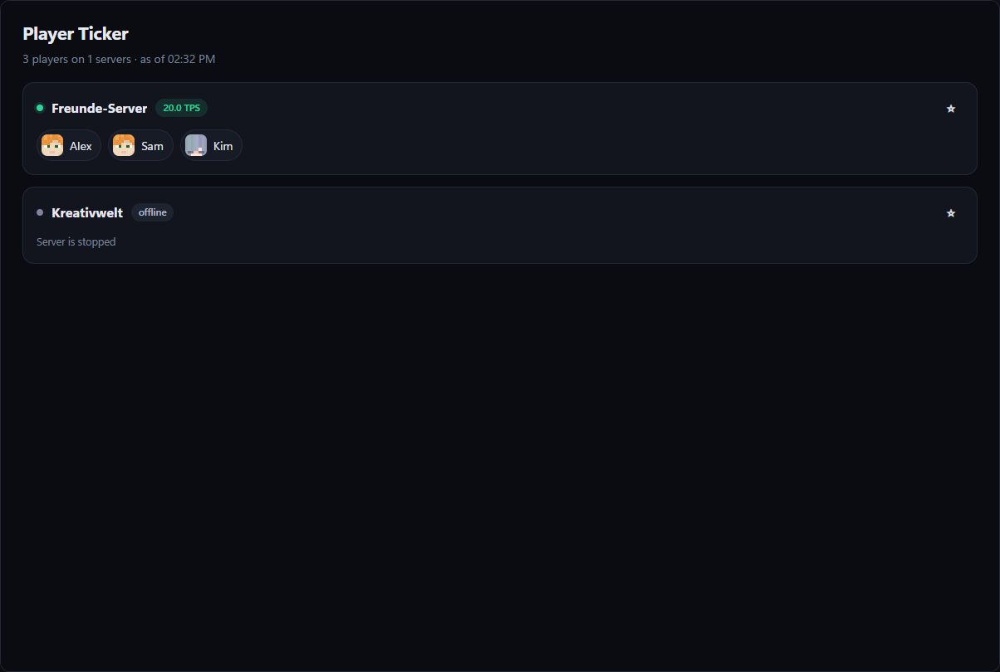
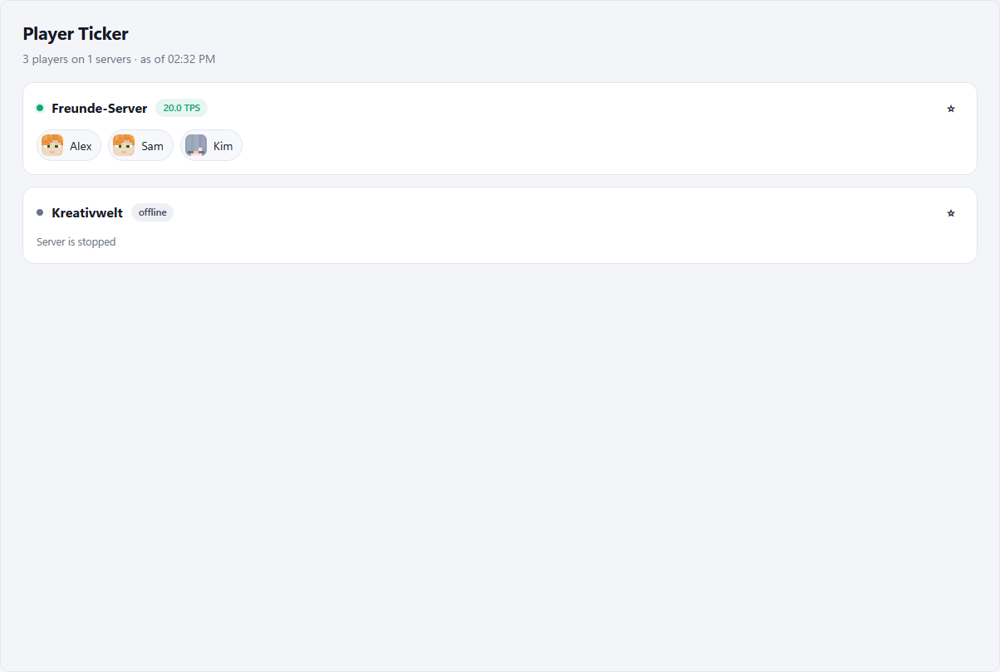
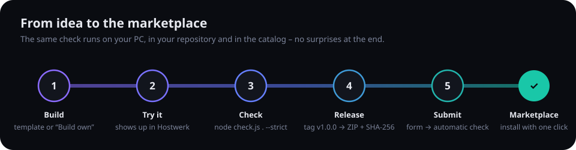
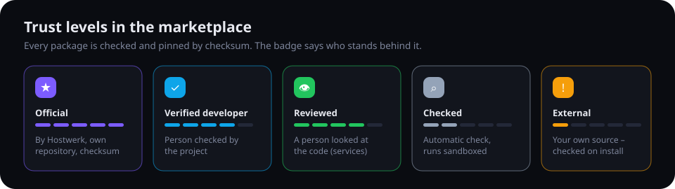
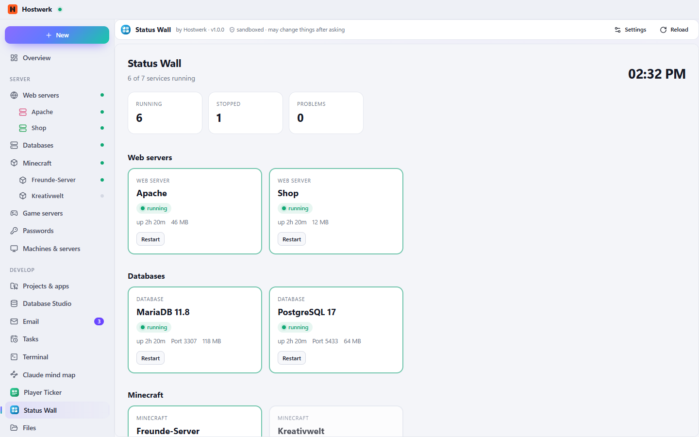

# Hostwerk-Erweiterungen bauen

[English](README.md) · **Deutsch**

Eine Erweiterung bringt eine **Seite** (in der Seitenleiste), eine **Kachel** (in der Übersicht) und/oder einen
**Dienst** (ein Programm, das Hostwerk startet) nach [Hostwerk](https://github.com/Passimoritz/hostwerk-public). Sie ist
ein Ordner mit `manifest.json`, normalem HTML/JavaScript und zwei Textdateien – ohne Build-Schritt, ohne Framework.

| Spieler-Ticker (dunkel) | Spieler-Ticker (hell) |
|---|---|
|  |  |

Erweiterungen **können Hostwerks Design nicht brechen**: Das SDK bringt den Design-Baukasten mit und gibt Farben,
Hell/Dunkel, Schrift und Sprache zur Laufzeit an die Seite weiter. Nutze die `hw-*`-Klassen und `var(--hw-…)`-Farben –
die Prüfung warnt bei festen Farben und eigenen Schriften.



---

## Inhalt

1. [Schnellstart (5 Minuten)](#1-schnellstart-5-minuten)
2. [Das Paket](#2-das-paket)
3. [manifest.json](#3-manifestjson)
4. [Das SDK – `Hostwerk.*`](#4-das-sdk--hostwerk)
5. [Design-Baukasten](#5-design-baukasten)
6. [Übersetzungen (Deutsch + Englisch)](#6-übersetzungen-deutsch--englisch)
7. [Rechte](#7-rechte)
8. [Einstellungen, Speicher, Ereignisse](#8-einstellungen-speicher-ereignisse)
9. [Kacheln für die Übersicht](#9-kacheln-für-die-übersicht)
10. [Erweiterung prüfen](#10-erweiterung-prüfen)
11. [Veröffentlichen: Repository, Release, Einreichen](#11-veröffentlichen-repository-release-einreichen)
12. [Vertrauensstufen und Verifizierung](#12-vertrauensstufen-und-verifizierung)
13. [Sicherheit](#13-sicherheit)
14. [Beispiele](#14-beispiele)



---

## 1. Schnellstart (5 Minuten)

**Weg A – in Hostwerk:** *Apps → Erweiterungen → Eigene bauen*. Hostwerk legt `<Hostwerk>/extensions/<id>/` an – mit
lauffähiger Seite, Texten auf Deutsch und Englisch und einem Symbol. Die Seite erscheint sofort in der Seitenleiste;
Dateien bearbeiten und oben auf **Neu laden** tippen.

**Weg B – auf GitHub:** [hostwerk-ext-template](https://github.com/Passimoritz/hostwerk-ext-template) öffnen →
**Use this template**. Das Repository bringt die Prüfung (GitHub-Action) und automatische Releases schon mit.

Ausprobieren in Hostwerk: *Apps → Erweiterungen → Datei* (ZIP des Ordners) oder *Von Link* (Link zu einem Release-ZIP).

## 2. Das Paket

```
meine-erweiterung/
├─ manifest.json        Name, Version, Rechte, Seite/Kachel/Einstellungen
├─ icon.svg             quadratisch, farbig – im Marktplatz und im Kopf der Seite
├─ page/
│  ├─ index.html        die Seite (lädt zuerst /ext-sdk.js)
│  └─ app.js            dein Code (keine Skripte aus dem Internet – alles ins Paket)
├─ widget/
│  └─ index.html        optionale Kachel für die Übersicht
└─ locales/
   ├─ de.json           alle sichtbaren Texte auf Deutsch
   └─ en.json           … und auf Englisch
```

Höchstens 10 MB. Keine Programme (`.exe`, `.sh` …) in Paketen, die nur Seiten haben.

## 3. manifest.json

```json
{
  "$schema": "https://raw.githubusercontent.com/Passimoritz/hostwerk-public/main/sdk/manifest.schema.json",
  "id": "player-ticker",
  "name": { "de": "Spieler-Ticker", "en": "Player Ticker" },
  "description": { "de": "Wer ist gerade online?", "en": "Who is online right now?" },
  "version": "1.0.0",
  "author": "Dein Name",
  "homepage": "https://github.com/du/hostwerk-ext-player-ticker",
  "icon": "icon.svg",
  "hostwerk": ">=2.9.0",
  "permissions": ["read:services", "read:minecraft", "storage"],
  "page":   { "title": { "de": "Spieler-Ticker", "en": "Player Ticker" }, "icon": "users", "file": "page/index.html" },
  "widget": { "title": { "de": "Spieler online", "en": "Players online" }, "file": "widget/index.html", "size": "third" },
  "settings": [
    { "key": "refresh", "type": "number", "label": { "de": "Aktualisieren (Sekunden)", "en": "Refresh (seconds)" }, "default": 10, "min": 3, "max": 120 }
  ]
}
```

| Feld | Bedeutung |
|---|---|
| `id` | a–z, 0–9 und `-`, 2–40 Zeichen. Bleibt für immer gleich. |
| `name`, `description`, `title`, `label` | Text oder `{ "de": …, "en": … }` – im Katalog sind beide Sprachen Pflicht. |
| `version` | `1.2.3`. Eine höhere Version erscheint in Hostwerk als Update. |
| `icon` | Quadratisches SVG/PNG im Paket – Marktplatz-Karte und Kopf der Seite. |
| `page.icon` | **Symbol in der Seitenleiste** – ein schlichtes Linien-Symbol wie bei Hostwerks eigenen Bereichen. Einer von: `puzzle users monitor gauge activity chart bell book bot box calendar camera clock cloud code coffee cpu database download file flag gamepad gift globe heart home image inbox key dashboard grid leaf line-chart list lock mail map message music network news package pie-chart radio rocket server settings shield cart sparkles star sun swords table tag terminal timer trophy tv wand wifi wrench zap`. |
| `hostwerk` | Mindestversion, z. B. `>=2.9.0` – ältere Hostwerk-Versionen installieren nicht. |
| `permissions` | Was die Erweiterung sehen und tun darf – siehe [Rechte](#7-rechte). |
| `network` | Webadressen, die die Seite per `fetch` erreichen darf (braucht das Recht `network`), z. B. `["https://api.example.com"]`. |
| `settings` | Formular, das Hostwerk zeichnet: `text`, `number` (`min`/`max`), `switch`, `select` (`options`). |

Mit der `$schema`-Zeile gibt es in VS Code Vorschläge beim Tippen.

## 4. Das SDK – `Hostwerk.*`

Zuerst laden: `<script src="/ext-sdk.js"></script>`. Das lädt auch den Design-Baukasten (siehe 5).

```js
const info = await Hostwerk.ready();           // Farben, Sprache, Einstellungen, Reiter, Kontext, Aktion sind da
const list = await Hostwerk.services();       // [{ id, kind, name, state, port, cpu, memory, startedAt, extra }]
const mc = await Hostwerk.minecraft.servers(); // nur Minecraft; extra.players, extra.tps
const stats = await Hostwerk.minecraft.stats(id);

Hostwerk.render('#list', Hostwerk.html`<b>${name}</b>`);   // jeder ${wert} wird maskiert – sicher für Spielernamen
Hostwerk.t('summary', { n: 3 });                            // Text aus locales/<sprache>.json, {n} eingesetzt
Hostwerk.fmt.bytes(123456); Hostwerk.fmt.duration(ms); Hostwerk.fmt.time(Date.now());

await Hostwerk.service('web', 'apache').restart();  // fragt vorher (braucht control:services)
await Hostwerk.minecraft.command(id, 'say Hi');     // fragt vorher (braucht command:minecraft)
await Hostwerk.put('/mc/servers/' + id + '/properties', { motd: '§aHi' }); // Einstellung ändern (change:minecraft, fragt vorher) – SDK 2.2
await Hostwerk.del('/knowledge/' + id + '/memory/' + eintrag);             // löschen (SDK 2.3)
const ordner = await Hostwerk.pickFolder('Tresor wählen');                 // Ordner-Dialog, Pfad oder null (SDK 2.3)
await Hostwerk.terminal('claude', { cwd: ordner, title: 'Claude' });       // tippt ins Hostwerk-Terminal, der Nutzer drückt Enter (SDK 2.5, run:terminal)

await Hostwerk.storage.set('pinned', 'srv1');       // von Hostwerk gespeichert (braucht storage)
const s = await Hostwerk.settings.get();            // Werte aus manifest.settings
Hostwerk.settings.open();                           // öffnet den Einstellungsdialog

Hostwerk.tab;                         // aktueller Reiter aus page.tabs (SDK 2.2); Hostwerk.setTab('codes') wechselt
Hostwerk.context;                     // { kind, id }, wenn als Reiter auf einer Dienstseite gezeigt (contributes.tabs)
Hostwerk.on('tab', (id) => …);        // anderer Reiter gewählt
Hostwerk.on('action', (a) => …);      // { id, target } – deine contributes.action wurde gewählt
Hostwerk.on('service', (s) => …);     // ein Dienst hat seinen Zustand geändert
Hostwerk.on('minecraft', (s) => …);   // Spieler kamen/gingen
Hostwerk.on('settings' | 'lang' | 'theme', …);

Hostwerk.toast('Fertig', { kind: 'success' });
Hostwerk.navigate('/mc/mein-server'); // einen Hostwerk-Bereich öffnen
Hostwerk.openUrl('https://…');        // öffnet nach Rückfrage im Browser (seit SDK 2.3 auch obsidian://)
Hostwerk.copy(text);                  // in die Zwischenablage (SDK 2.1)
Hostwerk.get('/system/health');       // direkter Lesezugriff (gegen die Rechte geprüft)
```

`Hostwerk.lang` (`de`/`en`), `Hostwerk.theme` (`dark`/`light`) und `Hostwerk.embed` (`page`/`widget`) sagen dir, wo du
gerade bist.

## 5. Design-Baukasten – Hostwerks eigene Klassen

**Grundanforderung:** Eine Erweiterung sieht genauso aus wie Hostwerks eingebaute Bereiche. Deshalb liefert
`/ext-sdk.css` Hostwerks **eigene** Klassen, erzeugt aus dem aktuellen Stylesheet der App. Künftige Design-Änderungen
kommen von selbst in deiner Erweiterung an. Seitentitel, Beschreibung und Reiter (`page.tabs`) zeichnet Hostwerk selbst.
Deine Seite beginnt direkt mit dem Inhalt.

| Klassen | |
|---|---|
| Aufbau | `row`, `row-tight`, `stack`, `grid grid-2` / `grid-3` / `grid-4`, `grow`, `right`, `muted`, `small`, `tiny`, `ellipsis`, `mono` |
| Karten | `card`, `card-pad`, `card-head` (mit `h3`), `card-body`, `stat` mit `k` / `v` / `s` |
| Bedienung | `btn` (+ `primary`, `ghost`, `danger`, `sm`, `xs`), `input`, `select`, `label`, `seg` (Segment-Knöpfe), `switch` (`<label class="switch"><input type="checkbox"><span class="track"></span><span class="thumb"></span></label>`) |
| Zustand | `badge` (+ `ok`, `warn`, `err`, `accent`), `callout` (+ `ok`/`warn`/`err`) mit `callout-body`, `callout-title`, `progress` |
| Listen | `table`, `list-item`, `setting-row` (mit `txt`) |
| Leer / Laden | `empty` (+ `h3`, `p`, `empty-action`), `hw-skeleton`, `spinner` |

Farben: `--bg`, `--surface`, `--surface-2`, `--line`, `--line-2`, `--text`, `--text-2`, `--muted`, `--accent`,
`--accent-soft`, `--accent-text`, `--ok`, `--warn`, `--err`, `--mono`. Die älteren `hw-…`-Klassen und `--hw-…`-Variablen
funktionieren weiter – bestehende Erweiterungen gehen nicht kaputt.

Regeln der Prüfung (Hinweise – im Katalog Fehler): keine festen Farben, keine eigenen Schriften (`var(--mono)` ist in
Ordnung), nichts über Hostwerk legen (`position: fixed`, riesiger `z-index`). Eine bewusste Ausnahme je Datei, mit
Begründung: `/* hostwerk-allow: colors, fonts – Vorschau wie im Spiel */`.

## 6. Übersetzungen (Deutsch + Englisch)

Jeder sichtbare Text steht in `locales/de.json` und `locales/en.json` mit **denselben Schlüsseln**:

```html
<h1 data-i18n="title"></h1>                <!-- füllt das SDK, wechselt mit der Sprache -->
<input data-i18n-placeholder="search">
```
```js
Hostwerk.t('playersOnline', { n: 5 })      // "{n} online"
Hostwerk.on('lang', render);               // eigene Texte neu zeichnen
```

Die Prüfung meldet fehlende Schlüssel und englische Texte, die noch deutsch aussehen. Texte im Manifest (`name`,
`description`, `title`, Bezeichnungen der Einstellungen) brauchen ebenfalls `{ "de": …, "en": … }`.

## 7. Rechte

| Recht | Erlaubt |
|---|---|
| `read:services` | Dienste und ihren Zustand sehen (`Hostwerk.services()`) |
| `read:web`, `read:databases`, `read:apps`, `read:tasks`, `read:mail` | Diese Bereiche lesen |
| `read:minecraft` | Minecraft-Server, Spieler, Statistiken, Welten |
| `read:system` | Gesundheit, Auslastung, Ports, Speicher je Dienst |
| `read:network` | Router, Rechner, Sicherheitslage |
| `read:live` | Zertifikate mit Restlaufzeit, Erreichbarkeit mit Verlauf (SDK 2.4) |
| `share:status` | Öffentliche Statusseite (`/live/statuspage`): an/aus, Titel, welche Prüfungen, geheimen Link erneuern, in einen Website-Ordner legen – fragt jedes Mal. Besucher sehen nur Namen, Zustand, Verfügbarkeit und Verlauf (SDK 2.6) |
| `control:services` | Starten, stoppen, neu starten – **Hostwerk fragt jedes Mal** |
| `command:minecraft` | Konsolenbefehle senden – fragt jedes Mal |
| `run:tasks` | Aufgaben ausführen – fragt jedes Mal |
| `change:minecraft` | server.properties, Spielregeln, Symbol, Plugins an/aus, Sicherungen – fragt jedes Mal (SDK 2.2) |
| `change:databases` | Datenbank-Sicherungen anlegen – fragt jedes Mal (SDK 2.2) |
| `change:mail` | Test-Mails in den Mail-Fänger, Mails als gelesen markieren – fragt jedes Mal (SDK 2.2) |
| `read:knowledge` | Wissensgraph: Projekte, Graph, Bericht, Fragen, Gedächtnis, Claude-Status (SDK 2.3) |
| `change:knowledge` | Wissensgraph bauen und abfragen, Ordner, Gedächtnis, Obsidian-Export – **ohne Rückfrage je Aufruf**, weil nur die eigenen Daten des Graphen betroffen sind (SDK 2.3) |
| `connect:claude` | Markierten Claude-Abschnitt und Skill in Projekte schreiben/entfernen – fragt jedes Mal (SDK 2.3) |
| `read:claude` | Claude-Status, Projekte, Gedächtnis-Kontext, Spar-Werkzeuge und Verbrauch (SDK 2.5) |
| `change:claude` | Kontext-Dateien in Projekte schreiben, Spar-Werkzeuge installieren/aktualisieren/entfernen – fragt jedes Mal (SDK 2.5) |
| `run:terminal` | `Hostwerk.terminal(befehl, { cwd, title, enter })`: tippt einen Befehl ins Hostwerk-Terminal. Ohne `enter` startet ihn der Nutzer mit Enter, mit `enter: true` fragt Hostwerk vorher (SDK 2.5) |
| `storage` | `Hostwerk.storage` (256 KB) |
| `network` | `fetch` zu den Adressen in `network` |

Nie möglich: Hostwerk-Einstellungen, Passwörter, beliebige Dateien, Herunterfahren und alles, was nicht in der Liste
steht. Nur anfordern, was du brauchst – Nutzer sehen die Liste vor der Installation. Jeder Aufruf landet im
Zugriffsprotokoll der Erweiterung (auch Ablehnungen).

## 8. Einstellungen, Speicher, Ereignisse

- **Einstellungen**: in `manifest.settings` beschreiben; Hostwerk zeichnet das Formular (passt so immer ins Design)
  und schickt Änderungen sofort (`Hostwerk.on('settings')`).
- **Speicher**: `Hostwerk.storage.get/set/remove/all` – JSON-Werte, 256 KB je Erweiterung, wird mit ihr entfernt.
  Browser-Speicher (`localStorage`, Cookies) geht im abgeschotteten Rahmen nicht.
- **Ereignisse** statt ständig abfragen: `service` (Zustand), `minecraft` (Spieler). Für alles andere langsam abfragen
  (≥ 10 s).

## 9. Kacheln für die Übersicht

`widget.file` ist eine kleine Seite ohne eigenen Rand/Hintergrund – den Rahmen zeichnet Hostwerk. Die Höhe folgt dem
Inhalt automatisch. Größen: `third`, `half`, `full`. Installierte Kacheln erscheinen in der Übersicht unter
*Anpassen* (ein-/ausblenden, anordnen).

## 10. Erweiterung prüfen

Dieselben Regeln laufen in Hostwerk (beim Installieren), in deinem Repository (GitHub-Action) und im Katalog:

```bash
curl -fsSLO https://raw.githubusercontent.com/Passimoritz/hostwerk-public/main/sdk/check.js
node check.js pfad/zu/meiner-erweiterung            # Bericht
node check.js pfad/zu/meiner-erweiterung --strict   # Katalog-Regeln (Hinweise = Fehler)
```

In Hostwerk: *Apps → Erweiterungen → installiertes Paket → Prüfen* zeigt denselben Bericht.

## 11. Veröffentlichen: Repository, Release, Einreichen

1. Die Erweiterung in ein **eigenes GitHub-Repository** legen (Vorlage: *Use this template*).
2. `version` in `manifest.json` erhöhen, eine Zeile in `CHANGELOG.md`, Tag `v1.2.3` pushen.
   Die Action prüft das Paket und erstellt ein Release mit `<id>-<version>.zip` und einer `.sha256`-Datei.
3. In Hostwerk bei der installierten Erweiterung auf *Einreichen* tippen – oder
   [Erweiterung einreichen](https://github.com/Passimoritz/hostwerk-public/issues/new?template=extension.yml) öffnen
   und den Release-Link eintragen.
4. Die Action prüft erneut (`--strict`), legt eine Kopie mit Prüfsumme in `packages/` ab und nimmt sie in
   `catalog/community.json` auf. Seiten und Kacheln sofort; Dienste warten auf einen Menschen (Label *approved*).
5. Updates: erneut einreichen mit höherer Version (gleiche Kennung – sie gehört dem, der sie zuerst eingereicht hat).

Testen ohne Einreichen: *Actions → Add extension → Run workflow* mit einem Paket-Link (Probelauf).

## 12. Vertrauensstufen und Verifizierung



| Abzeichen | Bedeutung |
|---|---|
| **Offiziell** | Von Hostwerk – eigenes Repository, in `catalog/extensions.json` (täglich aus den Releases gebaut). |
| **Verifizierter Entwickler** | Das Projekt hat die Person verifiziert (`catalog/verified.json`). |
| **Von Hand geprüft** | Zusätzlich von einem Menschen angesehen – Pflicht für Dienste. |
| **Automatisch geprüft** | Hat die automatische Prüfung bestanden, läuft abgeschottet. |
| **Fremde Quelle** | Aus einer selbst eingetragenen Quelle – nur beim Installieren geprüft. |

**Verifiziert werden:** Mindestens eine Erweiterung im Community-Katalog haben, dann
[Verifizierung beantragen](https://github.com/Passimoritz/hostwerk-public/issues/new?template=verification.yml).
Die Action bestätigt, dass die Erweiterungen von dir sind; das Projekt entscheidet von Hand (Label *verified*). Das
Abzeichen kann entzogen werden, wenn eine Erweiterung Code versteckt oder ohne Hinweis Daten sammelt.

## 13. Sicherheit

- Die Seite läuft in einem **abgeschotteten Rahmen mit eigenem, undurchsichtigem Ursprung** – kein Zugriff auf
  Hostwerks Anmeldung, Cookies oder API.
- Content-Security-Policy: Skripte nur aus dem Paket, Netz nur zu den Adressen in `network`, keine Rahmen, keine
  Formulare an fremde Adressen.
- Jede Anfrage läuft über die Brücke und wird auf dem **Server** gegen die Rechte geprüft; Änderungen bestätigt der
  Nutzer jedes Mal.
- Katalog-Pakete sind per **SHA-256** festgelegt – Hostwerk installiert genau die geprüfte Datei.

## 14. Beispiele

| Repository | Zeigt |
|---|---|
| [hostwerk-ext-player-ticker](https://github.com/Passimoritz/hostwerk-ext-player-ticker) | Minecraft-Daten, Köpfe, Rangliste, Speicher (Anheften), Einstellungen, Kachel, Live-Ereignisse |
| [hostwerk-ext-status-wall](https://github.com/Passimoritz/hostwerk-ext-status-wall) | Alle Dienste, Starten/Neustart mit Rückfrage, Gruppen, Kachel mit Ring |
| [hostwerk-ext-template](https://github.com/Passimoritz/hostwerk-ext-template) | Minimaler Start: Seite, Kachel, Einstellungen, Speicher, Übersetzungen, CI + Releases |
| [hostwerk-ext-motd-studio](https://github.com/Passimoritz/hostwerk-ext-motd-studio) | Ändert Hostwerk selbst: eigener Reiter auf jeder Minecraft-Seite, Rechtsklick-Aktion, `change:minecraft` |
| [hostwerk-ext-service-notes](https://github.com/Passimoritz/hostwerk-ext-service-notes) | Reiter auf allen Dienstseiten, Aktionen in der Schnellsuche, Speicher |
| [hostwerk-ext-knowledge-graph](https://github.com/Passimoritz/hostwerk-ext-knowledge-graph) | Große Seite mit 6 Reitern, Zeichenfläche mit Listen-Alternative, Rechte mit und ohne Rückfrage (SDK 2.3) |



### Sprachpakete

Hostwerk selbst pflegt Deutsch und Englisch. Weitere Sprachen kommen aus Erweiterungen: in `manifest.json` → `"languages": [{ "id": "fr", "name": "Français", "file": "lang/fr.json" }]`. Die Datei hat dieselbe Form wie Hostwerks `ui/src/i18n/en.json` – `{ "texts": { "<deutscher Text>": "<Übersetzung>" }, "patterns": [["Text mit {}", "Übersetzung mit {}"]] }`. Nutzer wählen die Sprache unter Einstellungen → Allgemein; was fehlt, erscheint auf Englisch. Der Prüfer kontrolliert Datei und Platzhalter.
